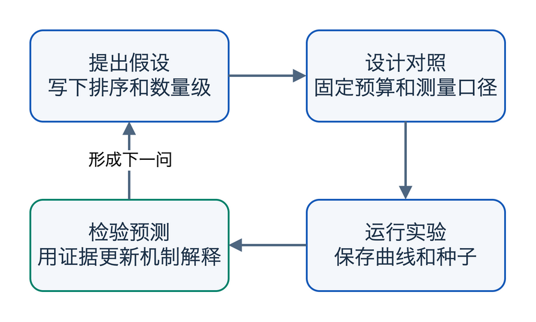
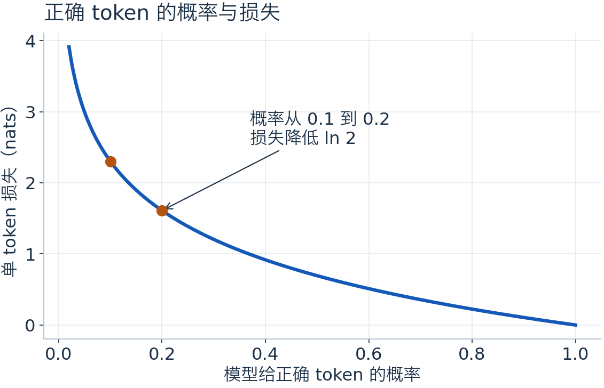
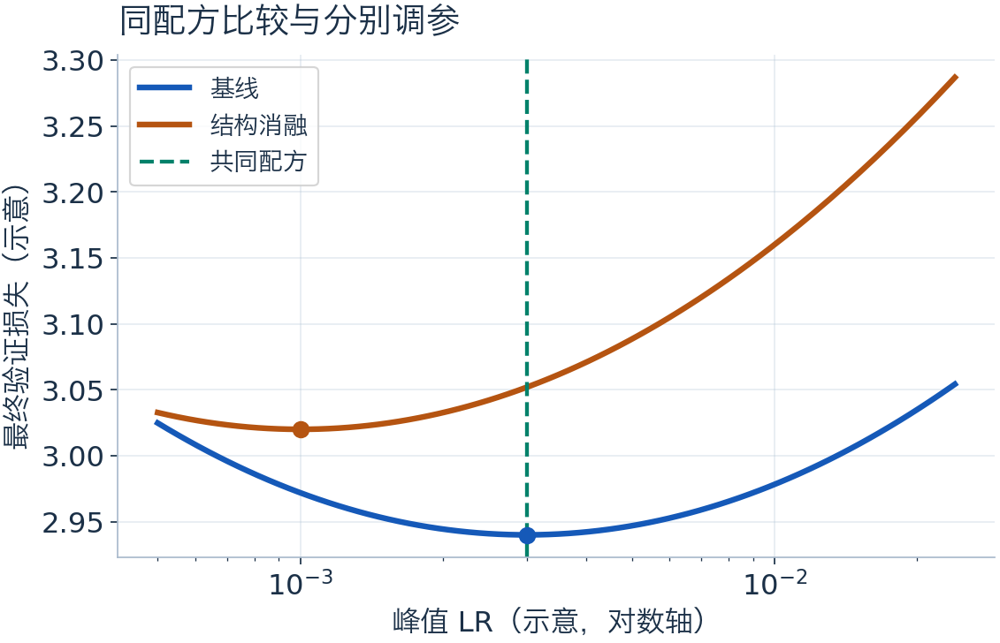

# 导论 · 用实验预测训练结果

## 为什么从预测入手

知道残差连接的公式，只能告诉我们前向做了什么。要解释它对训练的作用，需要在看结果前回答更具体的问题：移除残差会使验证损失升高多少？把学习率重新调好之后，这个差距还存在吗？如果换一组随机种子，有多大概率得到同样的排序？课程用这类留出实验检验理解程度。经典的凸优化、偏差与方差等工具依然有用，使用时要写清适用条件，并在条件改变时重新验证。

课程的实验循环是做作业探索、在讨论课解释结果、再预测没有见过的运行。自学可以保留相同结构。按“改动 → 机制 → 可观测指标 → 数量级或排序 → 可能推翻预测的证据”写下注记，然后训练。遇到预测偏差，比较事先写下的机制和实测数据。最终损失接近时，训练早期的梯度、激活和验证曲线仍可能区分两种解释。[Lecture 01，PDF pp. 3–24](https://deep-learning-alchemy.github.io/assets/slides/lecture_01.pdf)

*实验记录应保留运行前的预测。结果出来后，用证据更新机制解释，再形成下一问。*

## 为什么选语言模型预训练

| 设置 | 优化信号 | 需要关注的变化 |
| --- | --- | --- |
| 预训练 | 来自语料自身的下一个 token | 数据分布、参数量、训练 token 数、优化过程 |
| 监督微调 | 给定任务输入及参考输出 | 标注目标、训练与部署分布、基座初始化 |
| 强化学习 | 来自环境或奖励函数的反馈 | 采样策略、反馈频率、奖励与真实目标的关系 |

预训练给出了容易重复测量的连续指标。在固定 tokenizer 和验证集上，平均交叉熵的细小差别通常比能力测试的小样本准确率更容易测量。设真实条件分布为 $P$，模型为 $Q_\theta$，固定条件下的预期测试损失可分解为 $H(P)+D_{\mathrm{KL}}(P\|Q_\theta)$。前一项由数据决定，后一项反映预测分布和数据分布的差距。因此预训练实验适合做可控的比较，也让小规模结果有机会经过一组规模点以后推及更大模型。若要声称特定下游能力提高，还要实际测量该任务。[Lecture 01，PDF pp. 25–47](https://deep-learning-alchemy.github.io/assets/slides/lecture_01.pdf)

*公式图。纵轴为 $-\ln p$，因此相同的概率比对应固定的损失差。*

## d8 实验基线

- **数据**。DCLM 网页语料，词表 4,096，行长 1,024，默认取 600,000 行训练。课程常以约 614M input tokens 描述这次训练。每行输入和目标错开一位，有 1,023 个预测目标。
- **模型**。约 35M 参数的八层 decoder-only Transformer。注意力汇集上下文，SwiGLU MLP 改变每个位置的特征，残差流保持跨层的表示通道。细节见 LLMs 101。
- **训练**。每步 64 行，运行 9,375 步。用 AdamW、全局梯度裁剪，学习率短暂 warmup 后线性降低。
- **负对照**。如果所有词表项等概率，平均损失是 $\log 4096\approx8.32$ nats。初始化点未必恰好等概率。接近此值只能说明总体概率分配还没有明显利用语料中的规律。[官方 LLMs 101 讲义，PDF pp. 3–12](https://deep-learning-alchemy.github.io/assets/slides/llms_101_handout.pdf)

## 两种比较对应两种结论

一种比较为原版和每个消融使用相同的默认训练配方。这回答“把这个改动直接放入现有配方，性能如何”。另一种比较给每个模型相同的调参预算，分别从同一学习率候选网格选最好表现。这回答“在这组可选配置内，各模型能达到什么表现”。调参时用验证集，若要汇报可推广的估计，可另留数据或用额外种子复查。

导论中的预归一化消融说明了两种问题的区别。课件展示移除 pre-norm 后，原先的默认或更大学习率可能无法正常训练。此时直接消融同时测量了结构变化和配方的适应性。对于另一项比较，令跳连同时取前一层与前两层各一半，并且分别扫描两个模型的学习率。它检验模型对跳连形式的容忍度，按第 62 页的六点扫描，两组的最佳学习率都为 0.003，混合跳连的最优损失低约 0.001，这个差值还需与重复实验的波动比较。第 60 页展示的是各消融分别选出最佳学习率的结果，原题前提则为固定配方。以分别调参的结果看，移除残差的损失代价最大，其次是移除注意力。汇报时保留所有学习率曲线，并单独注明发散运行。最优值接近仍允许训练轨迹和可用学习率范围明显变化。[Lecture 01，PDF pp. 48–63](https://deep-learning-alchemy.github.io/assets/slides/lecture_01.pdf)

*合成示例。竖线用于直接替换消融，两条曲线的最低点用于分别调参后的比较。*

## 预测练习

1. **数值检查**。把正确 token 的概率从 $0.1$ 提高到 $0.2$，这一个 token 的损失变多少？答案是降低 $\log 2\approx0.693$ nats。平均到一整行时，还要除以目标 token 数。
2. **受控对比**。预测共享所有层权重会怎样影响激活 RMS。先写独立残差、同向残差两种假设，在相同宽度下逐层记录分支输出及与残差流的夹角。若同时增加深度和宽度，结果无法归因于深度一项。
3. **阅读作业**。在做 Assignment 1 前记录对六个学习率点的排序。跑完先检查学习率甜点区间，再预测 batch 翻倍会改变哪些判断。报告保留版本、数据、token 预算、种子、曲线坐标和选择最优点的规则。[Assignment 1](https://deep-learning-alchemy.github.io/assets/assignments/a1_basics.pdf)
