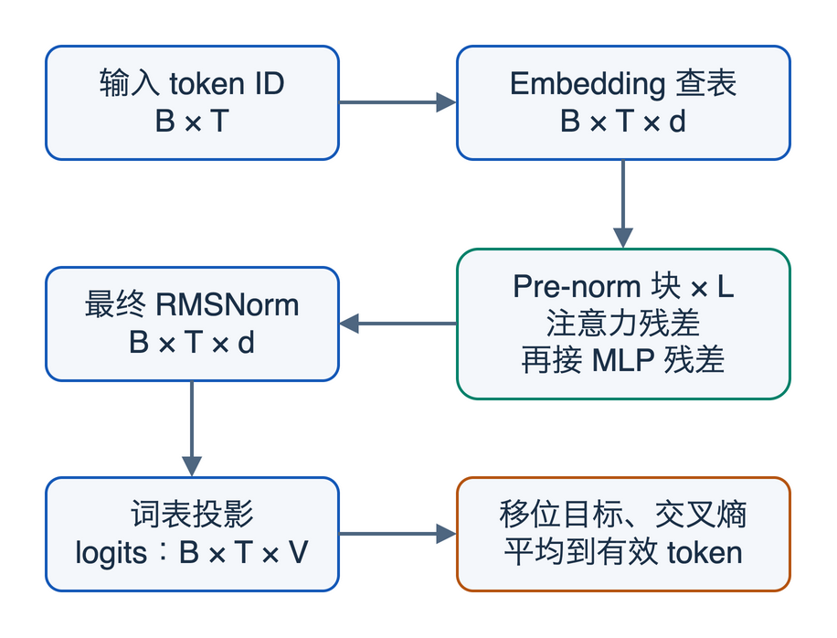
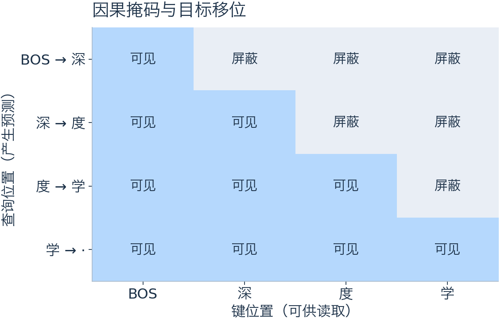
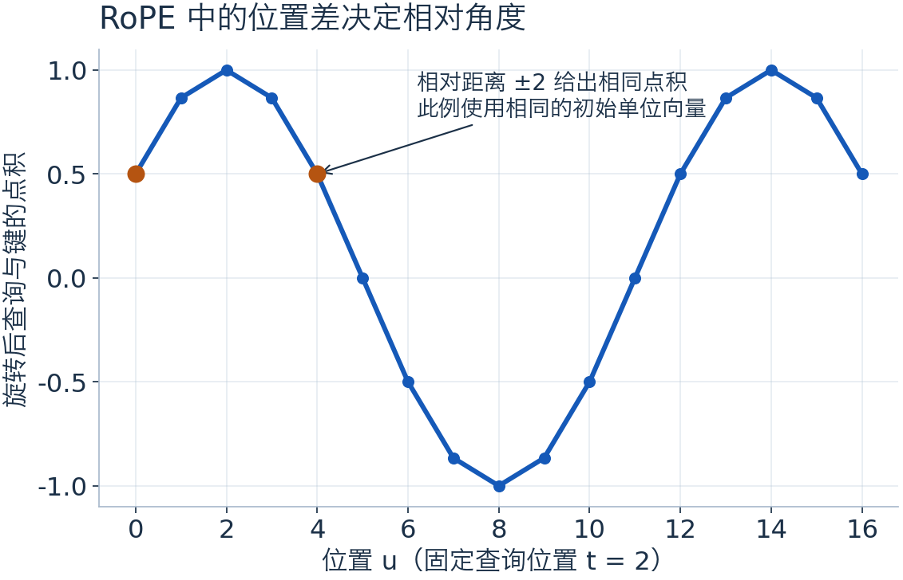

# LLMs 101 · 从 token 到一次参数更新

## 通过张量形状读完整次前向计算

课程的 d8 模型用 8 个独立块，模型宽度 $d=512$，8 个注意力头且每头维度 $d_h=64$，MLP 中间宽度 $d_{\rm ff}=1792$。设 $B$ 为本次前向输入的行数，$T=1024$ 为行长，$V=4096$ 为词表大小。

*前向路径中的 $T$ 维保持不变，最后沿词表产生 logits，再用移位后的目标计算损失。*

| 对象 | 形状 | 作用 |
| --- | --- | --- |
| 输入 token ID | $B\times T$ | 每个整数索引一个 SentencePiece token |
| 残差流 | $B\times T\times d$ | 保留每个位置的隐藏表示 |
| 一头的 $Q,K,V_{\rm val}$ | 各为 $B\times T\times d_h$ | 描述查询、匹配键和值 |
| 一头的注意力矩阵 | $B\times T\times T$ | 每行给出查询位置聚合各键位置的权重 |
| SwiGLU 中间表示 | $B\times T\times d_{\rm ff}$ | 按位置执行门控非线性变换 |
| 输出 logits | $B\times T\times V$ | 经过词表维度上的 softmax 得到预测分布 |

课程用已打包的 DCLM token 行。训练池是 960 万行，默认由数据种子打乱后取 60 万行，每个 epoch 重用该顺序。文档标记可以出现在打包行内部，讲义中的默认因果掩码按行内位置工作。固定验证集 1,000 行。阅读或自行实现时要同时检查打包、BOS、边界掩码，以及实际参与损失的有效目标数。[官方 handout，PDF pp. 3–6、11–13](https://deep-learning-alchemy.github.io/assets/slides/llms_101_handout.pdf)

## 从 logits 到交叉熵

自回归建模把联合概率拆为条件概率的乘积。若一行是 `[BOS, 深, 度, 学]`，位置 1、2、3 分别预测 `深`、`度`、`学`，最后位置的输出没有同一行内的下一个目标。令位置 $t$ 的 logits 为 $z_t$，该位置损失是
$$
\ell_t=\log\sum_{v=1}^{V}e^{z_{t,v}}-z_{t,x_{t+1}}.
$$
这个 log-sum-exp 计算可在指数前减去最大 logit，再把最大值加回。损失对单个 logit 的导数为其 softmax 概率减去目标的 one-hot 值。对于自然对数的逐 token 平均损失 $L$，perplexity 是 $\exp L$。假设目标 token 的概率分别为 $1/2$ 和 $1/8$，两个 token 的平均损失是 $\log 4$，perplexity 是 4。训练前向可并行计算所有位置，因果掩码保证每个位置只依赖之前及当前的输入。生成时必须先采样当前预测，再把 token 接到上下文里。

*四位置例子。一个查询可以读到自身及更早位置。最后一行仍可计算 logits，训练时舍去该位置的损失。*

## 块内计算与初始化

- **残差与 RMSNorm**。先算 $u=x+\mathrm{Attn}(\mathrm{RMSNorm}(x))$，再算 $y=u+\mathrm{MLP}(\mathrm{RMSNorm}(u))$。每条分支都先归一化，残差流有恒等路径。RMSNorm 用 $\sqrt{\frac1d\sum_jx_j^2+\epsilon}$ 作分母，并逐坐标乘可学习尺度。LayerNorm 还会减去均值。
- **注意力**。对每头形成 $QK^\top/\sqrt{d_h}$，掩住 $u>t$ 的键位置，再对每个查询的键轴做 softmax，并乘以值矩阵。缩放来自独立、单位方差的坐标内积的标准差 $\sqrt{d_h}$。各头拼接后，经输出投影合并回残差宽度。课内默认 head 配置的 query 和 KV 头数相等。GQA 缩减 KV 头数并在多个 query 头之间共享。
- **位置与 QK norm**。RoPE 把每对坐标按位置与频率的乘积旋转，导致旋转后的点积含 $R(t)^\top R(u)=R(u-t)$，因而具有显式相对位置信息。课程在 RoPE 后分别对每头 Q 和 K 做可学习尺度的 RMSNorm，减弱 token 相关的向量模长变化对注意力分数的影响。同一块内 Q 与 K 使用各自的尺度向量，该向量在同类的各头间共享。固定位置基数为 500,000。可学习坐标尺度会影响归一化后向量的几何性质。
- **MLP 与输出**。SwiGLU 用 $\mathrm{SiLU}(xW_g)\odot(xW_{\rm up})$ 在中间维度门控，再乘 $W_{\rm down}$。各位置共享这组矩阵。最后一次 RMSNorm 后用词表投影得到 logits。默认不绑定输入与输出投影，两个权重从同一基础随机表构造，分别用 $1/d$ 和 $1/\sqrt d$ 缩放，随后独立更新。启用绑定时是一份共享参数，以 $1/\sqrt d$ 初始化。
- **初始化与 dropout**。注意力与 MLP 权重用以 $1/\sqrt{d_{\rm in}}$ 为名义标准差、截断到三个名义标准差的零均值正态分布。RMSNorm 尺度从 1 开始。默认 dropout 概率为零。启用后，丢弃比例 $p$ 的条目并把保留项乘 $1/(1-p)$，以维持期望。课程同时作用于注意力权重和两条残差分支的输出，评估时关闭。注意力 dropout 后某一查询行的权重和可以偏离 1。[Slides，PDF pp. 23–39](https://deep-learning-alchemy.github.io/assets/slides/llms_101_slides.pdf) · [Handout，PDF pp. 12–19](https://deep-learning-alchemy.github.io/assets/slides/llms_101_handout.pdf)

从矩阵形状可以直接估算成本。在 $H=d/d_h$ 个头的标准稠密注意力中，每块注意力投影约 $4d^2$ 个参数，SwiGLU 约 $3d\,d_{\rm ff}$。内部注意力分数和值聚合的算术量随 $T^2d$ 增长，FlashAttention 一类实现可减少物化中间矩阵带来的读写。课程 dL 预设让 $d=64L$、$H=L$、$d_{\rm ff}=3.5d$，所以内部矩阵参数总量主要按 $L^3$ 增长。在固定宽度下增加块数则约按 $L$ 增长。

*公式图。一对相同单位向量按步长 $\pi/6$ 旋转时，点积为 $\cos((u-t)\pi/6)$。真实 RoPE 同时使用多组频率和学习到的查询与键。*

## 一次训练更新

1. **采样和反传**。均值损失对整个逻辑 batch 求梯度。内存有限时，$M$ 个等目标数的 microbatch 依次做前向和反传，每份损失乘 $1/M$，且在全部反传之前不更新参数。若有效目标数不同，则按有效目标数加权。
2. **裁剪**。全局梯度裁剪把累积梯度 $g$ 乘 $\min(1,c/\|g\|_2)$，课程阈值 $c=1$。该操作约束输入梯度的模长，AdamW 的实际更新还依赖历史动量和二阶矩。
3. **更新**。默认 AdamW 以 $\beta_1=0.9,\beta_2=0.95$ 对梯度与梯度平方取指数移动平均和初始偏差校正，用 $\hat m/(\sqrt{\hat v}+10^{-8})$ 作自适应方向。投影矩阵应用解耦衰减 $W\leftarrow(1-\eta\lambda)W-\eta u$，默认 $\lambda=0.1$。embedding、归一化参数和 bias 不参与衰减，仍接收梯度。
4. **调度**。600,000 行、batch 64 对应 9,375 次更新，每步处理 65,536 个输入 token。默认 peak LR 为 $0.003$，前 93 步线性 warmup，随后线性衰减。调度从索引 0 开始，启用 warmup 时首步学习率为零。课程还提供余弦、恒定和 warmup–stable–decay (WSD) 选项。改变 batch、数据量或 epoch 同时改变调度时长。

SGD 的动量缓冲常写成 $b_t=\mu b_{t-1}+g_t$，而 Adam 一阶矩会把新梯度乘 $1-\beta_1$。对恒定梯度输入，前者的稳态是 $g/(1-\mu)$，后者是 $g$。比较两个实现中的同名 `beta1` 和学习率时需要先检查缓冲约定。[Handout，PDF pp. 6–9](https://deep-learning-alchemy.github.io/assets/slides/llms_101_handout.pdf)

## 执行、诊断与复现

混合精度路径在 CUDA 上对选定计算用 bf16，参数与 Adam 状态默认保留 fp32，损失用 fp32 计算。编译、融合优化器、梯度累积与多 GPU 归约都可能因运算次序改变末位舍入。记录执行模式与随机种子。区分 `init_checkpoint_path` 只加载模型权重的热启动，和恢复完整模型、优化器、调度、随机状态与数据位置的续训。课程训练器的 `force_run=True` 可以绕过完成结果复用，想从头跑还需要关闭 checkpoint 自动恢复。

诊断时同时记录验证损失、训练损失的平滑趋势、逐层 activation/parameter/gradient RMS、学习率与剪裁前全局范数。RMS 等于 $\|x\|_2/\sqrt{\mathrm{numel}(x)}$，便于跨不同形状看典型坐标量级。若大多数步都裁剪，先查看梯度范数与实际参数更新 RMS，再判断提高裁剪阈值是否改变稳态。若单次训练 loss 跳高且验证 loss 平稳，可用预先固定的一组批次重新测量，隔离批间难度差异。[Handout，PDF pp. 9–11](https://deep-learning-alchemy.github.io/assets/slides/llms_101_handout.pdf)

## 补充阅读与预测练习

- **Attention Is All You Need** 的原架构使用 encoder–decoder attention 与正弦位置编码，包含带残差的子层和归一化。阅读 §3.2–3.5 时，按“预测能看到哪些 token、注意力有哪些来源、位置进入计算的位置”与课程 d8 对照。可先预测移除 causal mask 后的训练损失会怎样变化，再解释训练结果为何无法作为标准自回归指标。[Vaswani et al.](https://arxiv.org/abs/1706.03762)
- **DCLM** 让数据筛选策略在受控训练预算和评估套件下比较。课程拿该语料做固定实验环境，论文补足同样数量的网页 token 怎样因筛选或配比产生不同训练效果。阅读数据构造与消融部分时，同时记下 token 预算和结果评估所用的任务。[Li et al.](https://arxiv.org/abs/2406.11794)
- **RMSNorm**。它研究跳过均值中心化以后，按尺度归一化能否保留可用行为，并给出只用一部分坐标估计 RMS 的实验。练习：忽略 $\epsilon$，把所有输入加常数和乘正数，分别计算两种归一化的输出是否不变。[Zhang & Sennrich](https://arxiv.org/abs/1910.07467)
