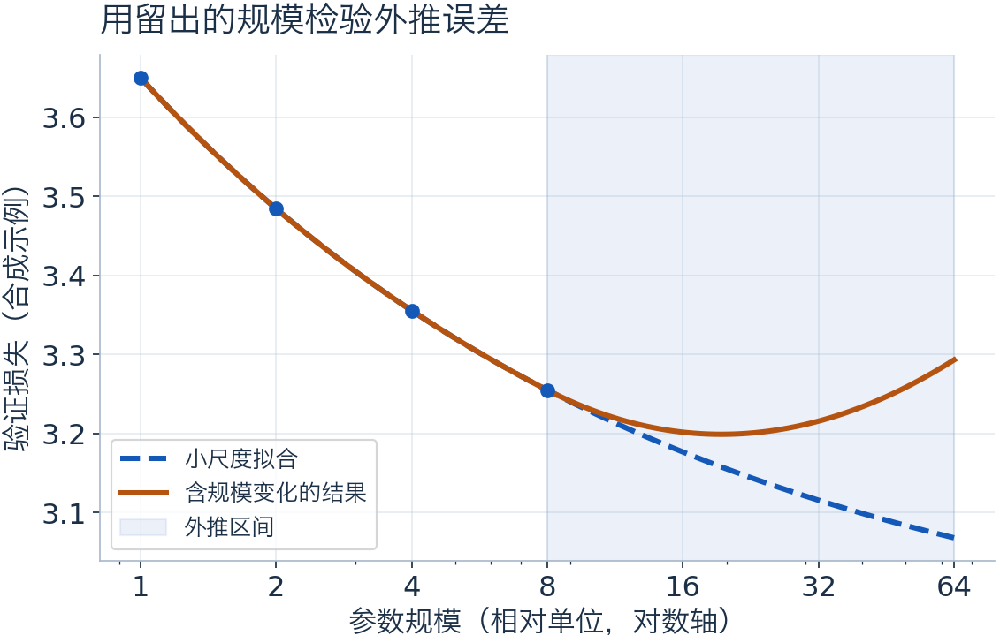
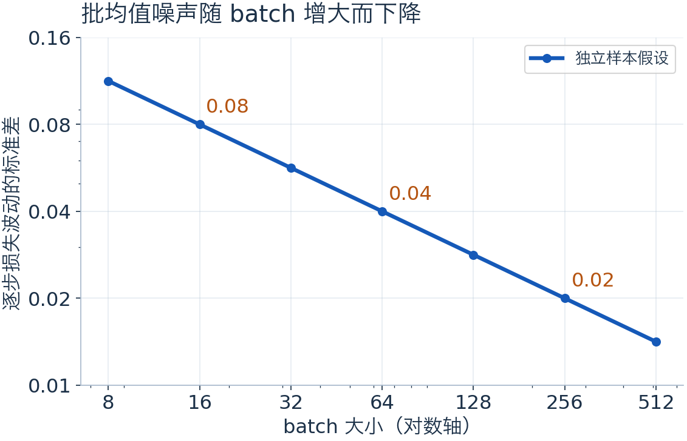
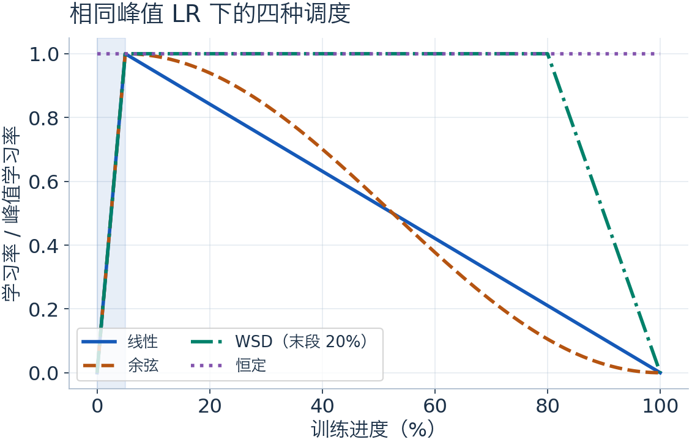

# 训练基本功 · 调参、缩放、随机性与诊断

## 调参时先确定比较对象

对 `方法 × 学习率 × batch × token 预算` 的完整搜索通常过于昂贵。先用对数间隔扫峰值学习率，标出损失盆地、失稳边界和最优点是否落在搜索边缘。固定预算，在两三个 batch 下重测附近的学习率，再把 shortlist 带到更大的 proxy 上。除了最优分数，也记录最优区间的宽度。区间宽意味着部署同一配方的风险较低，也意味着最优点的精确位置难以估计。

课件展示三个会被超参数改变的研究判断。差分隐私微调中，合理调参可以显著改善 DP-SGD 基线。重复训练同一份数据时，正则化设置能改变观察到的损失平台。比较 AdamW 与其他优化器时，各自的学习率和衰减都可能需要重选。可以先给每个方法同等搜索预算，再报告相同设置下的直接替换结果。并行小实验可用 `vmap` 把不同模型的参数、数据与状态放进额外实验轴，摊薄 GPU 启动开销，但每条轨迹仍应拥有独立随机数与优化器状态。[Lecture 02，PDF pp. 5–20](https://deep-learning-alchemy.github.io/assets/slides/lecture_02.pdf)

## 缩放律如何用于外推

常见两个拟合任务有不同用途：

| 拟合对象 | 示例 | 能回答的问题 |
| --- | --- | --- |
| 性能 | $L(N,D)\approx L_\infty+aN^{-\alpha}+bD^{-\beta}$ | 固定训练条件时，多给模型参数或数据，哪一项的边际收益较大？ |
| 最优配方 | $\eta_\star(N,D)$ 与 $B_\star(N,D)$ | 改变模型或数据量以后，哪组超参数值得优先验证？ |

此处 $N$ 表示参数量，$D$ 表示处理的 token 数或唯一语料规模，必须按具体论文定义。固定唯一数据量并重复训练、增加唯一数据量，是两个不同干预。有限区间里多个函数族可能都拟合得很好。训练时在较小规模拟合，保留最大规模点作外推检验，并查看损失绝对误差与方法排序。尤其要记录每个点是否重新调参，是否混入断层、上下文变动或不同的 token 预算。拟合时让全部可用点参与，只能评估对已见数据的解释能力。

**固定算力的背景推导。** 若内部矩阵的主要训练 FLOPs 近似满足 $C=kND$，且两项可分离，则令 $D=C/(kN)$ 可写成单变量函数。对 $\log N$ 求导得到最优时 $\alpha aN^{-\alpha}=\beta bD^{-\beta}$。两项按各自指数加权后的损失边际相等。这种推导依赖所选拟合、算力定义和训练范围，不能从单条模型规模曲线推出数据最优比例。[Lecture 02，PDF pp. 21–33](https://deep-learning-alchemy.github.io/assets/slides/lecture_02.pdf)

*合成示例。前四个规模参与拟合。阴影内的留出规模检验外推误差。*

## 读懂三篇指定文献

- **Step Law**。在给定参数规模和训练 token 数时，作者扫描学习率和 batch，发现对数坐标上最优附近有较平缓的损失区域。论文用训练步数解释数据量、batch 与学习率的联系。在其拟合范围内，改变 $D$ 会明显改变最优 batch，改变 $N$ 主要影响最优学习率。表 2 给出的指数为 $\eta_\star\propto N^{-0.713}D^{0.307}$，$B_\star\propto D^{0.571}$，$N$ 按非 embedding 参数数目计，$B$ 和 $D$ 按 token 计。论文另以不同模型形状、MoE 和数据配方作迁移实验。阅读 §3.2–3.5 时，确认每个对照的调度及 batch 单位，并比较预测配置与网格最优之间的实际损失差。指数依赖实验范围和参数口径。[Li et al.](https://arxiv.org/abs/2503.04715)
- **Kaplan et al.**。§5.1 将达到同一损失所需步数 $S$ 和处理样本数 $E=BS$ 拟合为 $S_{\min}/S+E_{\min}/E\approx1$。因此 $B_{\mathrm{crit}}=E_{\min}/S_{\min}$。代入可得在该 batch 下 $S\approx2S_{\min}$、$E\approx2E_{\min}$，清楚地展示算力效率与更新步数的权衡。在其训练条件下，作者观察到临界 batch 随目标损失改变，也用这种校正比较计算预算。此处的临界 batch 与 Step Law 在固定 token 预算下拟合出的最优 batch 有不同定义。[Kaplan et al.](https://arxiv.org/abs/2001.08361)
- **Summers & Dinneen**。他们固定其他随机来源，单独改动 ResNet-14 在 CIFAR-10 上某个初始权重的最小表示单位。单比特变化带来的最终模型差别接近其他随机来源带来的差别。论文也测试线性模型，其中轨迹保持得近得多，并用测试时增强、单轨迹加速集成缓解部分方差。可以把这组结果理解为有限训练轨迹对微扰的敏感性证据，不能仅凭损失起伏诊断优化发散。[Summers & Dinneen，§§3–5](https://arxiv.org/abs/2103.04514)

## 把三类波动分开测

**批间样本波动**。定义当前参数下单样本损失的标准差为 $\sigma$，近似独立时批均值的标准差是 $\sigma/\sqrt B$，因此 batch 变 4 倍，波动约减半。相关样本、学习趋势与模型自身变化会使估计偏离这条线。用固定验证小批次跨训练步评估，可以减轻因每步更换样本造成的波动。

**最终指标的种子波动**。对 A、B 使用成对的数据与模型种子，计算 $d_i=L_{A,i}-L_{B,i}$，估计 $\bar d$ 和样本标准差 $s_d$。在种子相互独立及差值近似正态的条件下，双侧区间是 $\bar d\pm t_{n-1,0.975}s_d/\sqrt n$。优势只有 $0.002$ 而种子波动约 $0.003$ 时，先查差值分布和置信区间。共享种子有机会减少方差，方差到底降低多少仍需由实验测量。

**轨迹微扰放大**。从同一个 checkpoint 分叉，用完全相同的后续批次，只在输入或权重中施加微小扰动。同时看参数差距、固定验证损失差和训练批损失差。参数距离变大、最终损失接近的情况可以同时发生。浮点算子非确定性也可能触发微扰，记录硬件、精度、并行归约方式及确定性选项。[Lecture 02，PDF pp. 34–44](https://deep-learning-alchemy.github.io/assets/slides/lecture_02.pdf)

*公式图。以 $B=64$ 时的 0.04 标定曲线，展示 $B^{-1/2}$ 近似的数量级。*

## 从异常曲线定位到模块

1. **验证指标口径。** 检查是当前 batch 还是固定验证集、横轴是步数还是 token 数、平滑窗口是否相同，学习率调度是否也发生变化。
2. **稳定性诊断。** 对比出问题前后的逐层激活、梯度、参数和优化器实际更新 RMS。检查 logit 最大值、注意力熵、Q/K 范数、残差分支和主流的 RMS 比值。激活和反传的 cotangent 分别对应前向信号与反向信号。
3. **单因素干预。** 如果尖峰与 Q/K 范数一起升高，尝试恢复 QK norm 或降低峰值学习率，测量注意力分数和最终损失是否同步改善。课程展示 Marin 训练中的门控注意力诊断。在早层注意力贡献偏小且门控参数模长偏大的情况下，团队尝试轻量衰减控制参数范数。跨项目复用该干预前先确认本项目也存在相同异常。
4. **预算与损失曲线。** WSD 的稳定阶段可用于复用中间 checkpoint 做不同训练时长的比较，每个候选时点需要从该 checkpoint 进行自己的衰减阶段。线性、余弦和 WSD 的相同峰值学习率对应不同累计学习率。[Lecture 02，PDF pp. 45–57](https://deep-learning-alchemy.github.io/assets/slides/lecture_02.pdf)

*公式图。用 5% warmup 放大早期变化。恒定调度无 warmup。WSD 在 80% 训练进度后才开始下降。*

## Basics 测验复盘

下列数值来自课程的配置与测量口径，可用来校准本课的 d8 直觉。阅读原题后，可先遮住这一段自己预测。[官方题目](https://deep-learning-alchemy.github.io/quiz-basics.html) · [官方讲评，PDF pp. 6–51](https://deep-learning-alchemy.github.io/assets/quizzes/basics_answer_slides.pdf)

| 题 | 实验结果与解释 |
| --- | --- |
| 1. 噪声口径 | 数据种子与模型种子都变化时，最终损失标准差约 0.0028。逐步训练损失的 jitter 约 0.04，固定验证集上更低。两种数值对应不同随机变量。 |
| 2. batch 与 jitter | batch 16 的 jitter 约为默认 64 的两倍，256 约为一半。学习率在测试范围内对该指标影响较小。 |
| 3. 取消 warmup | 五组种子的最终损失差平均约 0.106。结合早期激活与梯度变化检查训练为何变差。 |
| 4. 缩短 cooldown | 以损失差 0.02 为容限，在题目给出的候选方案中需要约 20% 冷却。高学习率阶段和退火阶段的损失趋势有明显差别。 |
| 5. 峰值 LR 和 warmup | 峰值 0.009 配 5% warmup 进入更低的损失区间，0.027 配 5% 或 20% warmup 落在 2.94–3.05 区间。更长 warmup 可以拓宽稳定范围，仍需同时测最优损失。 |
| 6. 参数与梯度范数 | 线性衰减加 WD 0.1 时，参数范数最终比峰值低约 3–15%。其他对比条件在峰值附近，梯度范数没有翻倍。 |
| 7. 规模外推 | 从小规模点拟合的曲线对整体排序有启发。重复八个 epoch 时 d9 仍带来改善，但收益缩小。取消 QK norm 时 d9 性能明显变差，说明配方与规模相互作用。 |
| 8. 更换一个训练 token | 五个种子上最大训练损失差的平均值约 0.09，差距往往先出现再减弱。验证损失差在更高学习率下增大。该实验改动一个输入 token，论文的单比特实验改动的是初始化参数。 |

## 一次完整的自学实验

从 A1 的七组实验中，选一套可复用的缩放曲线和一组随机性诊断。先扫学习率、warmup 与调度，再保持同一 token 预算在多个规模点重跑。用独立种子重复原版和改动版，对比单 token 微扰后的两条训练轨迹。最后从 loss、激活和梯度三个层面解释一处差异，写一个有可证伪答案的预测题。A1 PDF 的基线介绍称预设只改变深度，但发布版代码的 `depth_model_config` 与 LLMs 101 handout 一致，设置宽度为 $64L$、头数为 $L$。因此预设结果反映多种尺寸的共同变化。复现实验时记录所用代码版本，并核对实际宽度和头数。[Assignment 1 PDF](https://deep-learning-alchemy.github.io/assets/assignments/a1_basics.pdf) · [Assignment 1 代码](https://github.com/deep-learning-alchemy/assignments/tree/a1_release)
