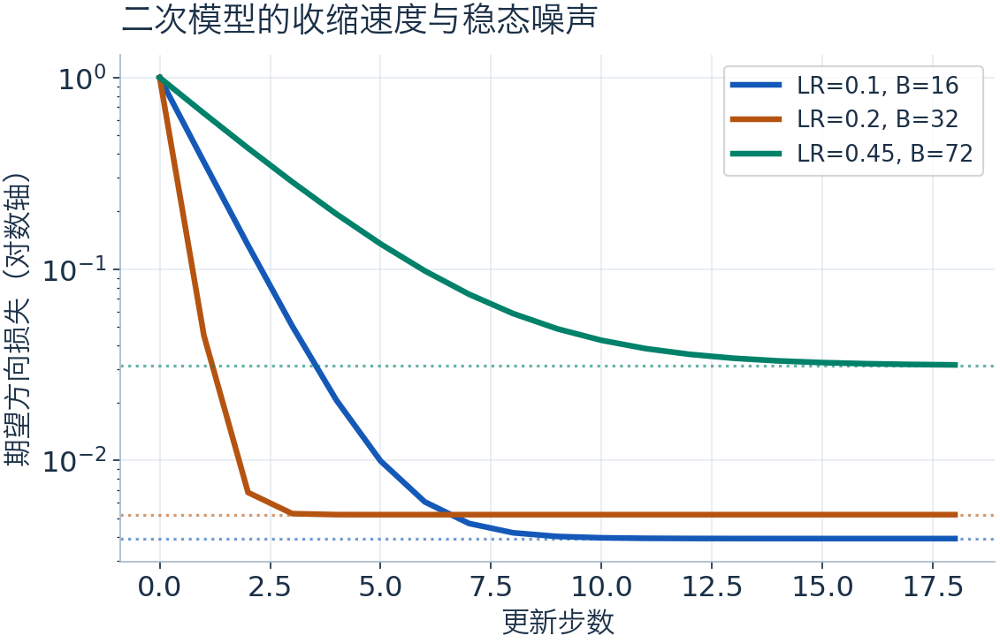
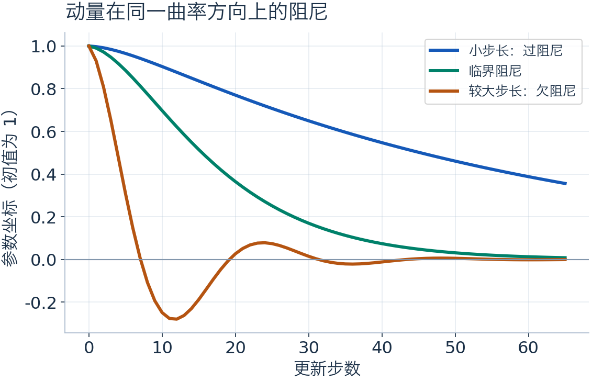
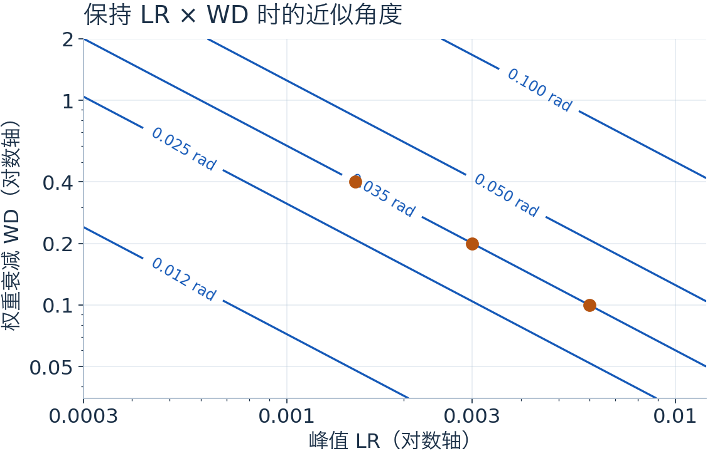
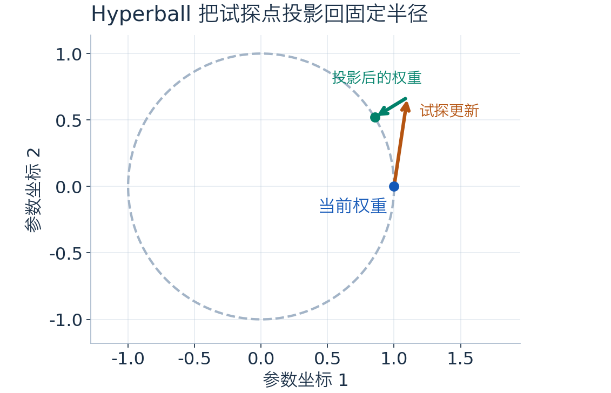

# 优化器（一）· 噪声二次模型与权重衰减

## 一次优化更新里有几个独立选择

Batch 决定本次估计使用多少样本，调度决定更新的全局尺度，动量汇总历史方向，预条件改变各方向的相对步长，权重衰减另外改变参数模长。把学习率乘 2、用新的 Adam $\beta_1$ 和把 batch 乘 2 都可能让最初几步变化更快，三种干预对梯度噪声、稳态和连续更新的相关性各不相同。

预条件 SGD 写成 $\theta_{t+1}=\theta_t-\eta_t P_tg_t$。取 $P_t=I$ 得到普通 SGD。若局部 Hessian 的两个方向曲率分别为 1 和 100，一个全局步长受曲率 100 的方向限制，曲率 1 的方向推进较慢。理想预条件 $P=H^{-1}$ 把二次模型的曲率都变为 1。Adam 以历史梯度平方作为对角缩放的依据，包含梯度均值和噪声的信息，无需显式构造 Hessian。经典收敛分析往往关心到高精度临界点的速度，大模型预训练往往关心固定 token 或算力预算达到的验证损失。[Lecture 03，PDF pp. 3–15](https://deep-learning-alchemy.github.io/assets/slides/lecture_03.pdf)

## 二次模型中的收缩与噪声

取 $L(\theta)=\frac12\theta^\top H\theta$，假设严格正定的 $H$ 与梯度噪声协方差 $C$ 共用特征向量，每一步的噪声独立，batch $B$ 把方差降到 $C/B$。在一个曲率为 $h$、方差项为 $c$ 的方向上，更新成为
$$
\theta_{t+1}=(1-\eta h)\theta_t-\eta\sqrt{c/B}\,\varepsilon_t,\qquad
\mathbb E[\varepsilon_t]=0,\quad\mathbb E[\varepsilon_t^2]=1.
$$
记 $a=1-\eta h$。若 $|a|<1$，初值贡献按 $a^{2t}$ 衰减。每一步又加入方差 $\eta^2c/B$，几何级数求和给出
$$
\mathbb E[L_t]=a^{2t}\mathbb E[L_0]+(1-a^{2t})\frac{\eta c}{2B(2-\eta h)}.
$$
先分别看两部分。第一项偏好快速收缩。第二项是恒定学习率下的稳态噪声损失，当 $\eta h\ll1$ 时约正比于 $\eta/B$，接近 $\eta h=2$ 的边界会显著增大。把 $B$、$\eta$ 同时乘 2，小学习率区间的稳态相近且收缩加快，继续放大后会受最大曲率限制。这解释了为何学习率的线性 batch 规则只在一段区间内适用，也解释了训练末期降低学习率为何可能降低损失。

**例子。** $h=4$、$c=2$、$B=16$ 时，$\eta=0.1$ 给出 $a=0.6$、稳态损失约 $0.00391$。把 $B$ 变成 32、$\eta$ 变成 0.2，$a=0.2$ 但稳态约 $0.00521$。两个点的 $\eta/B$ 相同；第二个点已经明显受到 $2-\eta h$ 的影响。用这个例子分别比较前五步和长期结果，就能看到“更快”和“更低”的区别。[Lecture 03，PDF pp. 16–20](https://deep-learning-alchemy.github.io/assets/slides/lecture_03.pdf)

*公式图。曲率 $h=4$，噪声方差 $c=2$，三条线的 $\eta/B$ 相同。水平虚线是各自的稳态，最大 LR 接近稳定边界时噪声底上升。*

## 为什么大 batch 更容易体现动量与预条件

以 heavy-ball 形式加入动量，单方向的均值递推为
$$
\theta_{t+1}=(1+\mu-\eta h)\theta_t-\mu\theta_{t-1}.
$$
其特征根满足 $r^2-(1+\mu-\eta h)r+\mu=0$。同一方向从两个实根过渡到共轭复根时，表现从非振荡转为振荡。多维共享同一个 $\eta,\mu$，不同曲率方向可以处在不同区域。小步长、过阻尼方向上，慢根近似 $1-\eta h/(1-\mu)$，该方向与步长放大的 SGD 有相似的慢阶段。小 batch 时，噪声底限制可用有效步长。大 batch 减少噪声后，动量在病态曲率下加速收缩的好处更明显。

*公式图。此例 $\mu=0.81$、$h=1$，临界点为 $\eta h=(1-\sqrt\mu)^2$。较大学习率仍处在稳定区间，下降中会出现过冲。*

令 $P=H^{-p}$，$0\le p\le1$。每个方向的确定性收缩系数变为 $1-\eta h^{1-p}$，噪声方差变为 $\eta^2h^{-2p}c/B$。调大 $p$ 可以缩小有效曲率的范围，也会相对放大小曲率方向的噪声。用相同的目标损失比较，预条件可能把开始出现步数收益递减的位置推到更大的 batch。论文的神经网络实验包括 SGD、动量、Adam 与 K-FAC，也用分段退火观察固定学习率造成的噪声损失可以减少多少。在常用的 $C=H$ 模型中，作者还用高斯均值估计给出风险参照 $d/(2N_{\rm seen})$。这些结果依赖曲率、噪声谱和目标损失。真实网络的曲率随时间改变，噪声也可能与参数和时间相关。[Lecture 03，PDF pp. 21–32](https://deep-learning-alchemy.github.io/assets/slides/lecture_03.pdf) · [Zhang et al.，§§3.5–4](https://arxiv.org/abs/1907.04164)

## 参数范数为什么会漂移

如果在一个局部设置中 $L(cW)=L(W)$ 对任意 $c>0$ 成立，则对 $c$ 求导得到 $\langle W,\nabla_W L\rangle_F=0$。纯梯度步沿等范数球面的切线走，有限步长下得到
$$
\|W-\eta g\|_F^2=\|W\|_F^2+\eta^2\|g\|_F^2.
$$
虽然沿半径缩放的功能近似不变，绝对范数会改变下一步的角度。严格尺度不变时，原始梯度随 $1/\|W\|_F$ 缩放，因此 SGD 每步的角度量级可以按 $\eta/\|W\|_F^2$ 变化。Adam 与 Muon 的更新需用它们实际的更新方向分析，原始梯度恰好切向也只保证了 SGD 的这个等式。

以解耦衰减和近似切向、范数均方为 $U^2$ 的基优化器更新为例。设 $R_t^2=\mathbb E\|W_t\|_F^2$，则
$$
R_{t+1}^2\approx(1-\eta\lambda)^2R_t^2+\eta^2U^2.
$$
若学习率与更新统计近似恒定、小 $\eta\lambda$，稳态给出 $R_\star\approx U\sqrt{\eta/(2\lambda)}$，角度量级约 $\eta U/R_\star\approx\sqrt{2\eta\lambda}$。这里的简化忽略了动量与当前参数的相关性。Wen 的推导显式计算了该投影项，给出依赖动量系数的修正，并用可交互的归一化线性模型观察 warmup 与 decay 是否让范数追踪随时间变化的平衡值。不同训练长度的累积径向衰减另可近似为 $\exp(-\lambda\sum_t\eta_t)$，与单步角度是不同的量。[Lecture 03，PDF pp. 33–42](https://deep-learning-alchemy.github.io/assets/slides/lecture_03.pdf) · [Wen 的权重范数推导，§§2.3–2.5](https://whenwen.github.io/wd_blog/public/weight-decay-part-2.html)

*公式图。等值线来自近似角度 $\sqrt{2\eta\lambda}$。橙点用于展示联合调参时可以检验哪些等乘积配置。*

## Hyperball 如何显式控制范数

对选择的参数矩阵固定 $R=\|W_0\|_F$。令 $\widehat X=X/\|X\|_F$，从基优化器得到 $u_t$ 后，设 $W_{t+1}=R\,\widehat{(W_t-\eta_tR\widehat{u_t})}$。试探步长为 $\eta_tR$，投影后实际角位移还取决于 $u_t$ 沿切线的分量。通常只对注意力和 MLP 等内部矩阵使用。输出头、embedding、归一化增益等参数的尺度可直接影响模型函数，需要各自的更新策略。

论文用 stable rank $\|W\|_F^2/\|W\|_{\rm op}^2$ 讨论 Frobenius 约束何时接近对谱范数尺度的控制。稳定秩较高时，权重能量分布在多个奇异方向。其实验在最高约 1.2B 参数的 Qwen3 风格设置比较 AdamW、MuonW 与 Hyperball 组合，并报告 Muon Hyperball 的收益可随训练时长保持。论文以达到相同损失所需 token 的换算来呈现速度收益，端到端速度还取决于额外算子时间。[Lecture 03，PDF pp. 43–50](https://deep-learning-alchemy.github.io/assets/slides/lecture_03.pdf) · [Wen et al.，§§2–4](https://arxiv.org/abs/2606.16899)

*几何示意。橙色箭头为归一化基优化器的试探步，绿色箭头为径向投影。*

## 自学实验

- 在 CPU 上模拟两个曲率方向，比较小 batch、大 batch 下的固定学习率最优点。记录达到同一风险阈值的步数，以及步数乘 batch 的样本量。加入衰减调度后，重新计算临界 batch。
- 在二维 $\|W\|_2$ 尺度不变目标上运行梯度下降。分别画 $\|W_t\|_2$ 与相邻方向夹角。然后把 $\eta$ 加倍并把 $\lambda$ 减半，预测稳态角度及半径如何变化。在上述近似下，角度相近，半径约变两倍。
- 对 A2 提供的 LR–WD 网格，拟合 $x=\log\eta,y=\log\lambda$ 的局部二次曲面。画出 $x+y$ 常数线并留出最大 token 预算。比较只调学习率、只按乘积法调衰减和联合调参的损失差。随后用 AdamW 和 Hyperball 重跑，并观察验证损失和角度代理量。[Assignment 2，Problems 1–3](https://deep-learning-alchemy.github.io/assets/assignments/a2_hyperparameter_scaling.pdf)
