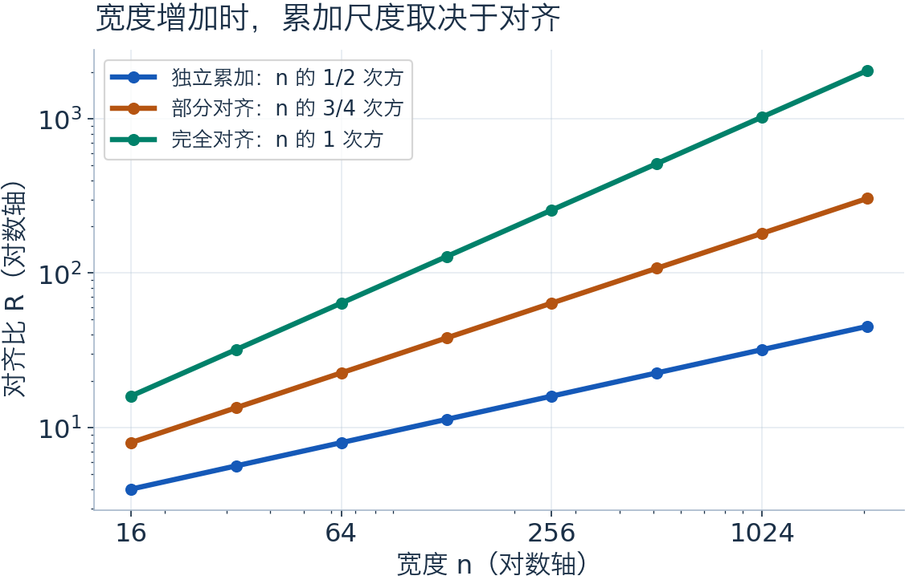
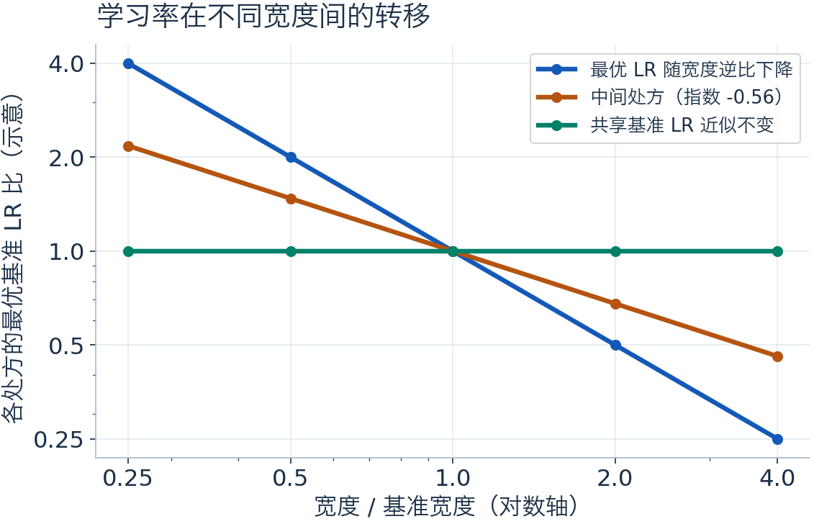
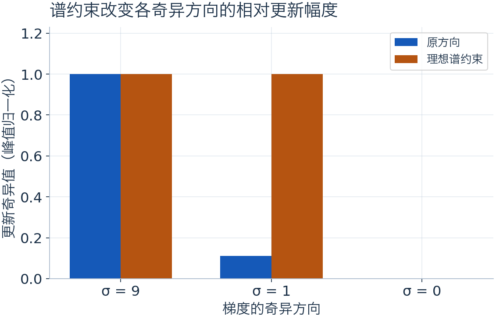
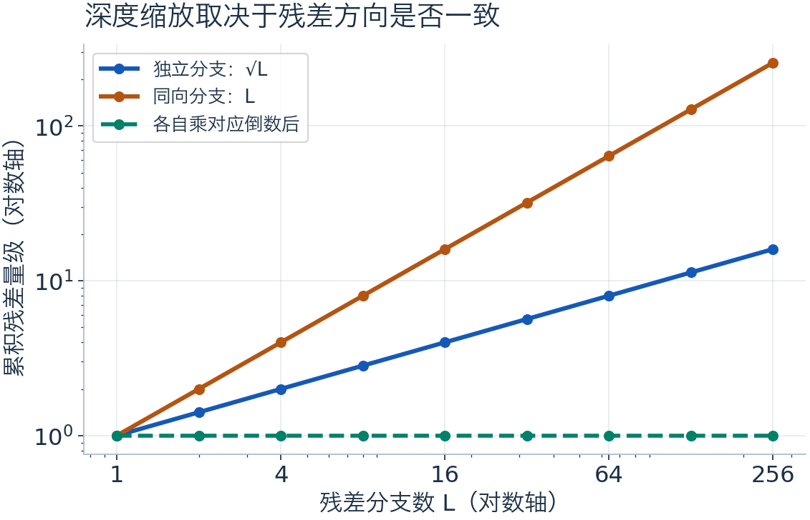

# 优化器（二）· 宽度缩放、μP 与 Muon

## 比较宽度时，比较的是函数的变化

在一个宽度为 $n$ 的模型中，某个权重坐标的变化可能非常小。后续矩阵会累加许多坐标的贡献，因此某层整体表征的变化仍可能很大。宽度缩放应该同时检查初始化和训练。初始化时隐藏表征 RMS 应保持 $\Theta(1)$，logits 有界。训练的有限步内，典型隐藏表征和 logits 的变化也应有界。要保留特征学习，还要让某些中间表示变化随宽度增长保持非零。有些 Neural Tangent Kernel (NTK) 参数化可让输出保持非平凡变化，而隐藏特征几乎不变，因而得到一个可分析的核模型极限。CS 312 关注的宽度缩放还需要描述表征随训练的变化。[Lecture 04，PDF pp. 7–20](https://deep-learning-alchemy.github.io/assets/slides/lecture_04.pdf)

## 从 $(a,b,c)$ 到参数组学习率

以扇入为 $n$、隐藏输入每维方差为常数量级的线性层为例：
$$
z=n^{-a}Wx,\qquad W_{0,ij}\sim\mathcal N(0,\sigma^2n^{-2b}),\qquad
\eta_W=\eta n^{-c}.
$$
$a$ 控制前向乘数，$b$ 控制权重初始化尺度，$c$ 控制学习率。独立且零均值的初始化使每个输出坐标累加的方差正比于 $n^{1-2(a+b)}$；因此中间层通常要求 $a+b=1/2$。ReLU 下 Kaiming 初始化还把方差的常数乘约 2，以补偿整流移除的平方能量。

进入训练后，令 $\Delta W$ 和 $\Delta x$ 分别为权重与输入特征的改变量。需要跟踪
$$
\Delta z=n^{-a}(\Delta W x_0+W_0\Delta x+\Delta W\Delta x).
$$
三个项分别对应本层权重更新、上游表示变化与二者交互。对 Adam，可在若干假设下近似令更新方向 $U$ 的坐标 RMS 为 $\Theta(1)$。定义对齐比
$$
R(U,x)=\frac{\|Ux\|_{\rm RMS}}{\|U\|_{\rm RMS}\|x\|_{\rm RMS}}
\asymp n^\alpha.
$$
独立零均值项的典型尺度给出 $\alpha=1/2$。完全同向求和可达到 $\alpha=1$。例如若 $U=uv^\top$ 且 $x=v$，则 $Ux=u\|v\|_2^2$，每行各分量相乘后的符号一致。直接更新项的 RMS 就按 $n^{\alpha-a-c}$ 变化，保持常数量级需要 $a+c=\alpha$。同样的分析还要检查 $W_0\Delta x$ 和 $\Delta W\Delta x$ 的对齐。训练中的对齐可以因层、宽度、优化器和时刻而变化。

在作业采用的全对齐、Adam 更新幅度模型与固定读出维度下，一组满足约束的选择如下。$n_0$ 为基准宽度，$m=n/n_0$。

| 参数组 | 前向倍率 | 初始化方差 | 参数组 LR |
| --- | --- | --- | --- |
| 固定 fan-in 输入映射 | $1$ | 扇入的倒数 | $\eta$ |
| 两轴均随宽度增长的内部矩阵 | $1$ | 实际扇入的倒数 | $\eta/m$ |
| 固定输出维度的读出矩阵 | $1/m$ | $1/n_0$ | $\eta$ |

课程的实现对 embedding 等模块有对应的初始化规则。验证移植时，可在不同宽度上用同一批数据运行几步，分别看初始 RMS、激活变化量和 logit 变化量。随后进行完整 token 预算下的学习率扫描。短程稳定性适合排除坏配置，最终最优点和转移损失需要长程测量。[Lecture 04，PDF pp. 15–35](https://deep-learning-alchemy.github.io/assets/slides/lecture_04.pdf) · [Assignment 2，Problem 4](https://deep-learning-alchemy.github.io/assets/assignments/a2_hyperparameter_scaling.pdf)

*公式图。要让 $\Delta W x$ 的 RMS 不变，对齐比增长更快时需要让坐标更新更小。*

## 两篇参数化论文的实验设计

- **Tensor Programs V。** $\mu$Transfer 的实用步骤是在目标模型的一个窄版中调共享超参数，再用 $\mu$P 规定的层级缩放映射到目标宽度。论文比较代理与目标的损失对学习率曲线，并演示在较小 BERT、GPT 代理上调参后向更大模型转移。§6 讨论了可转移超参数的类别。随宽度转移学习率较可行，正则化强度仍依赖数据与过拟合程度，初始化标准差在跨深度时也可能变动。建议先用 coordinate check 画不同宽度的激活量级，再验证最终损失曲线。[Yang et al.，§§4–7](https://arxiv.org/abs/2203.03466)
- **Scaling Exponents Across Parameterizations and Optimizers。** Everett 等将对齐视为待估计量，比较标准参数化和 $\mu$P 等组合在 SGD、Adam 和 Adafactor 下的缩放。给标准参数化配上合适的层级学习率也可得到有效转移。论文另指出通常的 $\varepsilon$ 会限制 Adam 的缩放不变性。当梯度乘 $s>0$，分子与 $\sqrt{\hat v}$ 一同乘 $s$，固定 $\varepsilon$ 形成新的相对尺度。论文用 $\operatorname{atan2}(\hat m,\sqrt{\hat v})$ 型更新避开该固定尺度，并通过实验检查层级 $\varepsilon$ 和 Adam-atan2。实际复现时记录极小梯度坐标中 $\sqrt{\hat v}/\varepsilon$ 的分布。[Everett et al.](https://arxiv.org/abs/2407.05872)

*指数示意。相同斜率代表相同缩放指数。水平线意味着可以在不同宽度复用相同的基准学习率，层级 LR 仍可按各组规则调整。*

## Muon 从矩阵约束得到更新方向

学习率控制多少参数变化可以通过不同范数来表达。对普通向量梯度下降，在线性化目标后加二次距离惩罚，会得到 $-\eta g$。对矩阵梯度 $G$，如果希望约束所有单位输入的最大输出变化，可以令 $\|\Delta W\|_{\mathrm{op}}\le\rho$。假设 $G=U\Sigma V^\top$ 为紧致 SVD：
$$
\min_{\|\Delta W\|_{\rm op}\le\rho}\langle G,\Delta W\rangle_F
=-\rho\|G\|_*.
$$
式中的核范数 $\|G\|_*$ 是奇异值之和。一个最优选择是 $\Delta W=-\rho UV^\top$，把非零奇异值都变成相同幅度，保留对应奇异向量。对满秩方阵，这个变换在各单位输入方向的范数效应相同。对矩形或秩亏矩阵，输出尺度仍取决于输入落在哪些子空间。例子：梯度 $\mathrm{diag}(9,1)$ 的 Frobenius 归一化仍保持 9:1 的更新奇异值比，理想的谱约束方向则得到 1:1。

实际 Muon 对动量矩阵（常为 Nesterov 方向）使用短次 Newton–Schulz 矩阵多项式近似，不必每步做 SVD。若令 $X$ 为缩放后的动量，迭代可写为 $X\leftarrow aX+bXX^\top X+c(XX^\top)^2X$，相当于逐奇异值施加同一五次多项式。作者使用适合少步更新的系数，以 bf16 矩阵乘法提高效率，得到的奇异值并非全部精确等于 1，精确零奇异值也不会被多项式变成非零。原文实测不同系数、Nesterov 与直接动量等选择。课件进一步展示规模化训练需要考虑解耦衰减和矩形矩阵的更新幅度匹配。若 $UV^\top$ 有秩 $r=\min(m,n)$，其坐标 RMS 为 $\sqrt{r/(mn)}=1/\sqrt{\max(m,n)}$，所以乘 $\sqrt{\max(m,n)}$ 可抵消这部分形状依赖。实践中常对内部二维权重用 Muon，embedding、norm 等其余参数保留 AdamW 等方案。[Lecture 04，PDF pp. 36–49](https://deep-learning-alchemy.github.io/assets/slides/lecture_04.pdf) · [Keller Jordan 的 Muon 技术说明](https://kellerjordan.github.io/posts/muon/)

*公式图。输入奇异值为 9、1、0，柱高按最大值归一化。有限步 Newton–Schulz 只近似这个结果。*

## 深度缩放的单独检验

把 $L$ 个残差分支的贡献看成向量和。分支增量若近似独立且均值为零，和的 RMS 典型按 $\sqrt L$ 增长，乘 $L^{-1/2}$ 可控制整体尺度。若分支增量一直同向，和按 $L$ 增长，需用 $L^{-1}$。A2 在宽度固定、深度改变的情况下用五步训练检查这些处方。共享块复用同一组权重，方向相关性往往更强。真实网络仍需测量残差更新的角度和范数。即使某处方在超深模型的五步测试中稳定，学习率、有效训练深度和最终损失也要在实际训练预算下验证。[Assignment 2，§§4.1–4.2](https://deep-learning-alchemy.github.io/assets/assignments/a2_hyperparameter_scaling.pdf)

*公式图。每条分支按典型单位尺度计算，独立与同向是两种边界模型。独立分支乘 $L^{-1/2}$，同向分支乘 $L^{-1}$，都给出图中的水平线。*

## Optimization 1 测验复盘

在同一个模型族内转移学习率时，常同时汇报最佳学习率的变化与转移损失。转移损失是目标宽度下用转移配置得到的损失减该宽度的拟合最低值。最优点移动一倍，但损失曲线很平，转移损失也可能很小。[官方测验与答案](https://deep-learning-alchemy.github.io/quiz-hyperparameter-scaling.html) · [课堂讲评 PDF](https://deep-learning-alchemy.github.io/assets/quizzes/hyperparameter_scaling_answer_slides.pdf)

| 题 | 测量与方法 |
| --- | --- |
| 1. 共享块 | 独立块换为共享块，三种处方在初始化时的 RMS 比约为 32.2、28.6 和 1.56。CompleteP 在题设的五步检验中损失最低。共享块更接近同向相加，embedding 还会影响测得的整体 RMS。 |
| 2. 联合改变 LR 和 WD | 余弦调度下、该网格中，接近最优 $\eta\lambda$ 的配置表现较好，实测给出的 C 组额外损失约 0.032。官方互动测验的区间门槛为 0.025，讲评 PDF 此处印作 0.25。 |
| 3. Hyperball 与训练时长 | 以现有 token 预算点外推至 2.4576B token，该题最优峰值学习率约 0.008。题目的 Hyperball 约束包含读出矩阵，应用到其他约束参数组时应重新验证。 |
| 4. batch 与动量 | batch 为 8 和 256 时，移除 Adam 一阶动量的损失代价约为 0.0276 与 0.2503。较大 batch 下损失对动量更敏感。题目在各 batch 内固定 LR 和 WD，结论对应直接移除动量的配方。 |
| 5. Almost-$\mu$P | 保留 $\mu$P 的 embedding 和内部矩阵学习率，换回基线的读出。1024 对 512 宽度的最优 LR 比约 0.869，题设转移损失约 0.0175。 |
| 6. Hyperball 与宽度 | 题设宽度范围拟合的最优 LR 指数约为 $-0.561$，宽度 1024 的转移损失约 0.033，结果仍随宽度改变。 |
| 7. batch 扩八倍 | 固定 token 预算，更新次数减少八倍。在候选方案中维持峰值 LR、把 WD 乘 8 最优。保留旧配方的代价约 0.106。可用累积衰减 $\lambda\sum_t\eta_t$ 理解为什么有必要重调，具体最优还要看角度、batch 噪声与学习率稳定性。 |

## 预测练习

1. 模型宽度翻成四倍，$a=0$ 且更新方向对齐按 $n^{3/4}$ 增长。直接表征变化要保持不变，内部矩阵学习率该乘几？由 $c=3/4$ 得 $4^{-3/4}\approx0.354$。检查其他两项是否也随宽度有界。
2. 取矩阵的奇异值为 $10,1,0$，比较 SGD 归一化和 Muon 理想谱约束下的三个奇异方向。判断哪一项的相对变化被放大，哪一项保持为零。再用一个接近零而非恰好为零的第三奇异值比较有限步近似。
3. 固定宽度做两种深度 sweep，分别用独立块和共享块。除 loss 外记录每个分支的 RMS 与它和前面残差和的夹角，再判断使用 $L^{-1/2}$、$L^{-1}$ 的统计依据。[Assignment 2 代码](https://github.com/deep-learning-alchemy/assignments/tree/a2_release)
