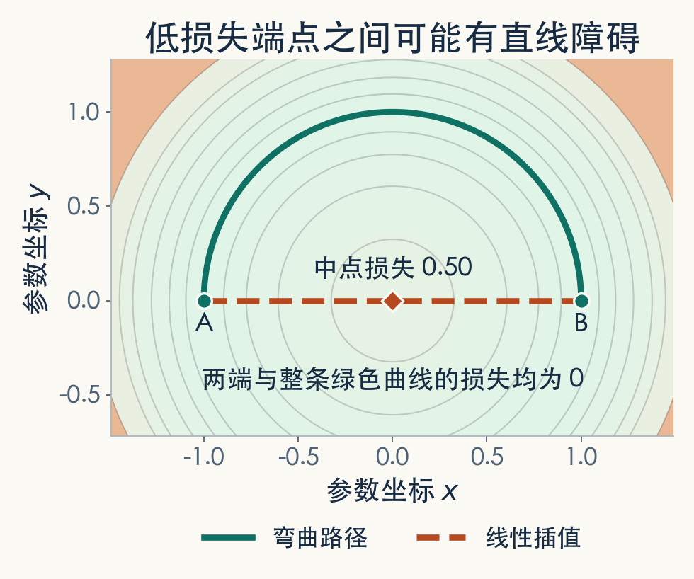
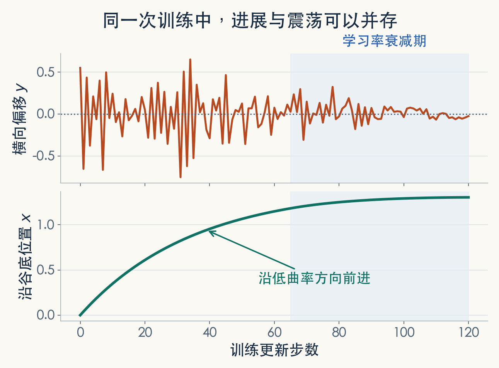
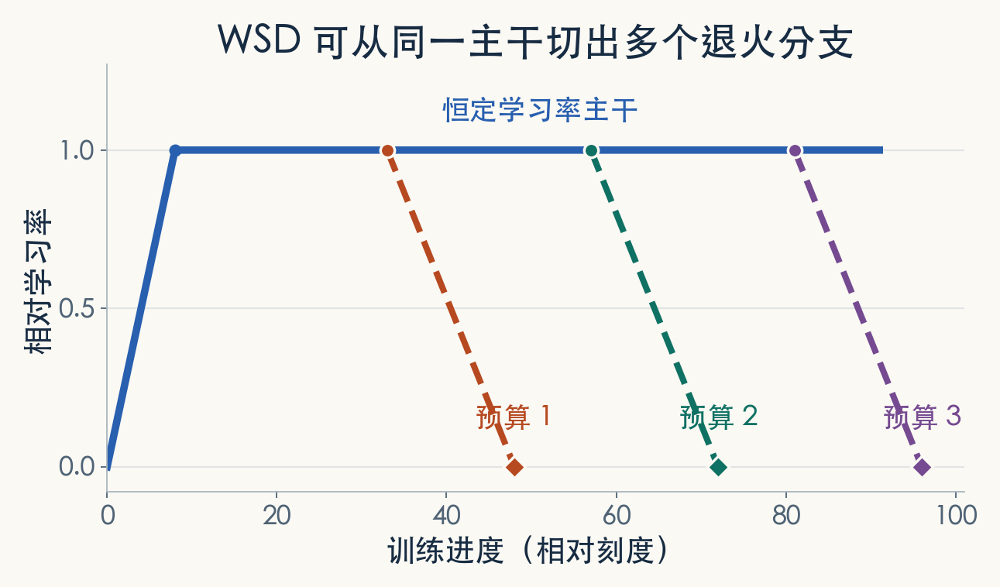
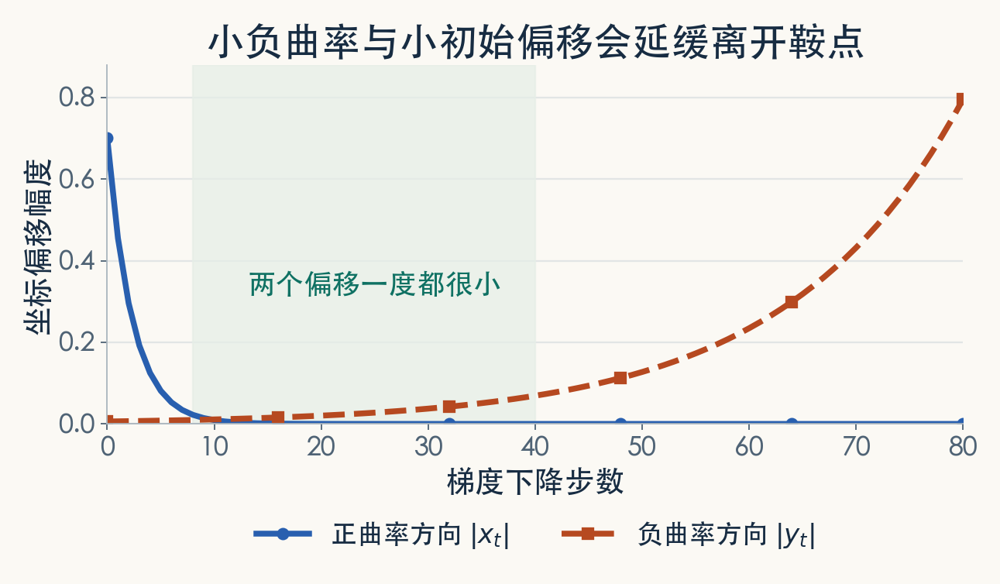

# 损失景观：模型平均、学习率调度与鞍点

对应 Stanford CS 312 第 5 讲（10 月 13 日）。这讲用三个尺度观察同一个预训练目标：比较两个 checkpoint 之间的路径，理解一次训练中不同方向的进展，再用局部曲率判断临界点附近的行为。读完后，你应能解释为什么微调模型往往可以合并、为什么恒定学习率下的 loss 可能低估实际优化进展，以及为什么梯度很小仍可能有下降方向。 [原始课件 PDF](https://deep-learning-alchemy.github.io/assets/slides/lecture_05.pdf)

## 参数平均会保留两个模型的能力吗

设两个 checkpoint 的参数为 $\theta_A,\theta_B$。要检验它们之间的直线路径，在同一验证集上评估 $\theta(\alpha)=(1-\alpha)\theta_A+\alpha\theta_B$。一个方便的量是中点障碍

$$
B_{1/2}=L\!\left(\frac{\theta_A+\theta_B}{2}\right)
-\frac{L(\theta_A)+L(\theta_B)}2.
$$

如果 $L$ 沿整条线段是凸的，Jensen 不等式给出 $B_{1/2}\le 0$。反过来，一个低中点只提供该采样点的证据。例：两个端点 loss 为 2.90、2.94，中点为 2.91，则 $B_{1/2}=-0.01$。仍应检查四分之一和四分之三处的 loss。A3 用 $B_{1/2}\le 0.01$ 作为权重平均是否可用的操作性阈值；解释时还可看中点是否优于 **较好的端点**。 [A3 第 3–4 页](https://deep-learning-alchemy.github.io/assets/assignments/a3_optimization2.pdf)

*解析示意。$L(x,y)=\tfrac12(x^2+y^2-1)^2$ 的整个单位圆都是最低点。线性插值通过原点，得到 $B_{1/2}=0.50$。看这张图时，沿橙线读权重平均，沿绿线读模式连通性，两条路径使用同一对端点。*

预测集成在函数空间进行。对真实 token $y$，设相同上下文中两个模型给出的概率为 $p_A,p_B$。等权概率集成的交叉熵满足

$$
-\log\frac{p_A+p_B}{2}\le \frac{-\log p_A-\log p_B}{2}.
$$

因此在相同样本上，用同一种平均方式聚合 token loss，集成 loss 至多为两个端点 loss 的均值。以 $p_A=0.8,p_B=0.2$ 为例，集成概率为 0.5，集成 loss 约为 0.693，端点均值约为 0.916，较好的单模型 loss 约为 0.223。这个界不保证集成超过最佳端点，也只适用于此处的概率平均。权重平均只需运行一个模型，但非线性网络没有对应的函数级保证。

### 共享初始化提供了什么

- **从同一预训练模型微调。** 权重坐标通常已有一定程度的特征对齐。WiSE-FT 在基础权重与微调权重间选插值系数，观察域内和分布外性能的折中。Model Soups 对一组微调权重求平均，可以用验证集只接纳改善结果的候选。任务算术把 $\theta_{\text{FT}}-\theta_0$ 当作任务向量，并测试加减向量后多任务能力如何变化。插值系数和任务向量组合都要用目标任务验证。 [WiSE-FT](https://arxiv.org/abs/2109.01903) · [Model Soups](https://arxiv.org/abs/2203.05482) · [Task Arithmetic](https://arxiv.org/abs/2212.04089)
- **从同一预训练 checkpoint 分叉。** 保存权重和 optimizer state，后续仅改数据顺序。先共同训练多久、分叉后各走多久，是两个不同的轴。分叉再短也可能保留强相关误差，模型平均的有效收益取决于后续差异和插值障碍。先比较低障碍区，再比较具体增益。 [原始课件第 27–29 页](https://deep-learning-alchemy.github.io/assets/slides/lecture_05.pdf#page=27)
- **独立预训练。** 两个同架构模型可能用不同的隐藏坐标表示类似功能。例：对两层网络 $W_2\phi(W_1x)$，若 $P$ 是置换矩阵且 $\phi$ 逐元素作用，$W_2P^\top\phi(PW_1x)$ 给出相同函数；直接平均前后的矩阵却会把对应通道混在一起。Git Re-Basin 和最优传输模型融合先尝试对齐再合并。评估时可以分别记录直线障碍和各任务的泛化性能。 [Git Re-Basin](https://arxiv.org/abs/2209.04836) · [Model Fusion via Optimal Transport](https://arxiv.org/abs/1910.05653)

还有一种对照是把**同一次训练的初始化与终点**连起来。部分模型沿该直线的 loss 会持续下降。中途参数的训练轨迹可能离这条直线很远，几个插值点也无法恢复梯度更新的方向与顺序。 [Lucas 等，2021](https://proceedings.mlr.press/v139/lucas21a.html)

### 论文延伸 · 让路径自己弯曲

Garipov 等把两个已训练端点固定，另外训练路径的控制点。他们用一处折点的折线或二次 Bézier 曲线，并通过随机抽取路径位置来近似优化沿途的平均训练 loss。ResNet-164 在 CIFAR-100 上的结果展示了同一对端点之间的直线障碍与可训练的低损失曲线。这提供了一个重要的实验区分：固定线段平均失败后，仍可考察换坐标后是否线性连通，或者原坐标下是否存在非线性的低损失路径。原论文还用周期学习率从一次训练轨迹保存多个快照做 Fast Geometric Ensembling，在预训练的 ImageNet ResNet-50 上追加 5 个 epoch，报告 top-1 错误率降低 0.56 个百分点。该实验比较的是多模型预测，因此评估时还应计入多次前向。 [Garipov 等，2018，§3–6](https://arxiv.org/abs/1802.10026)

## 用 Hessian 理解局部方向

在 checkpoint $\theta$ 周围，二阶近似是

$$
L(\theta+\Delta)\approx L(\theta)+g^\top\Delta+\tfrac12\Delta^\top H\Delta,
\qquad g=\nabla L(\theta),\ H=\nabla^2L(\theta).
$$

对单位方向 $u$，$u^\top H u$ 衡量该方向的局部曲率。大正特征值对应位移后 loss 很快增大的方向，接近零的特征值对应二阶变化很小的方向，负特征值对应向下弯曲的方向。在 $g=0$ 时，一个负特征值就足以排除局部极小。二维切片容易遗漏高维空间中的其他下降方向，而且切片形状依赖方向选取与参数的尺度。 [原始课件第 3–9、30–38 页](https://deep-learning-alchemy.github.io/assets/slides/lecture_05.pdf#page=30)

把二次近似的梯度设为零，得到 Newton 步 $\Delta=-H^{-1}g$。在正定二次函数中，这会按 $1/\lambda_i$ 放大平坦方向上的更新、缩小尖锐方向上的更新。在非凸网络中，负特征值会令该方向的 Newton 步沿着梯度上升。一个不同的曲率矩阵是广义 Gauss–Newton：若模型输出为 $f(\theta)$、其 Jacobian 为 $J$，则对输出损失 $\ell(f)$ 有

$$
H=J^\top \nabla_f^2\ell\,J+\sum_k\frac{\partial\ell}{\partial f_k}\nabla_\theta^2f_k.
$$

广义 Gauss–Newton 使用第一项。交叉熵对 logits 的 Hessian 半正定，所以这一项直接提供半正定估计，也舍弃了第二项体现的模型非线性曲率。课件展示了 Hessian 与 Gauss–Newton 主要谱分量的经验一致性，以及二阶方法可能减少更新步数、增加单步计算的取舍。比较结果时同时记录 loss 对更新数和运行时间的曲线。 [Meterez 等，局部二次模型的实证检验](https://arxiv.org/abs/2607.21716) · [Abreu 等，完整 Gauss–Newton 预条件](https://arxiv.org/abs/2510.09378)

## 为什么较高学习率下仍能取得进展

考虑局部简化问题 $L(x,y)=F(x)+\frac12hy^2$，其中 $x$ 是缓慢下降的低曲率方向，$y$ 是高曲率方向。令 $y$ 方向的梯度噪声 $\xi_t$ 独立同分布、均值为零、方差 $\sigma^2$。固定学习率 $\eta$ 下，

$$
y_{t+1}=(1-\eta h)y_t-\eta\xi_t,\qquad
\operatorname{Var}(y_\infty)=\frac{\eta\sigma^2}{h(2-\eta h)}\quad(0<\eta h<2).
$$

用 $V=(1-\eta h)^2V+\eta^2\sigma^2$ 可直接解得该式。在 $\eta h\ll 1$ 时，$y$ 方向贡献的期望 loss 近似 $\eta\sigma^2/4$。在 $1<\eta h<2$ 时，即使噪声为零，偏差也会翻符号并衰减；有噪声时会持续波动。与此同时 $x$ 的更新幅度仍会随 $\eta$ 增大。一次观测到的 loss 包含两部分：沿平坦方向积累的进展，以及偏离低曲率路径的额外代价。实际网络还可能因曲率变化而在确定性大步长下自我稳定，下一讲处理这一机制。

*数值示例。对 $L(x,y)=0.0075(x-1.4)^2+0.5y^2$ 做 SGD，只在 $y$ 方向加入标准差为 0.10 的独立高斯梯度噪声。第 65 步后将学习率从 1.88 线性降至 0.08。上图看横向震荡，下图看沿谷底已经取得多少进展。*

| 干预 | 预期影响 | 应测的量 |
| --- | --- | --- |
| 降低学习率 | 减小高曲率方向偏离；同时减少低曲率方向的单步进展 | 退火后的短期 loss、恢复学习率后的 regret |
| 对 checkpoint 做 Polyak 平均或 EMA | 汇总相邻权重，抵消训练轨迹中的部分震荡；均值也会滞后于持续前进的轨迹 | 同一训练步的原始和平均权重 loss、跨多个窗口的结果 |
| 保存一个稳定训练主分支，按预算另开退火分支 | 多个停止预算可以共用前面的训练 | 各预算的终点 loss 和所有分支的总计算量 |

测 EMA 时，仅替换评估权重，优化器照常更新原参数。$\bar\theta_t=\beta\bar\theta_{t-1}+(1-\beta)\theta_t$ 的有效记忆尺度约为 $1/(1-\beta)$ 步。评估训练更新的相邻余弦相似度也有帮助：全批量 GD 若沿高曲率方向往返，相邻更新可能呈负相关；小批量噪声会干扰这项诊断。一次训练的时间平均与两个微调端点的模型合并都有参数平均这一步，二者需要不同的对照。 [原始课件第 39–52 页](https://deep-learning-alchemy.github.io/assets/slides/lecture_05.pdf#page=39)

### 论文延伸 · WSD 理论与多预算的实验

Wen 等将局部区域写成一条低曲率方向随位置变化的路径及其陡峭的横向邻域。在专门分析随机梯度的定理里，他们进一步采用直线谷底、横向高斯噪声和足够小的步长等条件。在这些条件下，沿谷底的进度由累计学习率近似刻画，横向波动则在恒定学习率阶段贡献一个随学习率增加的 loss 项。论文还用一个 bigram 生成分布构造可直接检查的例子。这些假设说明了为何能同时出现“稳定阶段 loss 较高”和“退火后 loss 大幅下降”。验证 AdamW 或强振荡的训练仍需分别测量。 [Wen 等，2024，§3–4](https://arxiv.org/abs/2410.05192)

WSD（Warmup–Stable–Decay）先 warmup、再按恒定学习率推进，在预期停止预算前切出退火分支。论文延伸的 WSD-S 从上次退火结束的 checkpoint 恢复学习率，将退火时已使用的 tokens 继续计入主实验。作者在 0.1B、0.3B、0.6B、1.2B 的模型上比较多个停止预算，报告 WSD-S 在其设置下优于保留主干再反复分叉的 WSD，并能接近为每个终点单独训练的 cosine 参考。要比较成本，可以把所有分支加总，也可以单独比较首个可用 checkpoint 的质量；两个口径回答不同问题。A3 还比较了固定周期的 cosine restart、反平方根衰减和给定预算的调度；峰值学习率和总 token 数分别要对齐。 [Wen 等，2024，§5，图 10–13](https://arxiv.org/abs/2410.05192) · [A3 第 5–6 页](https://deep-learning-alchemy.github.io/assets/assignments/a3_optimization2.pdf#page=5)

*调度示意。假设每次退火都需要同样多的更新。圆点表示此时复制主干状态，菱形表示该预算的最终 checkpoint。若要核算得到三个模型的总训练成本，主干算一次，每段虚线分支各算一次。*

共享一条 WSD 主干也可能有代价：适合短预算的峰值学习率，到更长预算时未必仍然合适。课件举了 WSqD 的做法，用移位后的反平方根曲线代替恒定学习率平台，并在每个计划停止点前安排最终线性衰减。还可以先用同一条主干的滑动平均估计不同停止预算下的性能，再选预算做正式退火。 [WSqD](https://arxiv.org/abs/2607.10959) · [原始课件第 48–51 页](https://deep-learning-alchemy.github.io/assets/slides/lecture_05.pdf#page=48)

## 损失平台何时暗示鞍点

以 $L(x,y)=1+\frac12x^2-\frac{\varepsilon}{2}y^2$ 为例。原点梯度为零，沿 $x$ 增大、沿 $y$ 减小。梯度下降使 $y_{t+1}=(1+\eta\varepsilon)y_t$。若 $y_0$ 极小或负曲率绝对值 $\varepsilon$ 很小，则 $y$ 离开邻域需要很多步。这就区分了两个问题：训练能否从临界点附近离开，以及在有限预算内离开得多快。

*解析示意。取 $\eta=0.35$、$\varepsilon=0.18$，从 $(0.7,0.006)$ 开始。$|x_t|$ 乘以 0.65，$|y_t|$ 乘以 1.063。阴影区内两者都比较小，随后负曲率方向的偏移明显增大。*

### 论文延伸 · 负曲率比例与 Saddle-Free Newton

Dauphin 等将 Hessian 负特征值比例称为临界点的 **index**。随机高维高斯场模型给出一个有条件的预期：临界点的损失较高时，负特征值比例通常也较高。作者用小型神经网络的数值实验检查了类似关系。在 MNIST 深度自编码器和 Penn Treebank RNN 上，他们也比较了 SGD 后段与切换到近似 Saddle-Free Newton 的优化表现。方法将逆矩阵里的特征值替换为其绝对值，得到 $-|H|^{-1}g$，再用子空间近似和阻尼处理规模与近零曲率。回到上面的例子，Newton 在 $y$ 方向会把迭代直接带到零；理想化的 Saddle-Free Newton 则按 $1/\varepsilon$ 缩放，令偏离原点的方向更快增长。实际性能取决于特征方向的估计成本和阻尼。 [Dauphin 等，2014，§2、6–7](https://arxiv.org/abs/1406.2572)

部分矩阵分解类问题可以证明所有局部极小都是全局极小。严格鞍点规避的另一类结果依赖光滑性、步长和随机初始化等条件，排除收敛到具有负曲率的严格鞍点，并不给出逃离所需的更新数。深线性网络中还可以观察到训练依次经过若干鞍点邻域。将这些结果用于真实模型时，先报告梯度大小、负特征值和轨迹持续时间，再解释平台，避免用单张切片判断整个目标。 [Lee 等，梯度下降与严格鞍点](https://arxiv.org/abs/1602.04915) · [原始课件第 53–65 页](https://deep-learning-alchemy.github.io/assets/slides/lecture_05.pdf#page=53)

## 实验与预测练习

1. **A3 P1，分叉网格。** 固定架构、验证集与每次比较的 token 预算。沿共享前缀和分叉步数做网格，记录端点、概率集成与权重平均 loss。先用 $B_{1/2}$ 找典型格子，再画完整插值曲线。若权重平均恰好低于端点均值、仍高于最佳端点，记录障碍和相对最佳端点的差值。 [作业与启动代码](https://github.com/deep-learning-alchemy/assignments/tree/a3_release)
2. **A3 P2，动态干预。** 对照组留在原学习率，干预组先 dip 再回升，最后两组做同样的 cooldown。定义 $R(t)=L_{\mathrm{dip}}(t)-L_{\mathrm{control}}(t)$。比较下降期最低点、恢复期最高点和最终 $R$，并记录相同 token 数的原始权重与 EMA 曲线。用峰值学习率的小范围扫描检验排序是否稳健。
3. **预测题。** 比较相同 checkpoint 上两种学习率变化：第一组用更低学习率训练 100 步后恢复，第二组在相同 100 步内保持原学习率。假设沿途进度近似正比于学习率总和，横向 loss 可快速响应学习率。第一组在恢复前和恢复充分后各会领先还是落后？**推理：** 恢复前若横向 loss 下降超过低曲率方向的进度差，可短时领先；恢复充分后，横向波动趋近对照，第一组可能因累计步长较小而落后。两个条件都可用 regret 曲线及其 EMA 检验。

## Quiz 3 讲评 · Q1–Q4

- **Q1，共享前缀与平均。** 课程在较高固定学习率下观察到，长分叉会使平均权重劣于较好端点，共享前缀拉长后平均又有收益。概率集成的端点均值上界始终成立。用不同分叉点在长期退火训练中做比较时，课程观测到平均收益随分叉提前平滑减弱。
- **Q2，修正错误的峰值学习率。** 先用 4 倍学习率、再切回基线，可短时领先但最终落后。课程在第 3 层 MLP 矩阵看到权重 RMS 约高一倍，切回后逐步缩小。AdamW 的乘法收缩在固定学习率下为 $(1-\eta\lambda)^k$，因此 $1/(\eta\lambda)$ 可作为尺度适应的粗略步数；它只描述 decay 项本身的时间尺度。低峰值学习率的纠偏则体现了留给较高学习率积累进度和末期退火的时间如何分配。
- **Q3，EMA 和衰减。** 课程在恒定学习率实验里用 EMA 弥补了一部分与线性衰减的差距，过大的恒定学习率仍然表现较差。在持续退火中，历史权重的滞后影响往往在训练后段更明显。
- **Q4，dip 和 rewarm。** 课程比较近似相同学习率缺口面积的深短 dip 和浅长 dip，浅长方案的最低点较浅，回升后的 loss 过冲相近。若预算短、模型仍需在高学习率阶段推进，渐进 rewarm 会减少较高学习率下的有效步数，课程设定中表现更差。实际判断还可记录累积学习率和权重范数，并用相同终点 cooldown 验证。

以上是课程具体实验的读图线索。可先做原题，把各图的变化方向写下来，再对照结果。 [Quiz 3 自测](https://deep-learning-alchemy.github.io/quiz-optimization-2.html) · [讲评课件第 2–24 页](https://deep-learning-alchemy.github.io/assets/quizzes/optimization2_answer_slides.pdf#page=2) · [官方解答 PDF](https://deep-learning-alchemy.github.io/assets/quizzes/optimization2_solutions.pdf)
