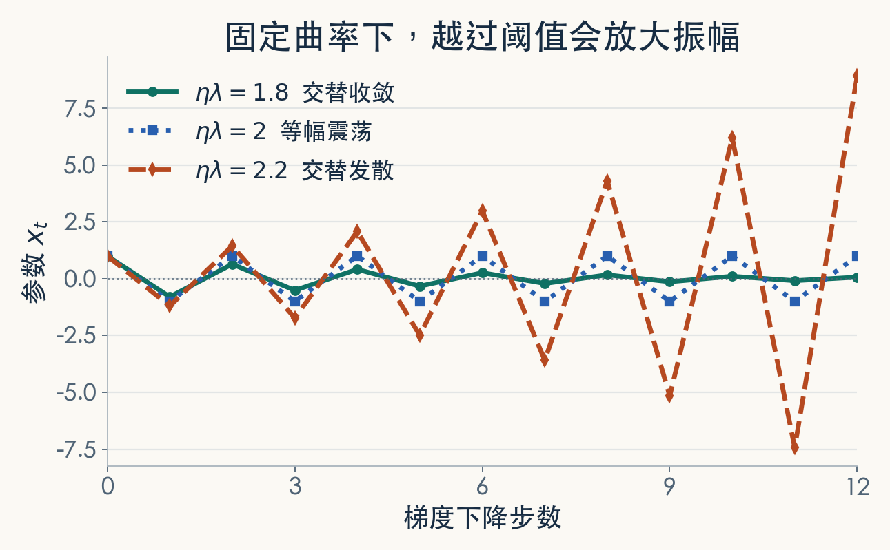
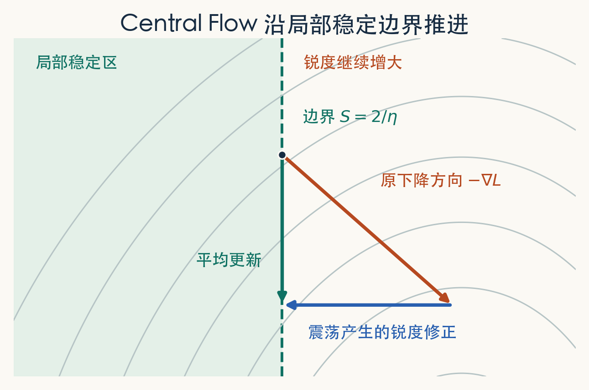
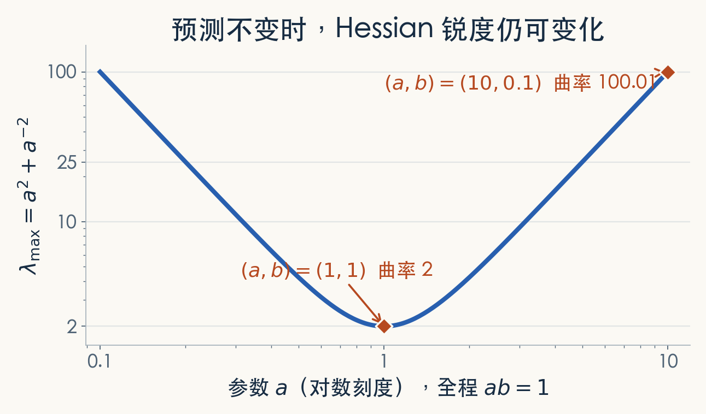
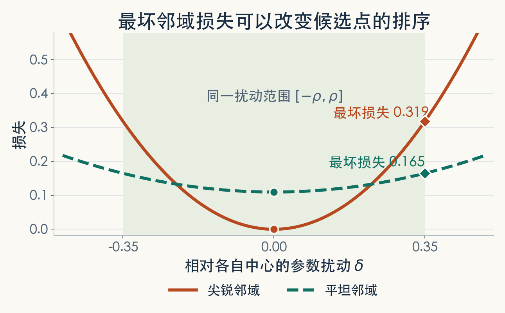

# 稳定性边缘：从 Hessian 到自适应优化

对应 Stanford CS 312 第 6 讲（10 月 15 日）。这讲从一个能完全求解的二次函数出发，解释真实网络为什么能在单步震荡中继续降低训练 loss，并讨论怎样测量 SGD、RMSProp 和 AdamW 的有效曲率。最后区分训练稳定性、局部参数扰动与泛化。 [原始课件 PDF](https://deep-learning-alchemy.github.io/assets/slides/lecture_06.pdf) · [PPTX](https://deep-learning-alchemy.github.io/assets/slides/lecture_06.pptx)

## 从固定二次函数推导稳定边界

在 $L(x)=\frac12\lambda x^2$ 上，全批量梯度下降是 $x_{t+1}=(1-\eta\lambda)x_t$。当 $\lambda>0$ 时，收敛要求 $|1-\eta\lambda|<1$，即 $0<\eta\lambda<2$。如果 $1<\eta\lambda<2$，迭代点在零点两侧来回移动，幅度逐步衰减。到 $\eta\lambda=2$，理想二次函数的幅度保持不变。以 $x_0=1$ 为例，$\eta\lambda=1.8$ 给出 $1,-0.8,0.64$，$\eta\lambda=2.2$ 给出 $1,-1.2,1.44$。正定多维二次函数在 Hessian 的特征基里分解为同样的一维递推，最大特征值 $S=\lambda_{\max}(H)$ 给出最先失稳的正曲率方向。

*解析示意。三条曲线从 $x_0=1$ 出发，每步都翻转符号。比较峰值到零线的距离，就能看到三个不同的振幅趋势。*

神经网络每走一步都在一个新的位置，局部 Hessian 随位置改变。此时 $2/\eta$ 仍是判断局部正曲率振荡的参考。**渐进锐化**（progressive sharpening）指训练前期 $S$ 逐渐增大。**稳定性边缘**（edge of stability，EoS）指在若干全批量神经网络实验中，锐度在 $2/\eta$ 附近波动，逐步损失有尖峰，而较长时间尺度上的 loss 仍下降。若所有统计量都以稀疏 checkpoint 采样，可能同时漏掉 loss 尖峰与 $S$ 的短时回落。 [原始课件第 3–13 页](https://deep-learning-alchemy.github.io/assets/slides/lecture_06.pdf#page=3)

### 论文延伸 · 改学习率检验边界是否跟随

Cohen 等除了用固定学习率比较不同阈值，还在同一次训练中改变学习率。减小学习率后，旧锐度低于新的 $2/\eta$，渐进锐化可以重新出现；提高学习率则立即降低参考阈值，当前参数会首先进入更不稳定的区间。论文还用很小的步长或数值求解 gradient flow 观察没有触边时的锐化，帮助区分「锐度原本就会升高」与「离散步长使曲率受到约束」。全批量实验中的平方损失较容易显示长时间平台；交叉熵的后期锐度可以降低，类别置信度和停止时间会影响观测。读取原文时应对照训练 loss、锐度与步长三条信息。 [Cohen 等，2021，§2.1–2.3、§4](https://arxiv.org/abs/2103.00065)

## Central Flow 如何描述震荡中的平均进展

先假设只有一个高曲率特征方向触边。把原始迭代写为 $w_t=\bar w_t+x_tu$，$u$ 是 $\bar w_t$ 处的顶特征向量，时间窗口内 $x_t$ 近似零均值。对梯度做二阶展开得到

$$
\nabla L(\bar w+xu)=\nabla L(\bar w)+xHu+\tfrac12 x^2\nabla^3 L(\bar w)[u,u]+O(|x|^3).
$$

假设顶特征值简单且损失足够光滑，有 $\nabla^3 L[u,u]=\nabla S$。所以 $xHu$ 平均后抵消，$\tfrac12\mathbb E[x_t^2]\nabla S$ 保留下来。离散梯度更新中的震荡会在慢变量上产生一个降低锐度的分量。若普通 gradient flow 会使锐度继续升高，触边后的平均轨迹可近似为

$$
\dot{\bar w}=-\eta\left(\nabla L+\tfrac12\sigma^2\nabla S\right),\qquad
\tfrac12\sigma^2=-\frac{\langle\nabla S,\nabla L\rangle}{\|\nabla S\|_2^2}.
$$

第二个式子由 $\frac{dS}{dt}=\langle\nabla S,\dot{\bar w}\rangle=0$ 得到，适用于 $\nabla S$ 非零且其与 $\nabla L$ 的内积为负的单方向触边情形。否则这个公式可能给出负方差，应允许离开边界。代回后，平均更新等于原下降方向在等锐度面切空间上的投影，所以沿这条近似流，训练目标可以继续下降。举例，若 $\nabla S=(1,0)$、$\nabla L=(-2,3)$，普通下降会增大锐度，受约束后的下降方向为 $(0,-3)$。 [原始课件第 14–28 页](https://deep-learning-alchemy.github.io/assets/slides/lecture_06.pdf#page=14)

*局部几何示意。橙色方向会穿过边界，蓝色方向消去它垂直于边界的分量。两者相加得到绿色方向，可以继续降低 loss，同时让一阶近似下的锐度保持不变。*

### 论文延伸 · 多个振荡方向与预测量

Central Flows 用低秩半正定协方差 $\Sigma=\mathbb E[(w_t-\bar w)(w_t-\bar w)^\top]$ 表示多个方向的振荡。模型以互补约束决定哪些方向具有非零方差，允许已触边的方向在适当时回到稳定区。没有方向触边时，$\Sigma=0$，回到 gradient flow。还可以预测观测到的平均 loss 与平滑参数上的 loss 有何关系：

$$
\mathbb E[L(w_t)]\approx L(\bar w)+\tfrac12\operatorname{tr}(H(\bar w)\Sigma).
$$

因此可以在同一实验中比较 raw loss 的窗口均值、平均权重的 loss 和两者的差值。论文也用曲率协方差修正模型输出的预测，并对照了真实迭代的长程轨迹。其近似建立在确定性实验和快慢时间尺度分离上，应用到大模型小批量训练时应重新检查误差。联系上一讲，$L(\bar w)$ 类似谷底附近的进度，协方差项刻画偏离低损失路径的代价。 [Cohen 等，2025，§3.2–3.3](https://arxiv.org/abs/2410.24206)

## 动量、批量与预条件

### 动量需要统一写法

对经典 heavy-ball，写作 $v_{t+1}=\beta v_t+g_t$，$x_{t+1}=x_t-\eta v_{t+1}$。代入 $g_t=\lambda x_t$ 并消去 $v$：

$$
x_{t+1}=(1+\beta-\eta\lambda)x_t-\beta x_{t-1}.
$$

两个特征根都在单位圆内的条件是 $0<\eta\lambda<2(1+\beta)$，其中 $0\le\beta<1$。到上边界时有一个根等于 $-1$。若使用 $m_{t+1}=\beta m_t+(1-\beta)g_t$ 的归一化动量，相同推导把式中的 $\eta\lambda$ 换成 $\eta(1-\beta)\lambda$，上界写成 $2(1+\beta)/(1-\beta)$。实现里的 $\eta$ 只有与动量定义和权重更新式一起才有可比性。

对独立零均值噪声，未归一化动量的噪声方差乘数是 $\sum_{k\ge0}\beta^{2k}=1/(1-\beta^2)$，强调的是随机分量被积累。全批量、高曲率附近的交替梯度则会在相邻步之间抵消。小批量情形应另外观察 batch sharpness 等统计量；近期研究用这种量测到大批量和小批量两种平台，避免把全批量 Hessian 的 $\lambda_{\max}$ 与批方向曲率混用。 [原始课件第 29–33 页](https://deep-learning-alchemy.github.io/assets/slides/lecture_06.pdf#page=29) · [Andreyev 等，2026](https://arxiv.org/abs/2604.14108)

### RMSProp 通过有效步长改变问题

- **Scalar RMSProp。** 用 $v_t$ 记录一个全局平方梯度统计，实际步长为 $\eta/(\sqrt{v_t}+\epsilon)$。高曲率振荡一方面推动参数进入低锐度区域，另一方面会增大梯度平方统计并降低实际步长。$\beta_2$ 越大，二阶矩估计对变化的响应越慢；同一有效边界可以由不同的原始锐度与梯度尺度组合实现。
- **逐坐标 RMSProp。** 定义 $D_t=\operatorname{diag}(\sqrt{v_t}+\epsilon)$，局部冻结它时，用对称矩阵 $D_t^{-1/2} H D_t^{-1/2}$ 的顶特征值衡量预条件锐度。它与 $D_t^{-1}H$ 相似。若把学习率也吸收到 $P=D_t/\eta$，则参考阈值是 $\lambda_{\max}(P^{-1/2}HP^{-1/2})=2$。有些坐标可以持续振荡，即使总 loss 相当平滑。
- **AdamW。** A3 采用 bias-corrected 二阶矩，另计一阶动量，并在冻结 $D_t$ 的局部正曲率近似下得到 $\eta\lambda_{\max}^{\mathrm{pre}}<38$（$\beta_1=0.9$）。现实中二阶矩也在变化，且 minibatch、梯度裁剪、weight decay 和 probe 组成都会影响对照。应把 38 标作理论参考线，记录经验平台的高度和维持时间。 [A3 第 7–8 页](https://deep-learning-alchemy.github.io/assets/assignments/a3_optimization2.pdf#page=7)

论文还给出了一个静态视角：在固定权重的局部分析下，把 RMSProp 的有效对角预条件器写成 $P$，其平稳解满足一个凸优化问题。约束是 $H\preceq 2P$，目标是 $\operatorname{tr}(P)+\eta^{-2}\nabla L^\top P^{-1}\nabla L$。第一项在稳定条件下倾向于较大的实际步长，第二项会限制沿当前梯度的前进速度。论文图 21 比较了平稳解、移除第二项的解与同样受稳定性约束的 GD。这个对照有助于理解为何增大名义学习率可能间接加速自适应方法，也说明预条件与 Hessian 逆之间的联系依赖正定性和允许的矩阵结构。 [Cohen 等，2025，§4–5，式 35、图 21](https://arxiv.org/abs/2410.24206)

## 平坦度为什么依赖坐标

考虑 $L(a,b)=\frac12(ab-1)^2$。在 $ab=1$ 的任意一点，预测量 $ab$ 和 loss 相同，但 Hessian 为 $(b,a)^\top(b,a)$（把 $(b,a)$ 视为行向量），唯一的非零特征值是 $a^2+b^2$。点 $(1,1)$ 的锐度为 2，点 $(10,0.1)$ 的锐度为 100.01。这对应于模型中常见的尺度对称性。在 A3 的语言模型中，最终 RMSNorm 的 gain $g$ 和 LM head 权重 $W$ 以 $W\operatorname{diag}(g)$ 作用于已经归一化的激活。只给 $W$ 加衰减时，训练可以通过调整 $g$ 补偿，同时改变按原始坐标测到的曲率。 [Dinh 等，2017](https://proceedings.mlr.press/v70/dinh17b.html) · [A3 第 9–11 页](https://deep-learning-alchemy.github.io/assets/assignments/a3_optimization2.pdf#page=9)

*解析示意。横轴每个位置都取 $b=1/a$，所以所有点的 loss 都为零。纵轴是对当前参数坐标计算的曲率。两轴均采用对数刻度。*

因此讨论泛化要说明扰动的范数、半径和参数化，并在同等训练预算下报告验证结果。课件对照了较早的跨模型相关性研究和后续采用不同架构、数据集、域外评估的结果。相关方向会随设置变化。对单次优化而言，曲率可以限制给定坐标和优化器下的稳定步长；对有限数据而言，测试集表现还由数据分布、训练量和正则化共同决定。 [Jiang 等，2019](https://arxiv.org/abs/1912.02178) · [Andriushchenko 等，2023](https://arxiv.org/abs/2302.07011) · [原始课件第 58–63 页](https://deep-learning-alchemy.github.io/assets/slides/lecture_06.pdf#page=58)

### 论文延伸 · SAM 的鲁棒目标和评估口径

Sharpness-Aware Minimization 在权重邻域内找高损失点，并降低这个点的损失：

$$
\min_w\left[\max_{\|\delta\|_2\le \rho} L(w+\delta)+\lambda\|w\|_2^2\right].
$$

线性化 $L(w+\delta)$ 后，Cauchy–Schwarz 给出扰动 $\hat\delta=\rho g/\|g\|_2$（$g\ne0$）。标准实现先用本批数据算出 $g$，再在临时扰动参数上求梯度，恢复原参数后用第二个梯度做优化器更新。靠近临界点时，线性项可能很小；若使用二次近似且存在正曲率，邻域的最坏损失增量约为 $\rho^2\lambda_{\max}/2$。这也区分了实际训练的一步扰动估计与精确内层最大化。

*解析示意。圆点是各自中心的 loss，菱形是扰动半径 $\rho=0.35$ 内的最大 loss。只比较圆点会选橙色候选点，比较菱形会选绿色候选点。*

Foret 等在 ImageNet 的 ResNet-152（400 epoch）上报告 SAM 的 top-1 错误率为 18.4%，同 epoch 的标准训练为 20.9%；论文也比较了标签噪声和不同扰动分组规模。**m-sharpness** 先分别对每组 $m$ 个样本做邻域最坏扰动，再对组求平均。小组可有不同的最大化方向，故「先分组最大化」与「先求整体 loss 再最大化」对应不同目标。实验时记录 SAM 的第二次前向和反向开销，比较同更新数、等算力预算和重新调优的基线；若面向微调或量化，也直接检验这些操作之后的性能。 [Foret 等，2021，§2、3.2–3.4，表 2](https://arxiv.org/abs/2010.01412) · [Baek 等，2024，标签噪声机制](https://arxiv.org/abs/2405.03676) · [Watts 等，2026，预训练与微调遗忘](https://proceedings.mlr.press/v306/watts26a.html)

## 实验与预测练习

1. **A3 P3，稳定性时间序列。** 固定全批量训练样本，在相同训练步对照原学习率、减半和加倍。记录 $\lambda_{\max}$、$\eta\lambda_{\max}$ 和 loss。再改用固定验证 probe 比较小批量 AdamW，以 $\eta\lambda_{\max}^{\mathrm{pre}}$ 对照参考线。标明全批量训练 Hessian 与 held-out probe Hessian 的区别。
2. **A3 P4，分解 Hessian。** 用 $Hv=\nabla_\theta(g^\top v)$ 给 Lanczos 提供 Hessian–vector product，估计顶、底特征值与特征对残差；普通幂迭代可能首先找到绝对值最大的负特征值。对独立 Rademacher 向量 $z$，$\mathbb E[z^\top H z]=\operatorname{tr}(H)$，$\mathbb E[\|Hz\|_2^2]=\operatorname{tr}(H^2)$。让 $z$ 只支持一个参数块，再观察 $Hz$ 在各块上的能量，可估计交叉块耦合，并与同形状随机分块比较。
3. **A3 P4–P5，梯度投影。** 从同一 checkpoint 比较全梯度、保留顶特征子空间、移除该子空间；报告梯度投影比例和 loss。比较优化器时要明确投影在预条件之前或之后，以及 moment buffers 如何初始化。可据此设计自己的预测题，例如同时比较两种投影位置，并预先指定观测窗口。 [A3 第 7–11 页](https://deep-learning-alchemy.github.io/assets/assignments/a3_optimization2.pdf#page=7)
4. **预测题。** 两个全批量 GD run 的锐度都在 $S\simeq 100$。把一个的学习率由 0.02 改为 0.01，把另一个改为 0.04。谁更可能立刻出现 loss 尖峰？**推理：** 新的 $\eta S$ 约为 1 和 4，第二组对高曲率方向的位移更可能立即放大。之后是否继续震荡或锐度回落，需要实际测量变化后的 Hessian。

## Quiz 3 讲评 · Q5–Q7

- **Q5，EoS 与深度。** 在课程指定的交叉熵全批量实验里，大步长下 $\eta\lambda_{\max}$ 的中位数约为 4.6，训练仍继续。该题的深度扫描里，较深模型先跨过 2，初始锐度和其后拟合速度都参与解释。
- **Q6，weight decay 与尺度。** 课程在默认 mask 下观测到较大 weight decay 对应较高终点锐度。若连 RMSNorm gain 一起衰减，补偿受限，锐度下降而 probe loss 变化很小。保持 $\eta\lambda_{\rm wd}$ 相同只对齐单步衰减系数，学习率与 mask 仍控制不同的更新分量。
- **Q7，预条件会转动投影方向。** 课程设置先投影 minibatch 梯度，再交给 AdamW。对角预条件一般不与正交投影交换，更新可离开原子空间。$\beta_2=0.95$ 的二阶矩又会逐步适应较小的投影梯度，令更新重新接近原有坐标尺度。在这组实验里，验证损失明显上升。

[Quiz 3 自测](https://deep-learning-alchemy.github.io/quiz-optimization-2.html) · [讲评课件第 25–39 页](https://deep-learning-alchemy.github.io/assets/quizzes/optimization2_answer_slides.pdf#page=25) · [官方解答 PDF](https://deep-learning-alchemy.github.io/assets/quizzes/optimization2_solutions.pdf)
