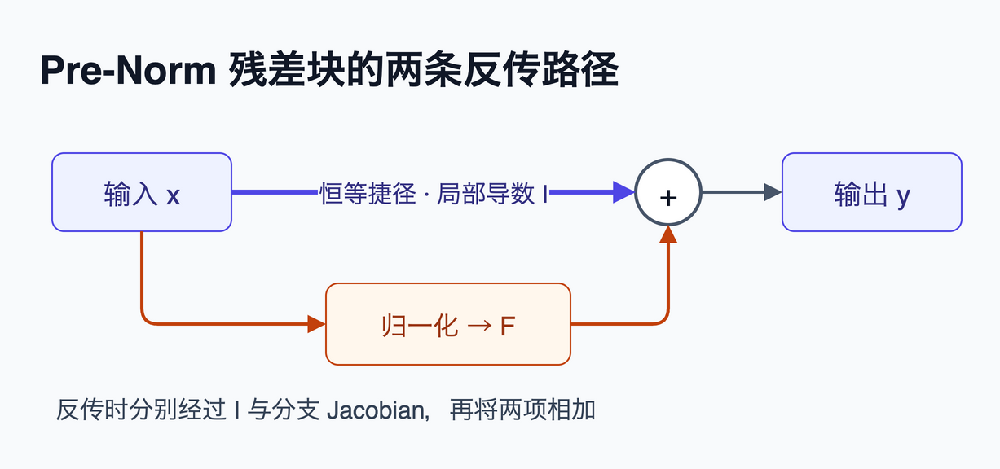
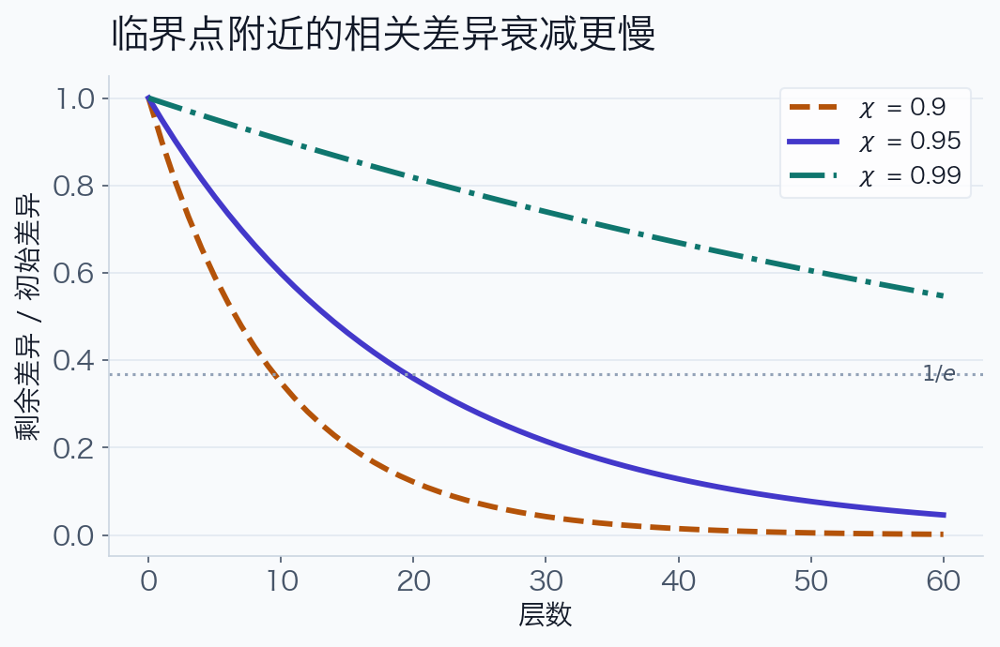
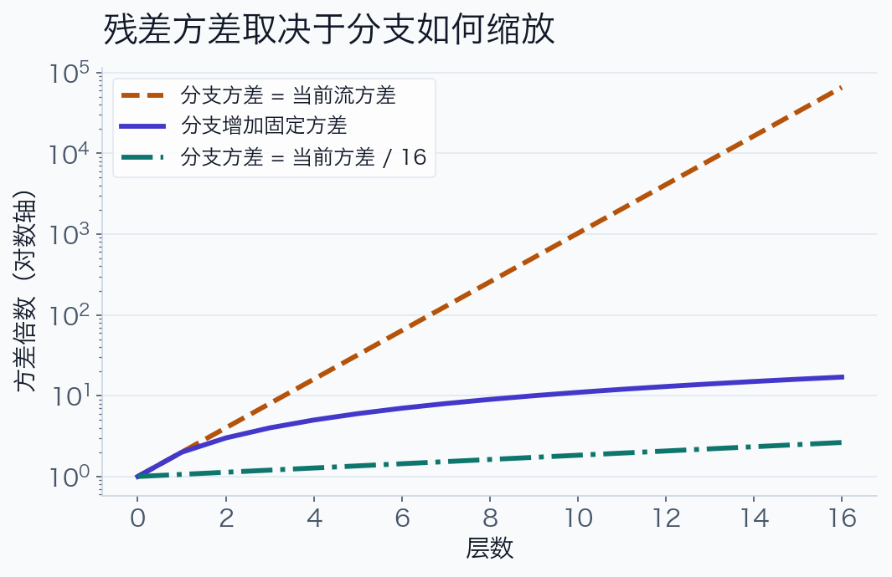
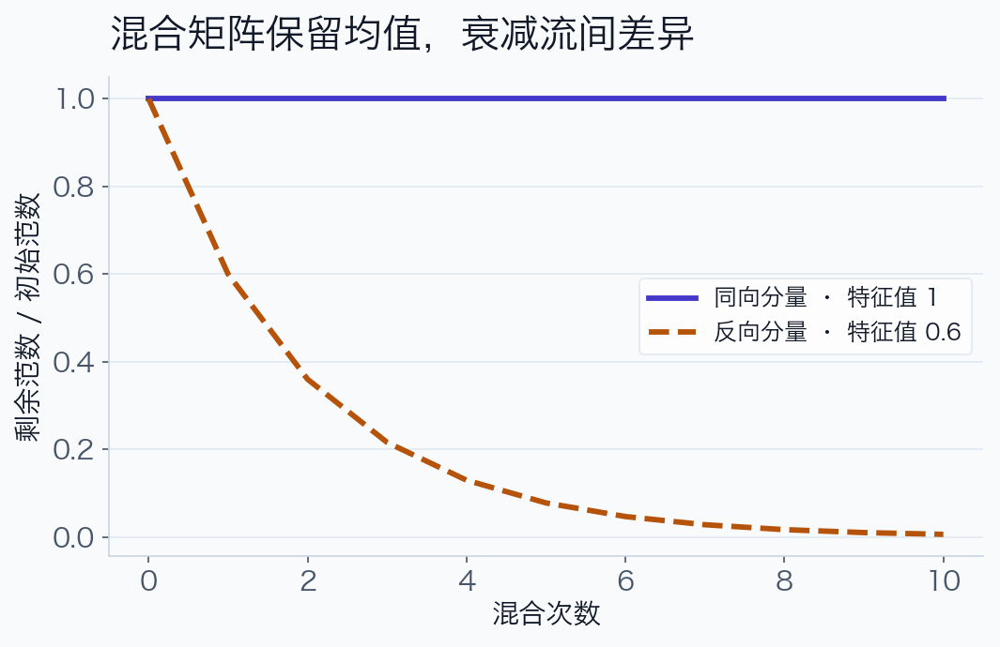

# 深度方向的信号传播

一个 34 层普通网络能用后面若干层近似恒等映射，理论上有机会复现一个 18 层模型。然而，在早期 ResNet 的对照中，普通网络加深后连**训练误差**都变大了。这首先是优化问题。网络表达能力的上界依然可能随深度增加，实际训练需要输入差异和梯度穿过同一串计算。

建议先掌握链式法则、方差与协方差、奇异值。读完这讲，应该能区分三个诊断：激活有多大、不同输入是否仍可区分、不同方向的梯度是否都能传播。[第 7 讲，PDF 第 3–18、20–33 页](https://deep-learning-alchemy.github.io/assets/slides/lecture_07.pdf)

## 恒等路径如何改变反向传播

*原创结构图。前向相加把输入分成两条梯度路径，直连项的局部导数是恒等矩阵。*

把尺寸相同的残差块写为 $x_{\ell+1}=x_\ell+F_\ell(x_\ell)$。从任意中间层 $j$ 展开到末层，得到

$$
x_L=x_j+\sum_{\ell=j}^{L-1}F_\ell(x_\ell),\qquad
J_{\ell+1,\ell}=I+J_{F_\ell}.
$$

每个相邻层 Jacobian 都含 $I$。展开 Jacobian 乘积时，有一项完全沿恒等路径传播，其他项包含一个或多个残差分支。分支导数仍可能缩放、旋转或抵消这些项，因此恒等路径提供了传播通道，端到端奇异值还需要独立检查。若把每层直连改成 $0.9x_\ell$，单是恒等路径对应的系数，100 层后就只有 $0.9^{100}\approx2.7\times10^{-5}$。

**残差网络的放置选择。** ResNet v1 在相加后使用 ReLU，因此负坐标经过直连也会被截断。全预激活 ResNet 将 BatchNorm 和 ReLU 移到卷积之前，配合等宽块的恒等捷径。He 等人的 CIFAR-10 ResNet-110 消融中，给主路径入口加门与给捷径加门影响相差很大，说明门放在哪里比「架构有门」这个标签更重要。Table 3 的 1001 层模型中，原始块测试错误率是 7.61%，预激活块是 4.92%，论文摘要的 4.62% 来自另一配置。分辨率或通道数发生变化时仍可能需要投影捷径。这个图像分类结果也提供了一个迁移边界，语言模型需要重新核验归一化、残差缩放和分支深度。 [He 等，Identity Mappings in Deep Residual Networks，§2–4 与 Tables 1–3](https://arxiv.org/abs/1603.05027)

**怎样理解短路径。** 若线性化每个块，$L$ 层的乘积展开有 $\binom{L}{k}$ 项经过 $k$ 个残差分支。项数在中间深度最多，每项的梯度大小则受分支 Jacobian 的乘积控制。课件引用的 ResNet 观察中，大部分有效梯度来自较短的路径。针对一些大语言模型的单层剔除，后面若干层对特定任务的边际影响也小。逐层剔除度量的是模型携带其余各层时的边际敏感度，同时删除多层需要另测。[第 7 讲，PDF 第 14–17 页](https://deep-learning-alchemy.github.io/assets/slides/lecture_07.pdf#page=14)

## 前向的尺度与几何

令宽度为 $n$ 的普通 MLP 使用独立权重 $W_{ij}\sim\mathcal N(0,\sigma_w^2/n)$ 和偏置 $b_i\sim\mathcal N(0,\sigma_b^2)$，定义 $q_\ell$ 为预激活方差。大宽度近似下，一层将方差映射为

$$
q_{\ell+1}=\sigma_w^2\,\mathbb E_{Z\sim\mathcal N(0,1)}
[\phi(\sqrt{q_\ell}Z)^2]+\sigma_b^2.
$$

若方差接近固定点 $q_*$，还可以跟踪两输入隐藏表示的相关系数 $c_\ell$。在 $c=1$ 附近，$1-c_{\ell+1}\approx\chi_1(1-c_\ell)$，其中

$$
\chi_1=\sigma_w^2\mathbb E[\phi'(\sqrt{q_*}Z)^2].
$$

在有序区 $\chi_1<1$，接近的输入越往后越相似，其差异按层衰减。比如 $\chi_1=0.95$ 时，每隔约 $-1/\log(0.95)\approx19.5$ 层，局部差异只剩原来的 $1/e$。混沌区 $\chi_1>1$ 时，$c=1$ 不稳定，两输入的相关性会向另一个固定点演化。这时应在实际固定点求相关递推导数来计算松弛深度。临界点附近的相关深度增长很快。

*公式示意，有序固定点附近的剩余差异按 χ 的层数次幂衰减。*

**论文延伸。** Schoenholz 等分别定义了方差和相关性的传播深度，给出了反向梯度方差的对应分析，并用深层全连接分类网络检验了可训练区域。对两输入使用独立 dropout 掩码时，即使初始表示完全相同，二者在一层后仍出现差别，$c=1$ 不再是固定点。仅调初始化方差以稳定单输入尺度，无法恢复论文里原来的相关临界点。这个推导依赖随机宽层和掩码假设，适用于理解机制，套用到有限宽且带残差的语言模型时需要重新测量。[Schoenholz 等，Deep Information Propagation，§2–4](https://arxiv.org/abs/1611.01232)

## 残差分支应该有多大

设 $q_\ell$ 为残差流每坐标方差，分支与残差流近似不相关，则

$$
q_{\ell+1}\approx q_\ell+\operatorname{Var}(F_\ell),\qquad
\operatorname{Var}(x+F)=\operatorname{Var}(x)+\operatorname{Var}(F)+2\operatorname{Cov}(x,F).
$$

- 分支方差若约为 $\alpha^2 q_\ell$，则尺度乘积为 $(1+\alpha^2)^\ell$。当深度为 $L$ 且 $\alpha=L^{-1/2}$，终点的方差倍数约为 $e$。
- Pre-Norm 使用 $x_{\ell+1}=x_\ell+F_\ell(\mathrm{Norm}(x_\ell))$。若各分支贡献近似同阶，残差方差约随深度线性增长，激活 RMS 约按 $\sqrt{\ell}$ 增长，分支相对残差流逐渐变小。
- Post-Norm 使用 $x_{\ell+1}=\mathrm{Norm}(x_\ell+F_\ell(x_\ell))$。归一化控制了输出的尺度，但直连导数也要乘归一化的 Jacobian。多层相乘可能衰减较早层的梯度。BN 依赖批次统计，LN/RMSNorm 的统计轴不同，以上方差计算应按具体结构检验。
- 分支前后都做归一化可约束输入和分支输出，信息仍可走未被归一化的捷径。另一种路线是 SkipInit、ReZero 或 Fixup，通过可学习分支系数或初始化规则从小更新开始，再让分支参与训练。

*公式示意，设初始方差为 1，流和分支近似不相关，对比未缩放、固定方差与 16 层缩放三种情况。纵轴为对数尺度。*

实测时在初始化和若干训练节点画三条曲线：残差 RMS、分支对残差的 RMS 比、损失对中间层的梯度 RMS。Post-Norm 的激活图可能平坦而早层梯度小，Pre-Norm 可能出现深层相对更新小。观察到方差变化以后，还可以测残差和分支的余弦，判断忽略协方差是否合理。[第 7 讲，PDF 第 25–33 页](https://deep-learning-alchemy.github.io/assets/slides/lecture_07.pdf#page=25)

## 没有残差连接也能训练吗

**动力学等距**要求端到端 Jacobian 的奇异值集中在 1 附近。$\mathrm{diag}(1.4,0.2)$ 的平均平方奇异值为 1，反复相乘时两个方向分别快速放大和衰减。方差统计可能掩盖这种分化。纯线性正交矩阵的乘积仍正交，加入 ReLU 后，部分方向可被导数为零的门截断。小预激活区的 tanh 导数更接近 1，配合正交初始化和临界方差，课件案例中的无残差网络能训练到一万层，但约 1200 层之后继续加深没有带来额外收益。

对于只做 token 混合的简化模型 $X_\ell=A_\ell X_{\ell-1}$，token Gram 矩阵满足 $\Sigma_\ell=A_\ell\Sigma_{\ell-1}A_\ell^\top$。假定为每层指定正定目标 $\Sigma_\ell=C_\ell C_\ell^\top$，令 $A_\ell=C_\ell C_{\ell-1}^{-1}$ 就可得到该目标。在真实 Transformer 中，普通 softmax attention 还必须满足归一化和因果结构，需要另外设计。课件的 E-SPA 案例让 36 层无残差模型在 WikiText-103 上从约 7.5 loss 降到 2.79，达到 Pre-LN 对照的训练损失约需 5 倍迭代。这两个量分别回答可训练性和训练效率。[第 7 讲，PDF 第 35–48 页](https://deep-learning-alchemy.github.io/assets/slides/lecture_07.pdf#page=35)

## 多条残差流与跨层路由

Hyper-Connections 保留 $n$ 条流，以矩阵 $H^{res}_\ell$ 混合直连路径，并用单独的可学习读入和写回权重使子层从多条流取输入、把更新发回多条流。初始化可让跳连近似恒等，训练中无约束乘积仍可能产生巨大的增益。

mHC 把 $H^{res}_\ell$ 约束为**双随机矩阵**，即非负且行和、列和均为 1。由 Jensen 不等式，对任意 $x$，

$$
\|Hx\|_2^2
=\sum_i\left(\sum_j H_{ij}x_j\right)^2
\le \sum_{i,j}H_{ij}x_j^2=\|x\|_2^2.
$$

因此精确投影后的纯混合矩阵不会放大二范数，且 $H\mathbf 1=\mathbf 1$。差异方向依然可能衰减。例如所有元素都是 $1/n$ 时，一次混合就只保留流的平均值。该结论覆盖残差混合矩阵的乘积，完整网络还包含读出、写回、分支变换和输入依赖混合产生的导数。

*公式示意。两流混合矩阵的对角元素为 0.8，非对角元素为 0.2。各流均值保留，差异在反复混合中衰减。*

**论文延伸。** 实现用 Sinkhorn-Knopp 交替归一化行列，20 轮得到近似投影。论文在 27B 设置报告混合传播指标最大值从 HC 的接近 3000 降至约 1.6。流扩张系数为 4 时，作者借助算子融合、重计算和流水线通信重叠将训练时间额外开销控制在 6.7%。这两个值都绑定论文的实现和测量口径。 [Xie 等，mHC，§4.2–4.3、§5.4 和 Appendix A](https://arxiv.org/abs/2512.24880)

另一条路线是 attention residuals。每个深度位置有一个学习到的查询，对早先各分支输出打分，再按权重读入。若初始查询为零，初始混合对可用源近似均匀。它允许后层按输入选择不同历史分支，代价包括保存或重算源输出。课件和 A4 都鼓励把深度注意力热图与 loss 一起看。[第 7 讲，PDF 第 49–58 页](https://deep-learning-alchemy.github.io/assets/slides/lecture_07.pdf#page=49)

## 作业与预测练习

A4 的前两题分别比较 Transformer 与 RNN 的深度稳定性。先复用检查点画逐层激活和梯度，再对变体单独调学习率，比较相对于各自基线的损失变化。第三题用跨层路由热图研究 attention residuals。保留同一数据、token 数和评估集，并记下参数数目和发散配置。[A4 说明](https://deep-learning-alchemy.github.io/assets/assignments/a4_architecture1.pdf) · [A4 代码](https://github.com/deep-learning-alchemy/assignments/tree/a4_release)

1. 某 80 层玩具网中，各层分支满足 $J_F=0$。捷径 A 的导数是 $I$，捷径 B 的导数是 $0.95I$。末层梯度范数设为 1，预测第一层梯度范数。**推理：** A 保持 1，B 为 $0.95^{80}\approx0.0165$。因此可以用这个极端设置单独检验捷径的衰减。
2. 两条残差流混合矩阵对角为 $0.8$、非对角为 $0.2$。若输入的两条流等长反向，经过 10 层纯混合后还留多少？**推理：** 此向量位于差异方向，特征值为 $0.6$，余量约为 $0.6^{10}=0.0060$。这个例子给出了双随机约束下仍需度量的差异丢失。
