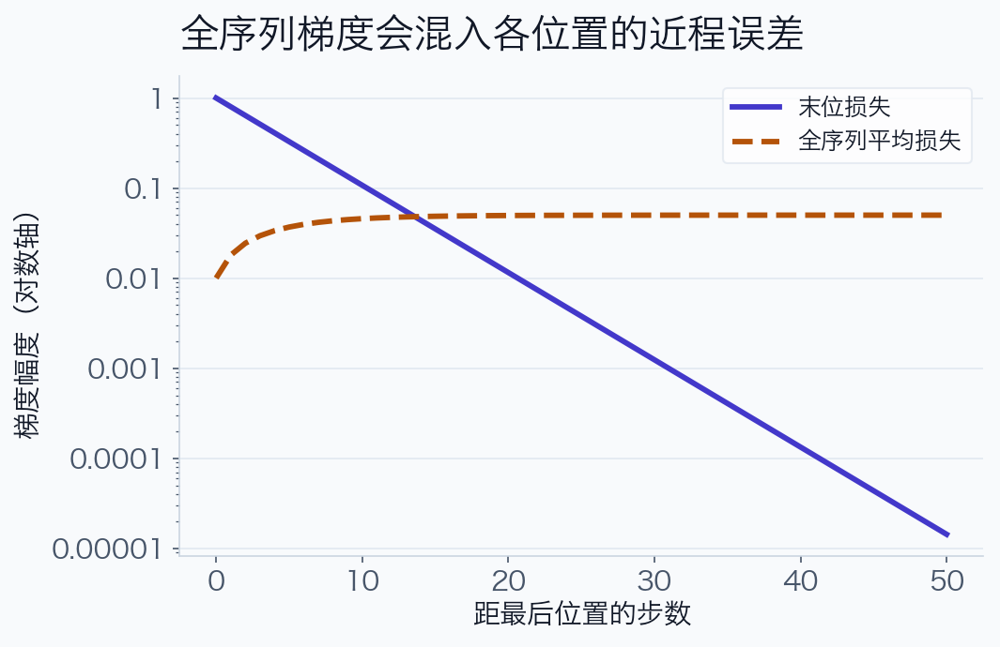
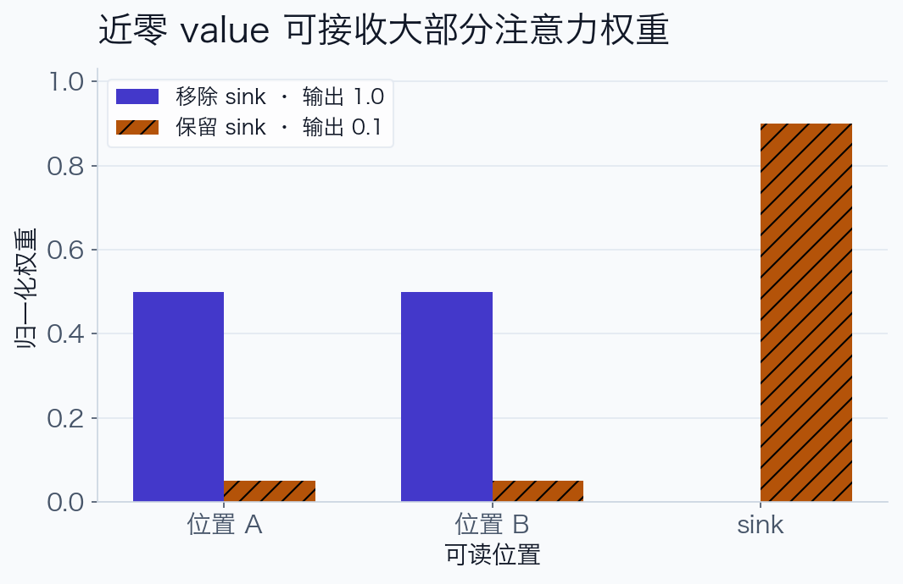
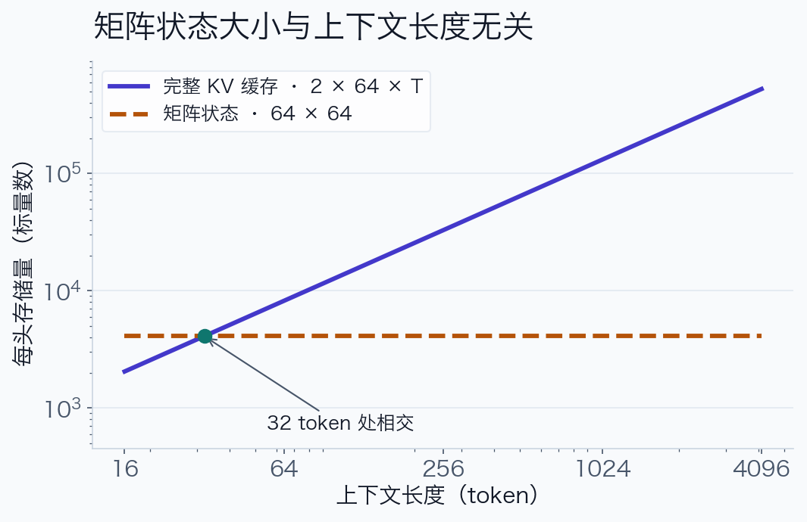
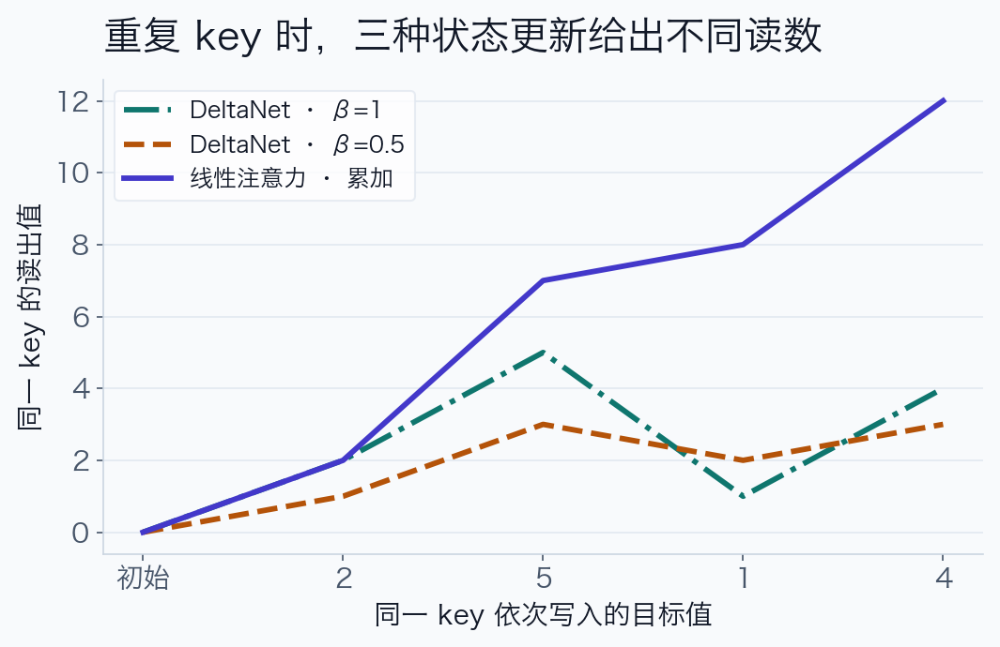

# 时间方向的信号传播与序列混合

预测下一 token 时，一个序列层要解决三个问题。**保留**衡量远处输入是否仍有影响。**混合**衡量当前输入能否选择合适的历史信息。**容量**衡量相同时间内可以携带多少可用信息。使用同样的验证集损失，可能掩盖两个模型在复制、检索或噪声过滤上的差别。读这讲需要矩阵外积、软最大值和链式法则。[第 8 讲，PDF 第 5–24 页](https://deep-learning-alchemy.github.io/assets/slides/lecture_08.pdf)

## 从普通 RNN 到可控的记忆

把 RNN 沿时间展开，普通单层形式为 $h_t=\tanh(Wh_{t-1}+Ux_t+b)$。对相隔 $k$ 步的状态，

$$
\frac{\partial h_t}{\partial h_{t-k}}
=J_tJ_{t-1}\cdots J_{t-k+1},\qquad J_s=\operatorname{diag}(1-h_s^2)W.
$$

每步共享 $W$，不同输入使 tanh 的导数变化。持续处于饱和区的坐标对历史信号不敏感。梯度爆炸则可能偶发，比如某个轨迹靠近损失变化陡峭的区域。标量近似可以提供数量级，$0.98^{200}\approx0.018$，每步只衰减两个百分点已经足以大幅削弱中距离信号。

*公式示意。100 个位置，每步 Jacobian 为 0.8，每个位置损失的局部导数均设为 1。纵轴为对数尺度。*

**论文延伸。** Pascanu 等用参数空间里的陡峭边界解释为什么一次超大更新可能越过窄的低损失区域。全局范数裁剪 $g\leftarrow g\min(1,\tau/\|g\|_2)$ 保留方向并限制异常步长。论文另提出软约束，使当前反向误差方向经过单步 Jacobian 后的范数与原值接近，并在合成长期依赖任务上比较裁剪和约束。裁剪处理异常的大梯度，小梯度的来源仍由时间 Jacobian 决定。[Pascanu、Mikolov 与 Bengio，On the Difficulty of Training Recurrent Neural Networks，§2–5](https://arxiv.org/abs/1211.5063)

LSTM 的细胞状态 $c_t=f_t\odot c_{t-1}+i_t\odot g_t$，输出为 $h_t=o_t\odot\tanh(c_t)$。若把门视为给定，细胞直连的导数是 $\prod_s f_s$ 的逐元素乘积。$f_t$ 接近 1 且 $i_t$ 接近 0 时，旧信息可原样传过这一时刻。GRU 将直连和写入用同一个更新门协调，例如写作 $h_t=(1-z_t)\odot h_{t-1}+z_t\odot \tilde h_t$，另有重置门控制旧状态怎样进入候选项。完整导数还要经过产生门和候选状态的递归支路。沿时间直接加一个无门的残差分支时，持续写入会累积状态幅度，是否有利取决于长期平均写入和梯度传播两方面。

课件回顾的早期调研发现，遗忘门、输出非线性、学习率搜索和随机种子在所测任务里比许多附加结构更重要。有研究通过截断或重排前缀发现，所测 LSTM 语言模型大约利用前 200 个 token 的上下文，最近约 50 个 token 的顺序最重要。这是特定数据和模型的行为测量，可以用同样干预检验另一模型。[第 8 讲，PDF 第 13–24 页](https://deep-learning-alchemy.github.io/assets/slides/lecture_08.pdf#page=13)

## Attention 的直接读取与注意力汇聚

因果点积注意力对当前查询 $q_t$，在所有 $s\le t$ 上计算 $a_{ts}=\operatorname{softmax}_{s\le t}(q_t^\top k_s/\sqrt{d_k})$，返回 $\sum_s a_{ts}v_s$。一层就能读到远处位置，所以缩短了时间方向的传播路径。不同得分形状实现不同功能。大部分概率集中到一项时接近检索，分布接近均匀时给出聚合统计。若当前层无需跨 token 更新，softmax 的总权重仍为 1，可以通过输出门缩小整个更新，也可以让某个近零 value 的位置接收概率。

*合成算例。A、B 的打分为 0、value 为 1，sink 的打分为 ln 18、value 为 0。移除 sink 会改变其他位置分到的概率。*

**注意力权重与因果影响。** 单个头的分数很高时，仍需看对应 value 和输出投影以及遮蔽后的 loss。课件列举了译文质量对大量头被剪除不敏感的实验，也列举了归纳头依靠前文的连续模式做复制的例子。前者支持冗余，后者说明一些头承担可干预验证的行为。对缓存也有具体影响，滑窗解码若驱逐作 sink 的初始位置，保留位置的权重会因重新归一化而变化。保留少量初始 KV 能显著改变流式模型的表现。

**论文延伸。** Gu 等比较了训练过程中何时出现 sink、数据和训练目标如何改变 sink 位置，以及显式 key bias 与 value 范数的作用。论文 Table 6 用归一化 sigmoid 与无归一化 sigmoid 区分了核函数和归一化的影响。保留归一化时仍能出现明显 sink，移除归一化后，在其 1B 设置里验证损失从 3.07 变为 3.10，sink 比例按论文统计从 45.1% 降到 2.5%。这里的比例以检测阈值统计注意力头，不能直接读作给第一个 token 的平均权重。显式近零 value 的偏置槽和输出门提供了两种对照，前者让多余权重有位置可分配，后者可缩放整条输出。Gu 等的结果支持归一化依赖是一个成因，论文也有归一化后依然无明显 sink 的另一核函数配置。[Gu 等，When Attention Sink Emerges in Language Models，§3–6、Tables 5–6](https://arxiv.org/abs/2410.10781) · [第 8 讲，PDF 第 26–35 页](https://deep-learning-alchemy.github.io/assets/slides/lecture_08.pdf#page=26)

## 矩阵状态如何存、读和改写

线性注意力使用 $q_t^\top k_s$ 对 value 加权。取 $S_t\in\mathbb R^{d_v\times d_k}$，因果顺序下可以先写后读。

$$
S_t=S_{t-1}+v_tk_t^\top,\qquad
y_t=S_tq_t.
$$

这来自 $\sum_{s\le t}v_s(k_s^\top q_t)=(\sum_{s\le t}v_sk_s^\top)q_t$。普通 softmax 包含针对每个查询都改变的指数项和分母，无法用同样的有限外积和精确重排。矩阵状态可递推，也能用分块或并行 scan 提高训练的硬件利用率。忽略投影，单头全序列注意力的混合成本约为 $O(T^2(d_k+d_v))$，逐步矩阵状态约为 $O(Td_kd_v)$。注意力解码保存 $O(T(d_k+d_v))$ 个 KV 标量，矩阵状态每头保持 $O(d_kd_v)$。相同数量级下，短序列吞吐、带宽和 kernel 效率依然要测。

*公式示意。单头的 key 和 value 维数均为 64，只计算此层用于解码的 KV 或递归状态标量数。横纵轴均为对数尺度。*

**状态扩展与输入选择。** SSM 用状态转移和读写描述一个序列算子。Mamba-2 的简化写法可在累加前施加输入依赖的全局衰减 $\gamma_t$，另外允许当前 value 直达输出。扩大矩阵状态的一维可增大存储量，外积写入仍适于计算。衰减提供时间选择性，但一次强衰减会同时削弱许多旧关联。

**DeltaNet 的误差更新。** 令当前 key 读出的旧值为 $S_{t-1}k_t$，对临时损失 $\frac12\|Sk_t-v_t\|^2$ 做一步梯度更新：

$$
S_t=S_{t-1}+\beta_t(v_t-S_{t-1}k_t)k_t^\top.
$$

当 $\|k_t\|=1$ 时，$\beta_t=1$ 令 $S_tk_t=v_t$，与 $k_t$ 正交的查询读数保持原值。附带衰减的 Gated DeltaNet 可以先对旧状态整体乘 $\gamma_t$，再针对当前 key 修改。取 $\gamma_t=1$ 且 $\beta_t=0$，状态完全保留，有助于穿过无关输入。两个门学习的是不同的操作：控制全局保留与控制当前方向的写入。课件比较 1.3B 模型时，纯 DeltaNet 在 8K 合成 passkey 表现强，但在长自然文章中的数字和 UUID 检索降幅明显。加门后，部分任务更好，优势依赖长度和干扰类型。[第 8 讲，PDF 第 36–43 页](https://deep-learning-alchemy.github.io/assets/slides/lecture_08.pdf#page=36)

*公式示意。对同一单位 key 依次写入 2、5、1、4，累加、完全覆盖和部分更新产生不同读数。*

**作者延伸。** Yang 的讲解将纯外积累加写成线性损失 $-\langle Sk_t,v_t\rangle$ 的梯度更新。DeltaNet 的平方误差目标显式使用当前预测值。博客在 MQAR 多查询关联回忆的所测高难设置报告了很高的准确率，同时 MAD 的综合平均分中 DeltaNet 低于 Transformer，因为其他子任务的表现并不一致。由此可设计更有针对性的诊断，分别评估关联覆盖、含噪条件检索和无关信息压缩。论文延续这个思路，还讨论如何用分块算法提高训练效率。[Songlin Yang，DeltaNet Explained (Part I)](https://sustcsonglin.github.io/blog/2024/deltanet-1/) · [Yang 等，Parallelizing Linear Transformers with the Delta Rule over Sequence Length](https://arxiv.org/abs/2406.06484)

## 容量取决于写入和读出

对单位 key $k_j$，外积和内的读出为 $S k_j=v_j+\sum_{i\ne j}v_i(k_i^\top k_j)$。交叉项是其他记忆造成的干扰。若 $d_k$ 维空间中各 key 都互相正交，最多容纳 $d_k$ 个正交 key。多个近正交 key 仍可在近似检索中使用，应报告误差阈值。已知所有 key/value 时可用最小二乘 $S=VK^+$ 作对照，衡量线性读出在给定表示下能做到多好。单层 MLP 的非线性读出也可作比较。显式 KV 缓存则为每个历史位置保存表示，其占用随上下文增长。

合成任务中一次低准确率可能有两个解释，状态和读出确实不能提供需要的信息，或当前优化配方没有学会利用表示。课件的 MQAR 对照提示不同混合器的可用学习率区间不同。可在同一长度下扫状态大小和学习率，再测是否对更长序列、更多 key 或不同 key 重复率泛化。相同 perplexity 也可能伴随不同的精确复制性能。混合架构在部分层用 recurrent state，在另一些层保留显式 attention，能同时测试两类机制，但最终吞吐还由保留的 KV 层数、批量和实现决定。[第 8 讲，PDF 第 45–56 页](https://deep-learning-alchemy.github.io/assets/slides/lecture_08.pdf#page=45)

## A4 作业与稳定性讲评

A4 要求分别测最后一个 token 的交叉熵 $L_T$ 与全序列平均损失 $L$ 对早期隐藏状态的梯度。$L_T$ 更直接衡量末端预测到远处状态的局部敏感度。$L$ 可通过每个位置的局部预测获得较强梯度。长程依赖的另一个证据是保持评估后缀相同，移除或破坏前缀，并测目标位置损失变化。沿深度还应同时比较激活尺度、分支更新相对尺度和梯度尺度。对时间递归的改动，可分别控制 time residual、norm 和输入依赖更新门，每种变体采用同一训练预算并独立调学习率。[A4 说明](https://deep-learning-alchemy.github.io/assets/assignments/a4_architecture1.pdf) · [A4 代码](https://github.com/deep-learning-alchemy/assignments/tree/a4_release)

| 官方讲评主题 | 适合复核的现象 |
| --- | --- |
| 归一化与逐层诊断 | Post-Norm 的激活 RMS 平坦，早层梯度偏小。去除残差的变体早层梯度更小，即使其激活可能增长很快。 |
| Transformer 和 RNN 的深度信号 | 两个残差模型的流 RMS 随深度增长幅度相近。在该配方中，位置旋转和归一化改动对 Transformer 的损失影响更明显。 |
| 时间信号 | 移除上下文对 Transformer 的影响大于 GRU 和普通 RNN。RNN 只对末位反传时出现明显的长距离衰减，全序列损失的梯度曲线平坦得多。 |
| 固定残差流的 RMS | 从训练中途保存尺度，再固定到各层，损失差约为 0.0043。直接固定到初始化尺度导致模型学不起来。 |
| 改动深度残差 | 将每子层的跳连改成跨两个子层的块级跳连，约有 0.1 NLL 损失差。末层的跨层 attention weights 略偏向较近的层。 |
| 改动时间更新 | 在所测配置中，损失顺序为 GRU、普通 RNN、归一化的 time residual、未归一化的 time residual。几个固定写入门相近，输入依赖门更好，测得有许多位置接近保留或完全写入的极端。 |

这些观察对应讲评中的特定课程设置。用其数值作预测先验时，记录数据、种子、调参预算和评估损失定义。[稳定性测验](https://deep-learning-alchemy.github.io/quiz-stability.html) · [稳定性讲评，PDF 第 2–40 页](https://deep-learning-alchemy.github.io/assets/quizzes/stability_answer_slides.pdf)

## 预测练习

1. 状态 $S_0=0$。同一个单位 key 先与标量 2 配对、再与 5 配对。用普通线性注意力或 $\beta=1$ 的 DeltaNet 更新后分别读到什么？**推理：** 累加读到 $2+5=7$。DeltaNet 第二次更新校正旧预测 2 与目标 5 的差，读到 5。若改用 $\beta=0.5$，两步依次读到 1 和 3。
2. 标量递归每步 Jacobian 为 0.8，末位置损失对 $h_{100}$ 的导数为 1。它对 $h_{50}$ 的梯度是多少？如果每个位置都添加一个有相同局部导数的损失呢？**推理：** 第一种为 $0.8^{50}\approx1.4\times10^{-5}$。若 100 个位置的损失取平均，第二种的局部梯度在同号假设下约为 $\frac{1}{100}\sum_{i=0}^{50}0.8^i\approx0.05$。用第二种梯度曲线判断末位记忆会高估远程依赖。
