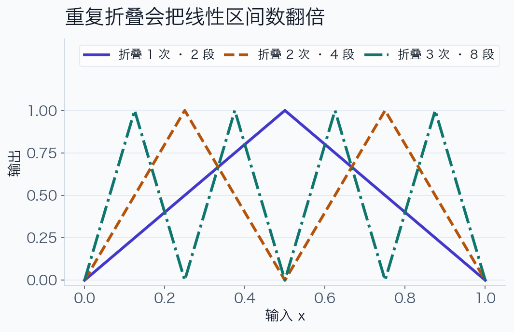
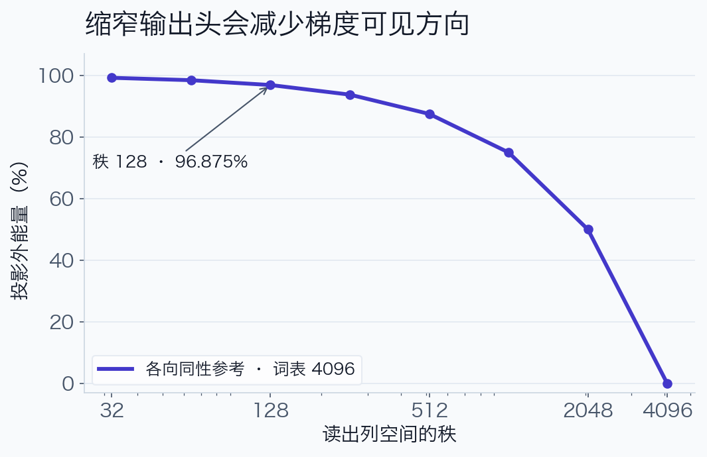
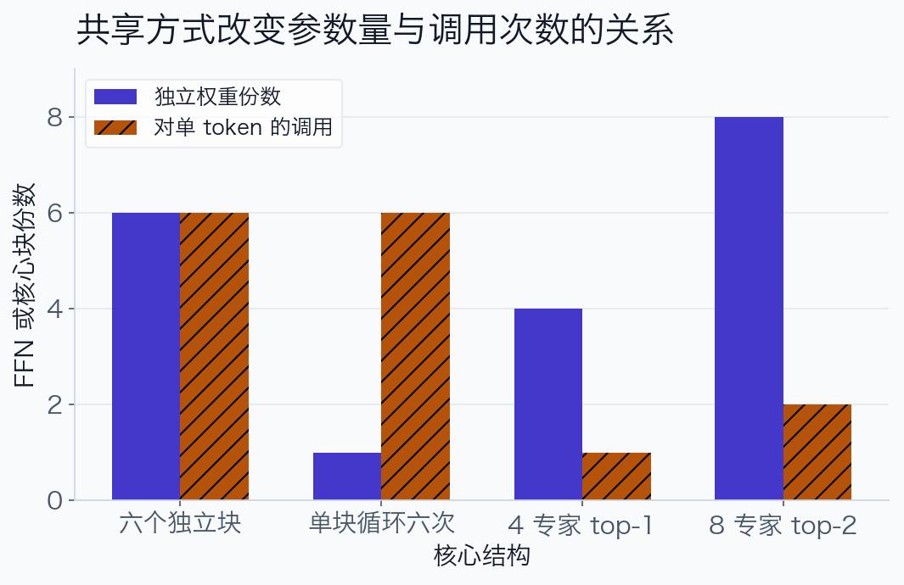
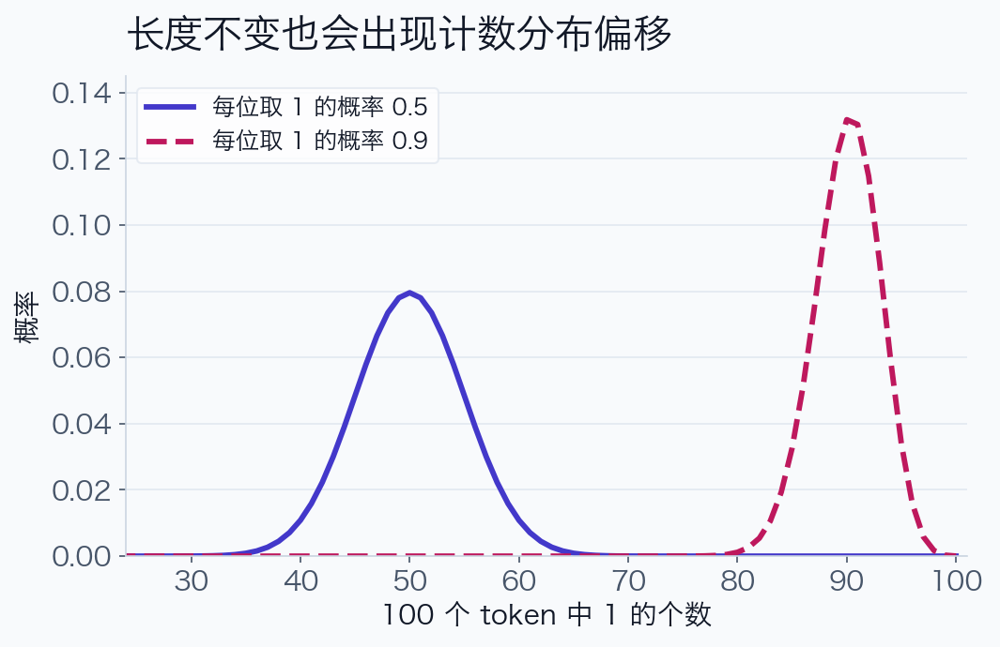

# 模型容量与表达能力

「把模型加大」有几种具体做法。加宽隐藏层可以扩大每步的表示空间。堆叠独立块可以增加顺序变换次数。增加低频激活的专家可以扩大存储参数量。循环调用同一个块可以增加计算的深度。判断哪项改动有效，需要明确目标函数、训练和推理预算、以及用来测量容量的任务。本讲需要一点矩阵秩、ReLU 和交叉熵的基础。[第 9 讲](https://deep-learning-alchemy.github.io/assets/slides/lecture_09.pdf)

## 深度把简单变换组合成复杂函数

通用近似定理给出了存在性：对紧集上的连续目标，在合适的非多项式激活条件下，可以用足够宽的单隐藏层网络逼近。要估计资源，还需问误差能有多小、需要多少单元。举例说，若在 $d$ 维单位方块以每维约 $1/\varepsilon$ 个网格点采样，点数随 $d$ 指数增长。这样的构造能证明可近似，却很难提供实际网络宽度。

ReLU 记作 $[x]_+=\max(x,0)$。在 $[0,1]$ 上构造一个从 0 升到 1 再降回 0 的分段线性函数

$$
f(x)=2[x]_+-4[x-1/2]_+.
$$

每段都覆盖完整区间 $[0,1]$，所以再执行一次 $f$ 会让每段分裂为两段。执行 $r$ 次得到 $2^r$ 段，所有段交替升降。一个隐藏层的 $m$ 个 ReLU 在一维最多产生 $m+1$ 段，精确复现需要至少 $2^r-1$ 个转折点。近似下也可数过 $1/2$ 阈值的次数。过阈值次数太少时，在不少区间会落到目标的另一侧，面积误差有下界。

*公式示意。三条曲线由同一折叠函数迭代得到，每多一次复合，线性分段数加倍。*

**论文延伸。** Telgarsky 的正式结论里，对每个 $k$ 都有深度 $2k^3+8$、仅常数个单元每层的 ReLU 目标，使至多 $k$ 层、至多 $2^k$ 个节点的指定半代数门网络在单位立方体上的平均绝对误差至少为 $1/64$。论文还分析卷积与最大值门以及树模型。其配套结果讨论了为何不能把这个特殊构造的难度推广到任意目标或任意标注。更高维的区域折叠与二层、三层网络间的径向函数分离是另外两种深度证据，各有独立假设。经验上，课件里的语言模型损失在一些中等宽深比范围内对形状较稳健，视觉模型和下游任务有时对形状更敏感。应在自己关心的指标上同时检查性能与层串行延迟。[Telgarsky，Benefits of Depth in Neural Networks，Theorems 1.1 和 3.12](https://arxiv.org/abs/1602.04485) · [第 9 讲，PDF 第 4–18 页](https://deep-learning-alchemy.github.io/assets/slides/lecture_09.pdf#page=4)

## 网络实际使用了多少复杂度

对 ReLU 网络固定输入线段 $x(t)=c+tv$。每一段区域内，激活模式固定，网络在内部为仿射函数。统计神经元预激活零点，可以估计沿线段实际经过多少分段。随机初始化没有专门安排一层的折点反复覆盖前层范围，因此极端构造的指数增长不容易出现。对上面的折叠例子，第 $j$ 层的一点误差可能被剩下层的斜率放大到约 $2^{r-j}$ 倍，折叠位置随之偏移。

**论文延伸。** Hanin 与 Rolnick 用零水平集的局部几何来研究线性区域边界。某神经元在指定小段转为激活的概率同时受其偏置密度和输入方向导数影响。定理对适用的随机初始化给出沿线段平均区域数的线性量级，取决于线段长度和神经元总数。到最近边界的典型间距约与总神经元数成反比。他们又观察了训练中的 ReLU 网络，MNIST 等实验的区域复杂度并未接近理论最大值。沿线测量是一个有用的复杂度探针，结论也受采样方向、数据附近的位置和随机初始化假设影响。课件的频率学习例子则提示，低频分量可能先被拟合，训练步数会改变测出的实际复杂度。[Hanin 与 Rolnick，Complexity of Linear Regions in Deep Networks，Theorems 1–3](https://arxiv.org/abs/1901.09021) · [第 9 讲，PDF 第 25–31 页](https://deep-learning-alchemy.github.io/assets/slides/lecture_09.pdf#page=25)

## 两种矩阵秩瓶颈

**词表读出。** 给定 $M$ 个上下文，把最终隐藏状态叠成 $H\in\mathbb R^{M\times d}$，无偏置读出权重为 $W\in\mathbb R^{V\times d}$。logit 矩阵 $Z=HW^\top$ 的秩至多 $d$。若对每行做 log-softmax，$\log P=Z-a\mathbf1^\top$，其中 $a$ 给每行的 log-sum-exp。这个归一化修正的秩至多 1，所以 $\operatorname{rank}(\log P)\le d+1$。对同一行任意词对作 log-odds 差会消去归一化常数。带偏置的情形需要将偏置项记在秩计数里，或对上下文方向中心化消掉常数偏置。

**论文延伸。** Yang 等将所有目标上下文的 log-probability 视为矩阵，分析了任意逐行常数偏移下所需的最小秩。将多个隐藏表示先线性混合再走单个 softmax，只能得到一条共同输出子空间。将各组件 softmax 后再在概率空间混合，则 $\log p(y\mid h)=\log\sum_j\pi_j(h)p_j(y\mid h)$，可越过前面的秩约束。论文在 Penn Treebank 的采样上下文上用奇异值阈值估计秩，单 softmax 读出秩约为 400，MoS 接近一万。增加组件数需要更多词表打分，且经验秩与损失改善不会在所有设置中同步。[Yang 等，Breaking the Softmax Bottleneck，§2、§4.3、Appendix C.5](https://arxiv.org/abs/1711.03953)

**反向路径。** 对词表交叉熵，令 $g=p-e_y$。回传到隐藏状态的是 $W^\top g$。只有 $g$ 在 $W$ 的列空间中的投影有影响。若该空间的正交基为 $U$，A5 用跨批次的平方范数比 $\sum\|g-UU^\top g\|^2/\sum\|g\|^2$ 衡量投影外能量。随机独立的 $r$ 维子空间有参考值 $1-r/V$，实际词表梯度和词向量可能相关。还要区分这个能量指标与回传梯度实际大小，$W^\top$ 的奇异值也会缩放保留下来的分量。SpamLang 的每条序列重复一个随机符号，目标规则可用很低维的打分实现，但大词表下训练仍可能变慢。该对照将训练信号问题与前向表达力区分开来。

*公式示意。读出秩为 128 时，随机独立子空间的投影外能量参考为 96.875%。真实词表梯度应与这条参考线比较。*

A5 的三种改动分别测试概率混合（MoS）、logit 的逐坐标非线性（Sigsoftmax）、从前缀位置直接计算 token 复制概率（CPLM）。后者用指针注意力累加同词的所有位置，给隐藏状态增加一条经过指针的梯度路径。CPLM 的门把当前预测分给词表和复制分支，复制分支还可通过 sink 将质量归还词表。读出秩、可达 log-probability 秩、梯度传输和损失是四项不同测量。[Godey 与 Artzi，LM Head Gradient Bottleneck](https://arxiv.org/abs/2603.10145) · [Copy-Paste Language Models](https://arxiv.org/abs/2610.19247) · [A5，PDF 第 4–5 页](https://deep-learning-alchemy.github.io/assets/assignments/a5_capacity.pdf#page=4)

**注意力打分。** 单头在应用掩码前的分数矩阵 $QK^\top$ 的秩至多为 head dimension。因果掩码会变化，逐行 softmax 也会改变矩阵秩，所以要核对目标是打分还是归一化权重。一个低维点积头仍可能通过将正确 key 放在最匹配的位置实现尖锐检索。要实现各行不同、分散在许多位置的复杂权重，低维头的匹配误差可能更高。固定 hidden size 增加头数通常会减小单头维数，需要在并行模式数和单头容量间权衡。课程用 BERT 的头数与头维数对照、目标注意力权重的 KL 误差以及稀疏平均任务说明这两种能力的区别。稀疏平均的对照是让查询指定少量早期位置求均值。固定状态若要应对最后才到达的任意查询，需要保留足够多的早期数值，在论文式下界中还必须约定精度、近似误差和任务分布。[第 9 讲，PDF 第 33–43 页](https://deep-learning-alchemy.github.io/assets/slides/lecture_09.pdf#page=33)

## 稀疏专家与重复计算

MoE 把每块的一个 MLP 换成 $E$ 个专家，路由器由当前 token 表示给专家打分，推理仅执行 top-$k$。$E$ 增大时，总参数和部署内存可能显著增长，激活的专家 FLOPs 主要随 $k$ 变。还要算路由、打包和通信。固定输入相关路由可让同类输入经常落入同组，逐次独立均匀抽签则缺少这种连续性。仅用硬 argmax 且合并权重为常数时，任务梯度很难直接进入路由器。可乘选中专家的概率来提供梯度。A5 对照负载均衡损失、归一化路由、训练时噪声、专家同初始化和基于历史分配的偏置。

区分 token 层面的置信度与整批使用情况。专家负载变异系数用分配比例 $f_1,\ldots,f_E$ 的标准差除以平均值。概率熵对每个 token 的软概率分布计算再取平均。所有 token 都以高置信度均匀分到各专家时，两项指标可同时接近零。路由质量最终由同预算损失和实际系统成本评估。[第 9 讲，PDF 第 19–22 页](https://deep-learning-alchemy.github.io/assets/slides/lecture_09.pdf#page=19) · [A5，PDF 第 6 页](https://deep-learning-alchemy.github.io/assets/assignments/a5_capacity.pdf#page=6) · [Fedus、Zoph 与 Shazeer，Switch Transformers](https://arxiv.org/abs/2101.03961)

循环块将存储和计算再分离。A5 用一个前置块和一个尾块夹住六次核心块调用。独立核心有六份参数，单块六次循环只有一份核心参数，前向仍计算六次。梯度会从各次调用累积到同一参数。训练循环数固定时，评估时再加循环可能越过模型训练时见过的激活分布。A5 用边界归一化和前置块输出注入分开检验信号传播，还比较训练中途在共享和独立参数之间转换。由共享块复制六份可保持切换瞬间的函数，此后的六份梯度不同。反向取权重均值一般也改变前向函数。切换实验应带上同点重置优化器的对照。[A5，PDF 第 7–8 页](https://deep-learning-alchemy.github.io/assets/assignments/a5_capacity.pdf#page=7)

*原创算例。循环两组按核心块计，MoE 两组按专家 FFN 计。份数用于展示共享与路由机制，各组不直接换算成 FLOPs。*

## 并行处理有限状态计算

有限状态机读到每个 token 后应用状态转移 $T_{x_t}$。状态按顺序更新，转移函数本身满足结合律，$(T_c\circ T_b)\circ T_a=T_c\circ(T_b\circ T_a)$。将状态表示成 one-hot 向量，转移可写成矩阵，子序列转移矩阵可由成对组合得到。并行前缀计算用 $O(\log T)$ 轮构造序列所有前缀的转移，模型的顺序层数于是可以远小于上下文长度。奇偶校验还可以先统计 1 的个数，再模 2。对训练时见过的有限计数范围，这条计算路径尤其短。

**论文延伸。** Liu 等证明指定计算模型下有多项式规模的 $O(\log T)$ 深度构造，对有可解代数结构的半自动机给出常深度方案。实验用 19 个半自动机及长度 100 的训练序列，报告用有限深度的 Transformer 获得超过 99% 的同分布准确率，并通过一维格点的最近边界检测头观察内部行为。论文使用 20 次复现中的最佳结果来检验能否学到捷径，训练稳定性另有专门分析。对奇偶任务改变 1 的频率，或测试训练序列长度之外的输入，可以触发计数外推失败。[Liu 等，Transformers Learn Shortcuts to Automata，§3–5](https://arxiv.org/abs/2210.10749)

*公式示意。两条曲线都是长度为 100 的二项计数分布。长度保持固定时，模型也可能遇到训练罕见的计数。*

复杂度上界还取决于运算模型。课件用两个电路类作参照，无界 fan-in 的常深度布尔电路 $\mathrm{AC}^0$ 无法计算任意长度上的奇偶，带阈值门的 $\mathrm{TC}^0$ 可以。若 $\mathrm{TC}^0\ne\mathrm{NC}^1$，对应的常深度模型仍无法模拟某些含不可解群的半自动机。加入中间 token 后，生成步骤也计入计算深度。在对数精度、projected pre-norm 等形式假设下，线性数量的额外解码步骤足以识别所有正则语言。这个结论描述架构构造所需的资源，预训练模型能否学到该算法需要独立实验。[Merrill 与 Sabharwal，The Expressive Power of Transformers with Chain of Thought](https://arxiv.org/abs/2310.07923) · [第 9 讲，PDF 第 44–50 页](https://deep-learning-alchemy.github.io/assets/slides/lecture_09.pdf#page=44)

## A5 作业与容量测验

A5 采用同一批数据、token 预算和评估方式比较不同模型。深宽比实验可先用公开数据点画 loss 对估计训练 FLOPs。需要记录尚未完成的超参数搜索，使用同学习率的极端宽深配置作为额外对照。另画存储参数和推理 FLOPs，尤其要区分 MoE 和循环块。若要比较不同 FLOPs 的方法，可以用密集模型拟合曲线 $L_{\rm ref}(C)=L_\infty+A(C/C_0)^{-\alpha}$。将变体损失代入逆函数得到密集等效成本 $C_{\rm eq}$，比较 $C_{\rm eq}/C_{\rm actual}$。比较结果取决于基准配方和拟合范围，损失接近拟合下界时逆算尤其敏感。[A5 说明](https://deep-learning-alchemy.github.io/assets/assignments/a5_capacity.pdf) · [A5 代码](https://github.com/deep-learning-alchemy/assignments/tree/a5_release)

官方容量测验在提交后显示实际测量和解释。下面按实验主题摘述适合复核的现象。

| 比较维度 | 官方测验的观测 |
| --- | --- |
| 深度和宽度 | 近似参数匹配时，极端窄深优于单层极宽，标准 d8 又优于极端窄深。较温和的窄深与宽浅变体在题设阈值内接近。 |
| 循环 | 所测检查点通常在训练指定的循环次数上损失最低。中途从共享核心长成独立各层，优于继续共享，仍落后于全程独立的对照。 |
| 读出 | Sigsoftmax 在所测两种秩都接近基线。MoS 在秩 64 时改善更明显，CPLM 在两种秩都有改善。按损失匹配等效秩时，结论依赖所给秩网格。 |
| 专家路由 | 无额外均衡的学习路由与固定的输入相关路由在给定阈值内打平，两者优于逐次随机路由。路由组合的排序受学习率搜索和所选配方限制。 |
| 路由诊断 | 同一检查点的负载变异系数和 softmax 熵随层变化不同，逐层都要检查。 |
| 循环和专家联合分配 | 在题设的总参数、激活和八次块计算限制下，所测全密集对照最佳。这个顺序来自单种子和特定配方。 |

[容量测验与交互讲评](https://deep-learning-alchemy.github.io/quiz-capacity.html) · [容量测验 PDF](https://deep-learning-alchemy.github.io/assets/quizzes/capacity_prediction_quiz.pdf)

## 预测练习

1. 词表有 4096 个词，读出列空间的秩为 128。若词表梯度方向各向同性，平均能量有多少落到列空间外？**推理：** 每个正交方向期望能量相同，外部占 $(4096-128)/4096=96.875\%$。用真实梯度图和这个基线对照，可测试训练是否使列空间和梯度方向对齐。
2. 一批共有 100 个 token，四专家路由把 token 等量分成四组。若每个 token 在本专家上的概率为 $0.99$，预测负载变异系数和归一化熵。**推理：** $f_e$ 都为 0.25，变异系数为零。若剩余概率均匀分配，归一化熵约 $0.048$，接近零。两项低值同时成立，分别表示均衡和高置信度。
3. 用长度 100 且独立公平的二进制串训练一个奇偶模型。测试时保持 100 位，把 1 的概率调到 0.9。**推理：** 明确的逐位翻转算法仍计算同一个规则。若模型只拟合了训练中常见的 1 的计数范围，测试中接近 90 的计数会触发外推。可画以真实 1 的个数为横轴的准确率曲线，比较纯长度变化与计数分布变化。
