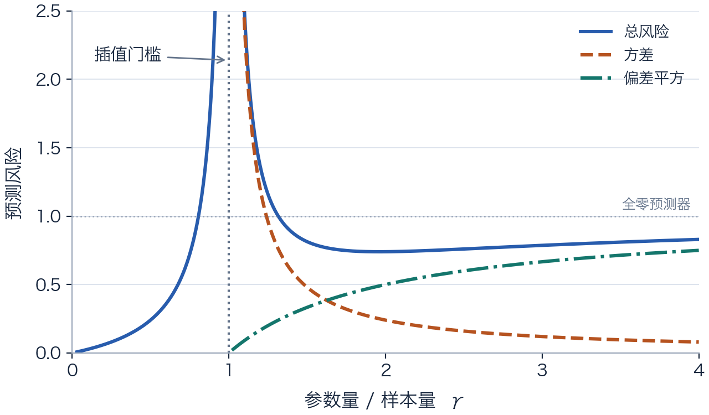
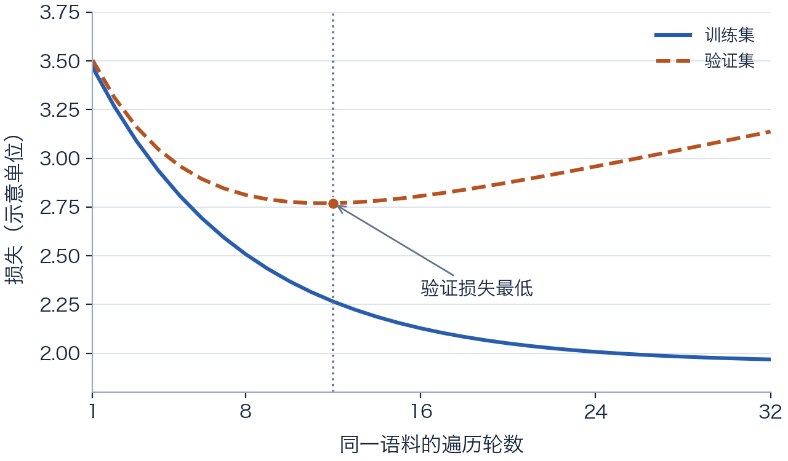
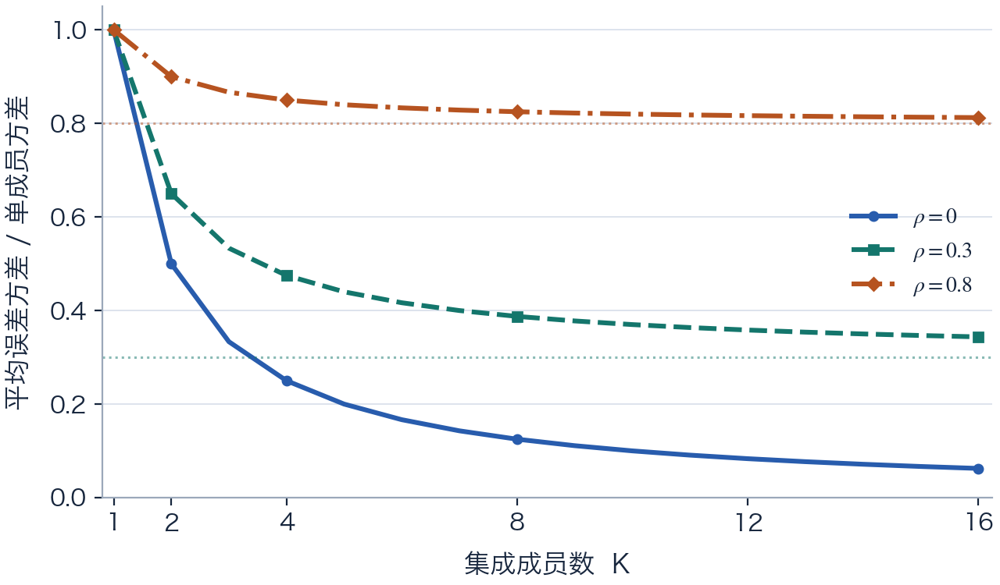
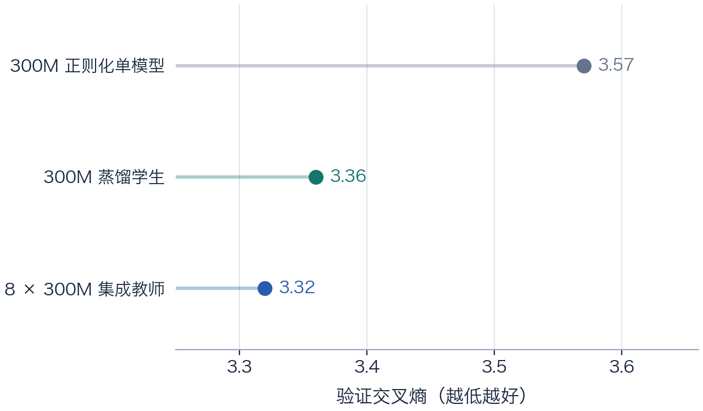
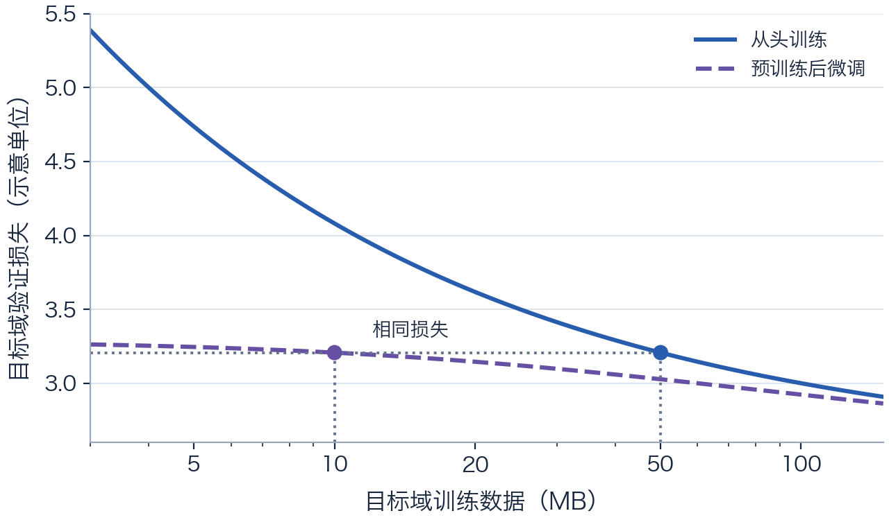

# 数据有限时的泛化与迁移

假设只有 2 亿个互异训练 token，训练预算却增加了十倍。把同一批数据重复十遍、扩大单个模型、或独立训练多个模型，分别会怎样影响验证损失？这三个操作增加的都是计算量，但改变的是不同变量。

[课程导读](#cs312-guide.md) · [官方 Lecture 10 PDF](https://deep-learning-alchemy.github.io/assets/slides/lecture_10.pdf)

## 先写清楚预算

| 约束 | 实验会比较什么 |
| --- | --- |
| 训练 FLOPs 固定、可获取新数据 | 在参数量 $N$ 与处理 token 数 $T$ 之间分配预算。对稠密 Transformer，可用 $C\approx 6NT$ 做粗略估算；长序列和具体算子会影响精确口径。 |
| 独立训练数据固定、计算可增加 | 设独立 token 预算为 $D$、遍历轮数为 $E$，则 $T\approx ED$。增加 $E$ 改变优化过程和重复暴露次数，新增独立训练 token 数为零。 |
| 部署成本受限 | 除训练损失外，还要比较单次推理成本和延迟。多模型集成可提高训练数据的利用效率，也增加线上前向计算量。 |

Chinchilla 实验研究第一种约束，其经验配比依赖数据分布、模型和预算范围。本讲主要研究第二种，并用蒸馏考察第三种。课件第 2–13 页分别说明这些预算以及数据有限时的几类干预。 [Hoffmann 等，Training Compute-Optimal Large Language Models](https://arxiv.org/abs/2203.15556)

## 最小范数插值与双下降

设 $y=Xw_\star+\varepsilon$，$X$ 有 $n$ 行样本和 $p$ 列特征。若 $p>n$ 且 $X$ 满行秩，训练集能被精确拟合。每个解都可写成最小范数解 $\hat w_{\min}=X^\top(XX^\top)^{-1}y$ 加上一个零空间向量。由零初始化对平方损失做全批量梯度下降，每次更新都是 $X^\top$ 乘以一个残差向量，因此轨迹始终在行空间。当步长允许收敛时，极限就是行空间中的唯一插值解。这是**隐式正则化**的一例。

在 $X=USV^\top$ 的紧致奇异值分解中，最小范数解沿第 $i$ 个右奇异向量的系数为 $u_i^\top y/s_i$。若 $s_i$ 很小，标签噪声在这个方向上可能被放大。岭回归用 $\|Xw-y\|^2+\lambda\|w\|^2$ 显式改变目标，对应系数变成 $s_i u_i^\top y/(s_i^2+\lambda)$，抑制小奇异值方向的放大。在高斯权重先验和高斯观测噪声下，这个目标也是 MAP 估计，相应的 $\lambda$ 为噪声方差除以先验方差。课件第 15–24 页可配合这一推导阅读。

### 指定阅读 1 · Hastie 等对插值风险的定量分解

在各向同性特征、线性目标、独立标签噪声，以及 $p/n\to\gamma$ 的高维极限下，论文第 3 节给出相对于无噪声回归函数的预测风险。设 $r^2=\|w_\star\|^2$、噪声方差为 $\sigma^2$，则

$$
R(\gamma)=
\begin{cases}
\sigma^2\gamma/(1-\gamma), & \gamma<1,\\
r^2(1-1/\gamma)+\sigma^2/(\gamma-1), & \gamma>1.
\end{cases}
$$

插值门槛两侧都可能出现噪声方差峰值。超过门槛之后，方差项下降，零空间中的真实信号增加造成的偏差却会上升。拿全零预测器的风险 $r^2$ 作基准，$\gamma>1$ 一侧只有在信噪比大于 1 且 $\gamma$ 足够大时才会优于它。这个对照可以防止把“测试风险下降”直接读成“预测器已经有效”。论文第 4 节进一步允许特征相关，风险取决于真实权重与特征协方差特征向量的对齐情况。第 8 节用随机特征研究改变特征数、维持原始输入维度的情形。 [Hastie、Montanari、Rosset 与 Tibshirani，Surprises in High-Dimensional Ridgeless Least Squares Interpolation](https://arxiv.org/abs/1903.08560)

**图 11.1 · 双下降与风险分解。** 根据上式取 $r^2=1$、$\sigma^2=0.24$ 计算，纵轴截到 2.5 以便看清门槛两侧。$\gamma=1$ 处风险发散。门槛右侧的方差迅速回落，偏差平方逐渐上升。

## 固定语料下的三个干预

### 重复训练与显式正则化

先看训练损失和验证损失的分叉。继续训练后如果训练损失下降而验证损失回升，额外更新对两者的作用已经不同。扩大参数量时，每个大小都应重新搜索学习率、轮数和 weight decay。对于 AdamW，仅考虑衰减项，整段训练的累计倍率为 $\prod_t(1-\eta_t\lambda)$；调整轮数或学习率调度就会改变这个倍率。要研究衰减本身，还可以同时记录参数范数和相对更新幅度 $\|\Delta w\|/\|w\|$。第 04 章有相应的优化动力学。 [优化器动力学与权重衰减](#04-optimizer-dynamics.md)

**图 11.2 · 重复训练时的过拟合。** 自构教学曲线，两条线在同一组 checkpoint 上评估，独立语料量始终固定。约第 12 轮验证损失达到最低点，而训练损失随后仍下降。

### 集成的两个比较口径

每个成员接受相同语料但使用不同训练随机性。对同一上下文，用 $\bar z=K^{-1}\sum_i z_i$ 聚合 logits，然后计算 $\operatorname{softmax}(\bar z)$。结果等价于逐类概率的归一化几何平均。可以比较总参数量相当的单模型与集成，也可以在不同总成本下拟合验证损失曲线。独立训练只规定随机性来源，成员预测误差仍可能高度相关。

设简化模型中成员的某个标量预测误差方差为 $s^2$，两两相关系数为 $\rho$，平均后的方差为 $s^2[\rho+(1-\rho)/K]$。这个模型说明增加成员主要消减不共享的误差。交叉熵还受偏差、概率校准和 logit 聚合方式影响。该式的方差斜率只适用于简化模型。

**图 11.3 · 集成的方差下限。** 由等相关模型计算。$K=8$ 时，无相关误差的相对方差是 $0.125$，$\rho=0.8$ 时则为 $0.825$。横虚线给出成员数趋于无穷时的下限。

### 指定阅读 2 · Kim 等如何估计数据效率

- **基线与外推。** 作者在固定独立 token 数下，联合调整学习率、训练轮数和 weight decay。部分设置中的最佳衰减系数约为常用值的 30 倍。以 2 亿 token 为例，单模型正则化参数缩放拟合的验证损失渐近值约为 3.43。联合缩放先在固定成员大小下拟合成员数趋于无穷的极限，再外推成员大小；得到约 3.17。附录 C.4 区分了取极限的次序，附录 H 给出拟合与敏感性分析。5.17 倍数据效率是把该渐近损失映射回基线的数据曲线得出的估计。 [Kim、Kotha、Liang 与 Hashimoto，§3–5、附录 C.4、H](https://arxiv.org/html/2509.14786v1)
- **全局最低损失不一定来自最好的单模型配方。** 论文分别改变训练数据顺序和参数初始化，在其设置中，只改变其中一个来源也可以获得大部分集成收益。单成员验证损失的最优超参数与集成渐近损失的最优超参数可以不同。Dropout 和成员集成都能引入随机性，比较时应同时记录训练和推理成本。 [Kim 等，§4、附录 C](https://arxiv.org/html/2509.14786v1)
- **蒸馏有独立的部署收益。** 论文用教师无条件生成的文本和原始文本一起训练学生。单个 300M 学生相对正则化单模型把损失从约 3.57 降至 3.36，八成员教师约为 3.32。按损失差计算，学生保留约 83% 的改善。相同大小的教师与学生也可通过自蒸馏改善损失。对比实验需要记录合成数据和原始数据的混合比例、训练预算以及独立下游指标。该文还分别测量预训练下游任务和数学继续预训练；后者的 17.5 倍数据效率对应特定配方与基线。 [Kim 等，§6–7、附录 E–G](https://arxiv.org/html/2509.14786v1)

**图 11.4 · 从八成员教师到单个学生。** 根据 Kim 等 §6.1 报告的三个损失值重新作图。横轴放大到 3.25–3.66。学生到基线相差约 0.21，到教师相差约 0.04。 [Kim 等，图 9](https://arxiv.org/html/2509.14786v1#S6.F9)

原图可按问题查找。第 29–45 页比较重复训练与正则化，第 46–60 页比较成员数与参数量，第 61–75 页比较独立 token 预算，第 76–90 页讨论蒸馏和下游评估。 [官方课件](https://deep-learning-alchemy.github.io/assets/slides/lecture_10.pdf#page=29)

## 预训练怎样减少目标域数据需求

先区分两个过程。**上下文学习**把示例放进输入，模型参数固定。**微调**用目标样本更新模型权重。两个过程都可以利用已经学到的特征。若模型已掌握词法和基础语法，少量标注可能足以确定一项新分类任务的标签规则。贝叶斯解释将这种现象写成对潜在任务 $z$ 的后验预测 $p(y\mid x,S)=\sum_z p(y\mid x,z)p(z\mid x,S)$，其中 $S$ 是上下文中的示例。它描述了一类可能机制。Xie 等在隐马尔可夫模型混合分布与特定假设下证明了相应结果，并在合成数据上检验了示例顺序等效应。 [Xie 等，An Explanation of In-context Learning as Implicit Bayesian Inference](https://arxiv.org/abs/2111.02080)

### 指定阅读 3 · Hernandez 等用从头训练衡量迁移

固定目标模型大小 $N$，用 $D_F$ 个目标域字符微调，得到验证损失 $L_F$。在同尺寸模型的从头训练曲线上找到达到 $L_F$ 所需的目标域数据量 $D_E$，定义 $D_T=D_E-D_F$。例如，微调用 10MB 达到从头训练用 50MB 的损失，则转移量为 40MB，有效数据倍率为 5。对真实曲线需统一分词、评估集合和学习率搜索，并检查 $L_F$ 是否落在可比较范围内。

**图 11.5 · 用等损失水平线读出有效数据量。** 自构示例。紫线表示微调 10 MB，蓝线表示从头训练用 50 MB；两点使用相同的验证损失。横轴为对数，倍率直接用两个数据量相除。

作者在低数据区拟合 $D_T\approx k D_F^\alpha N^\beta$。文本迁移至 Python 的拟合中 $\alpha\approx0.18$、$\beta\approx0.38$。由此得出，同一模型下若目标样本增加，额外转移量仍可增加，但有效数据倍率 $1+D_T/D_F$ 下降。第 3.1 节还有一个反例：若目标数据充足，论文测试的部分小模型从头训练优于微调，作者称之为 *ossification*。这个结果来自其特定模型与优化设置，微调的计算优势也取决于是否把已有模型的预训练成本计入。 [Hernandez、Kaplan、Henighan 与 McCandlish，Scaling Laws for Transfer，§1–3、附录 A](https://arxiv.org/pdf/2102.01293)

### 微调验收

课件第 91–115 页给出三个评估方向，可以用同一组 checkpoint 记录。

| 要回答的问题 | 观察量与对照 |
| --- | --- |
| 预训练优势是否传递到目标任务？ | 比较从头训练和微调的目标域验证曲线。在给定预算下分别调学习率；如果优化器状态不可用，把重新 warmup 作为独立设置。WSD（warmup、stable、decay）提供可在稳定段接续、再对目标阶段退火的调度思路。 |
| 源域能力保留多少？ | 记录微调前后的源域测试分数。比较纯目标域更新和混入部分源域样本的 replay 设置。 |
| 目标域收益能否外推？ | 预先定义域外切分，例如更长文本或不同写作来源。并列报告源域、目标域和域外指标，以便区分训练交接、遗忘与分布变化。 |

可以画一条**学习–遗忘权衡曲线**。每个点对应不同 checkpoint 或微调学习率，横轴用源域损失增量，纵轴用目标域损失；两个指标越低越好。Watts 等通过预训练阶段的 SAM、较高学习率和缩短退火，观察到更有利的权衡。Li 等比较不同预训练 token/参数比，发现 AdamW 和 Muon 的微调排序会随预训练数据量翻转。 [Watts 等，Sharpness-Aware Pretraining](https://proceedings.mlr.press/v306/watts26a.html) · [Li 等，Pretraining Data Scale Reverses the Muon-AdamW Fine-Tuning Gap](https://arxiv.org/abs/2611.03633)

没有源域原件时，可用冻结的初始模型生成 replay 样本，再检查是否保留了原有行为。Marek 等在语言模型实验中观察到这种做法可缓解遗忘，在剩余容量受限时仍有遗忘。域外测试也要区分训练数据来源与数量。Fang 等固定模型和数据规模做对照，在其 CLIP 自然分布变化设置中发现，预训练数据的来源分布解释了大部分稳健性差距。 [Marek 等，Forgetting in Language Models](https://arxiv.org/abs/2605.26097) · [Fang 等，Data Determines Distributional Robustness in CLIP](https://proceedings.mlr.press/v162/fang22a.html)

## 自学实验与预测题

[A6](https://deep-learning-alchemy.github.io/assets/assignments/a6_generalization.pdf) 的问题覆盖架构、正则化、优化与微调。可用一个小型文本语料做同类对照。固定独立训练数据和验证集，改变训练轮数与 weight decay 形成二维网格。每个设置使用配对随机种子，分别画训练和验证损失对处理 token 的曲线。额外比较同一组成员的单模型均值与 logit 集成结果，并记下各自的推理成本。

1. **线性回归的特征数由 $p=0.98n$ 增至 $1.02n$，训练误差下降。测试误差会继续下降吗？** 两个设置都接近插值门槛。在各向同性模型中，风险可由噪声放大主导。加入 ridge 或移到更远的 $p/n$ 后再比较，可区分噪声放大与表达能力不足。
2. **独立 token 数固定且只能部署一个 300M 模型。用集成验证损失当作最终效果有什么问题？** 部署预算适用于学生模型。应实际蒸馏并测量学生的验证损失、源域与目标域得分，同时记录教师集成的训练开销。
3. **微调数据由 10MB 增到 100MB，转移量按 $D_F^{0.18}$ 变化。数据倍率会怎样？** 固定 $N$ 且仍在拟合区内，$D_T$ 乘约 1.51，而 $D_T/D_F$ 降至原先约 0.15 倍。低数据区的倍率不宜直接外推到目标数据充足的情形。
