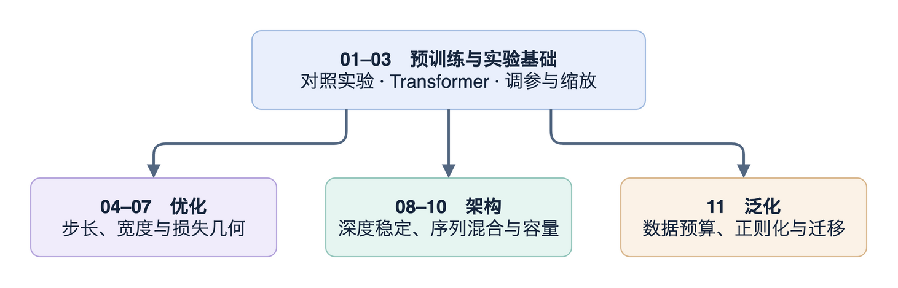

# Stanford CS 312 · Deep Learning Alchemy

Stanford 2026 年秋季课程的中文自学笔记。课程训练的是预测实验结果的能力。每章从一个训练问题入手，补足所需的数学和工程背景，再结合课件和指定阅读解释现象。建议先写下预测和判断依据，再对照讲义、原论文和官方测验。

**课程结构。** 第 01–03 章建立共同的训练与实验背景。后三部分依次关注训练怎么走、模型如何传递和存储信息，以及数据变少时哪些方法仍然有效。

## 学习顺序与原始课件

资料核对日期为 **2026 年 11 月 17 日**。下表覆盖官网当天已公开的 **10 套主讲课件、1 套补充课件、4 套测验讲评**，以及 2 份同讲次的 PPTX 和 LLMs 101 补充讲义。课表指定的 **28 项阅读**包括 25 篇论文和 3 篇作者技术文章，原文入口及延伸解读见各章。

| 本站笔记 | 官方日期与主题 | 官方课件 |
| --- | --- | --- |
| [01 · 用实验预测建立训练直觉](#01-introduction.md) | 9/22 · Introduction | [Lecture 01 PDF](https://deep-learning-alchemy.github.io/assets/slides/lecture_01.pdf) |
| [02 · LLM 预训练基础](#02-llms-101.md) | 9/23 · LLMs 101 | [Slides](https://deep-learning-alchemy.github.io/assets/slides/llms_101_slides.pdf) · [Handout](https://deep-learning-alchemy.github.io/assets/slides/llms_101_handout.pdf) |
| [03 · 调参与缩放规律](#03-training-basics.md) | 9/24 · Basics | [Lecture 02 PDF](https://deep-learning-alchemy.github.io/assets/slides/lecture_02.pdf) |
| [04 · 优化器动力学与权重衰减](#04-optimizer-dynamics.md) | 10/1 · Optimization 1 | [Lecture 03 PDF](https://deep-learning-alchemy.github.io/assets/slides/lecture_03.pdf) · [PPTX](https://deep-learning-alchemy.github.io/assets/slides/lecture_03.pptx) |
| [05 · 宽度缩放、μP 与 Muon](#05-width-and-muon.md) | 10/6 · Optimization 1 | [Lecture 04 PDF](https://deep-learning-alchemy.github.io/assets/slides/lecture_04.pdf) |
| [06 · 损失景观与训练轨迹](#06-loss-landscapes.md) | 10/13 · Optimization 2 | [Lecture 05 PDF](https://deep-learning-alchemy.github.io/assets/slides/lecture_05.pdf) |
| [07 · 稳定性边缘与平坦性](#07-edge-of-stability.md) | 10/15 · Optimization 2 | [Lecture 06 PDF](https://deep-learning-alchemy.github.io/assets/slides/lecture_06.pdf) · [PPTX](https://deep-learning-alchemy.github.io/assets/slides/lecture_06.pptx) |
| [08 · 深度方向的信号传播](#08-depth-stability.md) | 10/22 · Architecture 1 | [Lecture 07 PDF](https://deep-learning-alchemy.github.io/assets/slides/lecture_07.pdf) |
| [09 · 序列混合与长程依赖](#09-sequence-mixing.md) | 10/27 · Architecture 1 | [Lecture 08 PDF](https://deep-learning-alchemy.github.io/assets/slides/lecture_08.pdf) |
| [10 · 模型容量与表达能力](#10-model-capacity.md) | 11/5 · Architecture 2 | [Lecture 09 PDF](https://deep-learning-alchemy.github.io/assets/slides/lecture_09.pdf) |
| [11 · 数据有限时的泛化与迁移](#11-generalization.md) | 11/12 · Generalization | [Lecture 10 PDF](https://deep-learning-alchemy.github.io/assets/slides/lecture_10.pdf) |

已经熟悉预训练流程的读者可以快速浏览前两章，再从第 03 章开始。阅读实验曲线时，先确认横轴的单位（步数、处理过的 token、独立 token 或 FLOPs），再比较终点、波动和随机种子差异。

## 官方测验与讲评

| 日期与主题 | 在线练习与打印版 | 讲评 |
| --- | --- | --- |
| 9/29 · Basics | [在线测验](https://deep-learning-alchemy.github.io/quiz-basics.html) · [试卷 PDF](https://deep-learning-alchemy.github.io/assets/quizzes/basics_prediction_quiz.pdf) | [讲评 PDF](https://deep-learning-alchemy.github.io/assets/quizzes/basics_answer_slides.pdf) · [笔记第 03 章](#03-training-basics.md) |
| 10/8 · Optimization 1 | [在线测验](https://deep-learning-alchemy.github.io/quiz-hyperparameter-scaling.html) · [试卷 PDF](https://deep-learning-alchemy.github.io/assets/quizzes/hyperparameter_scaling_prediction_quiz.pdf) | [讲评 PDF](https://deep-learning-alchemy.github.io/assets/quizzes/hyperparameter_scaling_answer_slides.pdf) · [笔记第 05 章](#05-width-and-muon.md) |
| 10/20 · Optimization 2 | [在线测验](https://deep-learning-alchemy.github.io/quiz-optimization-2.html) · [试卷 PDF](https://deep-learning-alchemy.github.io/assets/quizzes/optimization2_prediction_quiz.pdf) | [讲评 PDF](https://deep-learning-alchemy.github.io/assets/quizzes/optimization2_answer_slides.pdf) · [解析 PDF](https://deep-learning-alchemy.github.io/assets/quizzes/optimization2_solutions.pdf) · [笔记第 07 章](#07-edge-of-stability.md) |
| 10/29 · Architecture 1 | [在线测验](https://deep-learning-alchemy.github.io/quiz-stability.html) · [试卷 PDF](https://deep-learning-alchemy.github.io/assets/quizzes/stability_prediction_quiz.pdf) | [讲评 PDF](https://deep-learning-alchemy.github.io/assets/quizzes/stability_answer_slides.pdf) · [笔记第 09 章](#09-sequence-mixing.md) |
| 11/10 · Architecture 2 | [在线测验](https://deep-learning-alchemy.github.io/quiz-capacity.html) · [试卷 PDF](https://deep-learning-alchemy.github.io/assets/quizzes/capacity_prediction_quiz.pdf) | 官网提供在线反馈，课表尚无独立讲评课件 · [笔记第 10 章](#10-model-capacity.md) |

## 官方作业索引

| 作业 | 官方材料 |
| --- | --- |
| A1 · 超参数与缩放 | [说明](https://deep-learning-alchemy.github.io/assets/assignments/a1_basics.pdf) · [代码](https://github.com/deep-learning-alchemy/assignments/tree/a1_release) |
| A2 · 超参数随规模变化 | [说明](https://deep-learning-alchemy.github.io/assets/assignments/a2_hyperparameter_scaling.pdf) · [代码](https://github.com/deep-learning-alchemy/assignments/tree/a2_release) |
| A3 · 损失景观 | [说明](https://deep-learning-alchemy.github.io/assets/assignments/a3_optimization2.pdf) · [代码](https://github.com/deep-learning-alchemy/assignments/tree/a3_release) |
| A4 · 架构稳定性 | [说明](https://deep-learning-alchemy.github.io/assets/assignments/a4_architecture1.pdf) · [代码](https://github.com/deep-learning-alchemy/assignments/tree/a4_release) |
| A5 · 模型容量 | [说明](https://deep-learning-alchemy.github.io/assets/assignments/a5_capacity.pdf) · [代码](https://github.com/deep-learning-alchemy/assignments/tree/a5_release) |
| A6 · 泛化 | [说明](https://deep-learning-alchemy.github.io/assets/assignments/a6_generalization.pdf) · [代码](https://github.com/deep-learning-alchemy/assignments/tree/a6_release) |

## 待发布

课程表中，11/17 的 Generalization 第二讲、11/19 的 Generalization 测验、12/1 的 Exotic 讲座和 12/3 的 Exotic 测验均标注为 TBA。A7 已列入日程，说明与代码链接待发布。可在课程官网查看后续更新。 [Stanford CS 312 官方课表](https://deep-learning-alchemy.github.io/#schedule)

## Acknowledgements · 致谢

感谢 Stanford CS 312 授课教师 **Tatsunori Hashimoto**、**Suhas Kotha**，课程助教 **Kaiyue Wen**、**Tristan Thrush**，以及参与课程材料制作与分享的人员。实验预测式教学、课程主题、原始课件、讲义、作业和测验均来自课程团队。各章注明推荐阅读及对应作者。 [Stanford CS 312 官方网站](https://deep-learning-alchemy.github.io/)

本站提供独立编写的中文自学笔记，包括补充推导、阅读解读及原创预测练习。本站与 Stanford 或课程团队无隶属关系。课件、试卷、代码及论文保留各自权利归属，原件从官方入口查看。
