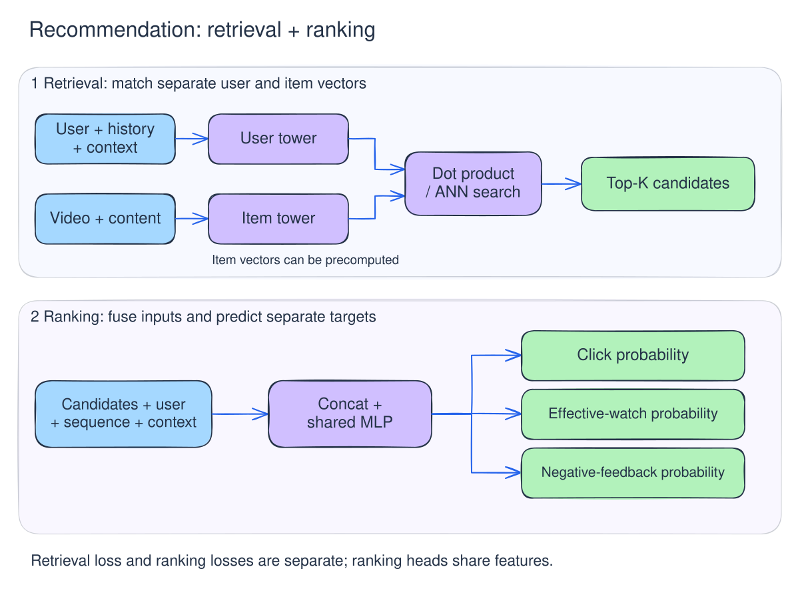
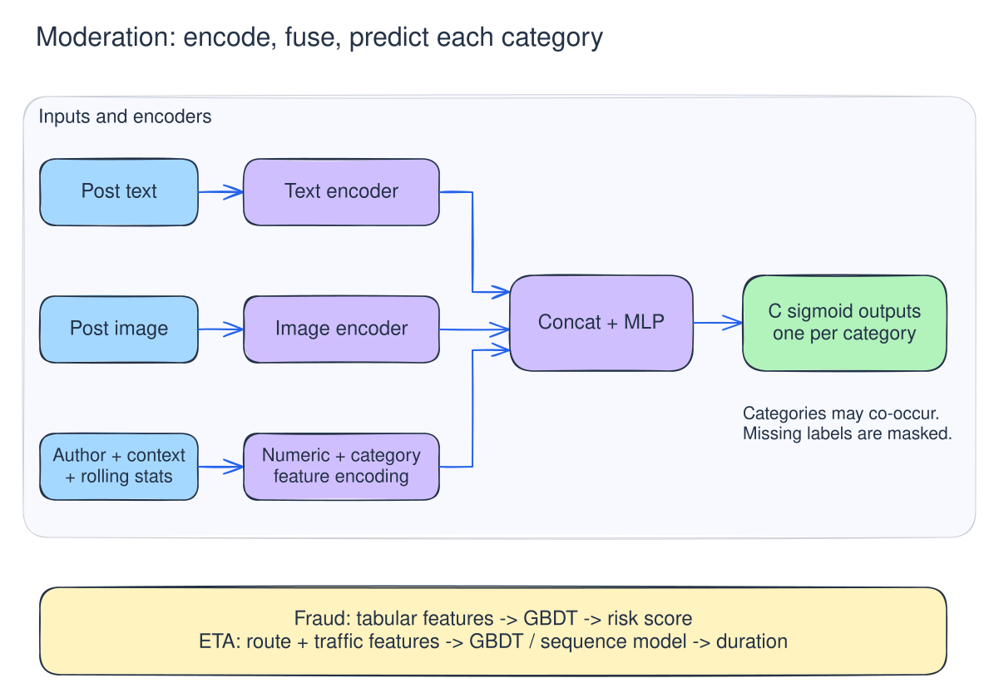
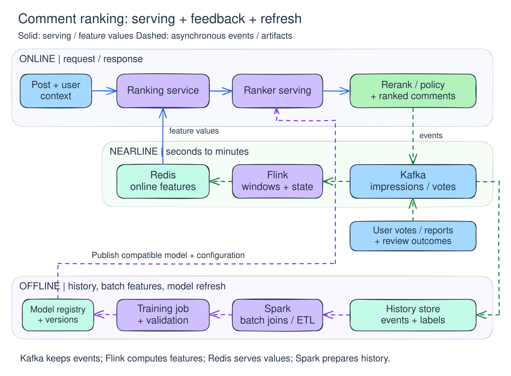

# ML System Design Tutorial · 第一部分：通用解题流程

ML system design 回答分八步：先讲清端到端方案，再选两个核心问题深挖。

## 0. 流程总览

1. **Functional requirements**：系统为谁完成什么任务？
2. **Non-functional requirements**：需满足哪些规模、延迟、可靠性与成本约束？
3. **Data / feature engineering**：训练数据、标签和线上特征从哪里来？
4. **Model**：如何定义预测任务、训练目标与模型结构？
5. **High-level design**：如何连接数据、训练、部署与线上请求？
6. **Inference / evaluation**：如何完成推理，并验证系统效果？
7. **Deep dives（约两个）**：哪些关键问题最值得深入，如何取舍？
8. **Potential follow-ups**：需求或约束变化后如何调整？

前一步的结论直接作为后一步的输入；拿到新信息时可回退修正假设与方案。

| 环节 | 应当得到的结论 |
| --- | --- |
| Functional requirements | 核心用户流程、输入输出、业务目标、设计范围 |
| Non-functional requirements | 量化的规模假设、服务目标与约束优先级 |
| Data / feature engineering | 样本与标签定义、数据来源、特征及其更新方式 |
| Model | baseline、主要模型、训练目标与选型依据 |
| High-level design | 离线训练、在线服务、反馈回流的完整链路 |
| Inference / evaluation | 推理策略、离线与线上评估、监控和回滚方式 |
| Deep dives | 两个关键问题的具体方案、替代方案与取舍 |
| Potential follow-ups | 对变化条件的判断及相应调整 |

## 1. Functional requirements · 功能需求

**先用一句话串起主流程**（输入 → 系统处理 → 输出 → 用户动作 / 结果），再拆出约 3 条核心功能。这一步只界定产品行为，不展开组件和模型。

### 三条功能的结构

1. **基本功能**：核心任务（如按 query 返回相关结果）。
2. **延伸功能**：主流程上的关键补充（如条件筛选、上下文或个性化，属于当前 scope，区别于条件变化后的 follow-ups）。
3. **高级功能 / 反馈**：多轮交互、解释与引用，或收集用户反馈、人工复核。

### 可以说哪些功能？

| 方向 | 可以说的内容 |
| --- | --- |
| 核心能力 | 推荐内容、搜索结果、识别违规、生成回答 |
| 个性化 / 上下文 | 根据用户兴趣、当前位置、当前会话调整结果 |
| 用户控制 | 按条件筛选、屏蔽内容、修改偏好 |
| 反馈 / 人工处理 | 点赞或点踩、举报、申诉、人工审核 |
| 特定交互 | 多轮追问、展示引用、解释决策原因 |

**按题选择最重要的三条，每条一句话，写成“用户可以……”或“系统支持……”。**

### 常见题目：三条需求示例

| 题目 | 1 | 2 | 3 |
| --- | --- | --- | --- |
| 推荐 Feed | 为用户返回个性化内容列表 | 支持屏蔽作者或不感兴趣的内容 | 支持点赞、点踩等反馈 |
| 搜索 | 根据 query 返回相关结果 | 支持类目、价格等条件筛选 | 支持拼写纠错与查询建议 |
| 内容审核 | 对提交内容识别违规类别 | 根据审核结果放行、拦截或转人工 | 支持用户申诉和人工复核 |
| 知识库问答 | 根据知识库回答用户问题 | 展示支持回答的来源引用 | 支持结合会话上下文多轮追问 |

下面用 10 道题练习三条功能需求的写法。

| 题目 | 1 · 基本功能 | 2 · 延伸功能 | 3 · 高级功能 / 反馈 |
| --- | --- | --- | --- |
| Airbnb Price Prediction · 房源定价 | 根据房源和目标日期提供建议价格 | 允许房东设置价格上下限并调整建议 | 记录采纳、改价和预订结果 |
| Harmful Content Detection · 有害内容识别 | 识别文本、图片中的违规类别 | 按类别和风险执行放行、限制传播或拦截 | 支持举报、申诉和人工复核 |
| Video Recommendation · 视频推荐 | 返回个性化视频列表 | 结合本次会话的观看行为调整后续推荐 | 记录观看、跳过和不感兴趣反馈 |
| Reddit Comments Ranking · 评论排序 | 为帖子返回排序后的评论 | 支持最佳、最新等排序方式 | 支持赞踩、举报并记录展示位置 |
| Customer Churn Prediction · 用户流失预测 | 预测用户在指定时间窗口内的流失风险 | 向运营提供高风险用户名单与主要风险因素 | 记录干预措施、用户响应和后续留存 |
| Account Takeover Detection · 账号接管检测 | 判断登录或敏感操作的账号接管风险 | 按风险触发额外验证或限制操作 | 支持用户确认异常、申诉和人工复核 |
| Address Autofill · 地址补全 | 根据输入前缀返回候选地址 | 支持位置偏好和拼写纠错 | 记录候选展示、选择和地址修改 |
| Nearby Restaurant Recommendation · 附近餐厅推荐 | 根据位置推荐附近餐厅 | 支持菜系、价位和营业状态筛选 | 记录点击、到店 / 下单和评分反馈 |
| Payment Fraud Detection · 支付欺诈检测 | 对交易判断欺诈风险 | 按风险放行、追加验证或转人工审核 | 接收拒付、调查结果与申诉结论 |
| Map Traffic Forecasting · 地图交通预测 | 预测路段在未来时间窗口内的速度或拥堵程度 | 支持按区域、出发时间查询预测路况 | 接收后续实测速度，核对预测与实际结果 |

### 反馈和 label 的关系

- **显式反馈**：赞踩、不感兴趣、人工纠正；可以作为偏好或审核标签。
- **隐式反馈**：点击、观看、跳过；通常是代理信号，需要关联曝光、位置和上下文。
- **后续结果**：预订、留存、实测速度、调查结论；可能延迟到达，也可能来自外部系统。

功能需求只需交代反馈入口，label 定义留到 data 部分。原始反馈必须先做归因和质检：未点击不等于“不喜欢”，通过验证也不等于“无欺诈”。

这里只写产品功能。业务目标在开头一句带过，具体指标放到 evaluation；P99、QPS、可用性放到 non-functional requirements；双塔、Redis、Kafka 留到模型与架构部分。

## 2. Non-functional requirements · 非功能需求

**同时覆盖系统指标和 ML concern。** 默认选下面三条，按题调整：

| 三条需求 | 回答什么？ | 表达方式 |
| --- | --- | --- |
| **1 · 系统服务约束** | 在多大规模下，多快、多久内必须返回？ | “峰值 X QPS、Y 个候选下，端到端 P99 ≤ Z ms。”批任务则给完成时限。 |
| **2 · ML 质量约束** | 结果需要多好？哪种错误代价最大？ | “在给定误拦率上限下提高欺诈召回”，或“提高有效观看时长，同时限制负反馈”。 |
| **3 · 场景关键约束** | 什么因素最容易让本题的方案失效？ | 实时兴趣、新数据 / 新用户、标签延迟、反馈偏差、故障行为、成本等，选择最关键的一项。 |

默认按 **1 条系统服务约束 + 1 条 ML 质量约束 + 1 条场景关键约束** 组合；题面另有硬约束时一并补齐。

### 可以从哪些角度想？

| 类别 | 角度 | 要确认的内容 |
| --- | --- | --- |
| 系统 | 延迟 / 吞吐 / 规模 | 峰值 QPS、候选规模、端到端 P99；批处理完成时限 |
| 系统 | 可靠性 / 降级 | 可用性、依赖失败时允许返回什么、哪些操作必须暂停 |
| 系统 | 成本 | 单请求成本、训练和存储预算 |
| ML | 质量 / 错误成本 | Precision / recall、排序质量、预测误差；误判与漏判分别损失什么 |
| ML | 新鲜度 / 分布变化 | 新行为或新环境多久反映到结果；质量下降到什么程度需要干预 |
| ML | 冷启动 / 覆盖 | 新用户、新物品、低数据量群体是否也必须获得可用结果 |
| ML | 标签 / 反馈偏差 | 标签多久成熟、哪些结果不可观测；训练和评估需要覆盖哪些样本 |
| 共同约束 | 隐私 / 安全 / 公平性 | 哪些数据可使用；哪些群体需单独检查质量；哪些决策需人工处理 |

**需求与实现分开**：如“最新观看行为 30 秒内影响推荐”是要求，流式特征计算是实现；“新物品有展示机会”是要求，探索策略留到后面。

### 筛选原则与写法

1. **看失败后果**：优先选影响业务成立的底线（如超时阻塞支付、误删伤害正常用户）。
2. **看架构影响**：优先选决定模型大小、在线 / 批量路径、数据更新频率或评估方式的约束。
3. **合并同类项**：同一服务场景的规模与延迟合并为一条；保证系统与 ML 质量各有覆盖，第三条留给本题最独特的风险。

统一按 **约束对象 + 指标 / 可检查条件 + 适用范围** 表述。先明确指标与错误成本；未知数值先对齐量级并注明假设。

### 参考题目：三条怎么落地？

下表给出四类任务的非功能需求示例。数值仅适用于相应题设，实际回答时需确认。

| 题目 | 1 · 系统服务约束 | 2 · ML 质量约束 | 3 · 场景关键约束 |
| --- | --- | --- | --- |
| 视频推荐 | 约 10 亿视频库，端到端 P99 约 250 ms | 优化有效观看与满意度，同时检查多样性和负反馈 | 推荐需要跟随会话兴趣变化，确认行为生效时限 |
| 有害内容识别 | 每秒数万帖子，处理预算 1–3 秒 | 各类别自动删除的 precision 至少 95% | 评估需覆盖未拦截内容，避免标签只来自已复核样本 |
| Airbnb 定价 | 房东主动刷新建议时，约 200 ms 内返回 | 以预期收入衡量建议质量，评估需考虑价格对预订概率的影响 | 需求突变需在小时级反映到建议，确认具体更新时限 |
| 支付欺诈检测 | 支付授权链路的评分预算约 50 ms | 权衡欺诈损失、误拦损失及不同处置动作的成本 | 标签延迟且被拒交易缺少结果；未成熟或不可观测样本需单独处理 |

注：审核例子的 **precision ≥ 95%** 指自动删除集合中实际违规内容的比例，需分违规类别验证；模型预测分 > 0.95 并不等价于达到该 precision 要求。这里只约定质量目标，测量方法与实验留到 evaluation。

## 3. Data / feature engineering · 数据与特征工程

**按这个顺序讲：pipeline → 样本与 label → feature families → feature tiers → 数据质量。**

### 先沿 pipeline 找数据

先串起：**什么触发预测 → 对谁 / 什么打分 → 当时有哪些输入 → 返回什么决策 → 后续得到什么反馈。**

| 场景 | 一条样本是什么？ | 预测时的输入 | Label 从哪里来？ |
| --- | --- | --- | --- |
| 内容审核 | 一条帖子在一次审核时点的记录 | 文本、图片、作者及发布上下文 | 人工审核、申诉复核得到的各类违规标签；分歧样本保留不确定性 |
| 视频推荐 | 某次请求中一个被曝光的视频 | 用户历史、视频内容、当前会话 | 点击、有效观看、跳过、不感兴趣；不同目标分别定义标签 |
| 支付欺诈 | 一次交易的决策记录 | 金额、商户、设备、历史交易 | 调查结论、拒付等后续结果；先确认哪些结果可算欺诈及成熟窗口 |
| ETA | 某时点对一段行程的预测 | 起终点、候选路线、当前路况 | 对应路线 / 行程的实际耗时；确认是否包含等候与停靠 |

**先定预测单位与时间截面，再列特征**：label 可以晚到，feature 必须在预测时点可得。推荐场景的日志至少记录 `request_id`、用户 / 物品 ID、曝光时间与位置、模型版本，用于后续反馈归因。召回与排序需区分候选、曝光与交互；未曝光物品没有“未点击”的观测标签。

### Feature families · 有哪些信息？

按语义分组，每组举 2–3 个代表特征，并说明作用：

| Family | 可以列什么？ | 主要作用 |
| --- | --- | --- |
| User / actor | 兴趣、账号年龄、历史行为、作者历史违规率 | 个性化、历史偏好或风险 |
| Item / content | 文本、图片、类目、时长、内容 embedding | 描述对象本身；补充新物品的信息 |
| Context | 时间、地区、设备、当前 query / 会话 | 区分本次请求的意图与环境 |
| Interaction / cross | 用户与类目的历史交互、query 与内容匹配、设备与账号关系 | 表达请求方与对象之间的匹配或异常 |
| Aggregate / temporal | 近期点击率、交易频率、重复内容突增、路段速度 | 描述群体统计与时间变化 |

**按场景选择，解释信号为何有用。** ID、频率、比例、文本、图像、序列等输入如何编码，按需补一句即可。

### Feature tiers · 什么时候算、依赖什么数据？

下面的时间范围用于举例，实际由 freshness 和 latency 要求决定。**Family 是信息分类，tier 是计算与更新方式。** 历史特征也可以在请求时读取；在线读取不代表在线重新计算。

| Tier | 数据与更新方式 | 需要确认什么？ |
| --- | --- | --- |
| **Real-time / request-time** | 本次请求自带的数据，或请求时读取 / 计算的特征 | 请求字段是否可靠？依赖读取是否超时？当前决策前是否已经可用？ |
| **Nearline** | 事件流持续聚合，秒到分钟级更新，常写入在线 KV 存储 | 事件是否迟到、重复？聚合更新到什么时点？缺失与过期如何区分？ |
| **Batch** | 历史数据小时到天级聚合，输出统计、embedding 或快照 | 数据来源与版本是什么？快照有多旧？上线使用的版本是否与训练一致？ |

#### 例子一：内容审核

- **Real-time**：本次文本、图片；读取账号年龄、已有处罚记录、粉丝数、locale、发布客户端。内容是直接输入；粉丝数只是传播范围的代理信号，客户端声明的字段需要校验。
- **Nearline**：过去一小时作者违规率、发帖速度、相似图片的重复发布突增。依赖行为事件和已确认的审核结果，可用流处理计算并写入带 TTL 的 KV 存储。新帖尚无评论，评论突增只用于异步重评分。
- **Batch**：长窗口作者违规率、历史复核分歧、已知违规图片指纹库的快照。保留来源和版本；分歧可表示标签不确定性。指纹库的实际同步频率按处置时效要求确定。

#### 其他场景怎么分？

| 场景 | Real-time / request-time | Nearline | Batch |
| --- | --- | --- | --- |
| 视频推荐 | 当前观看视频、设备、请求上下文、最近行为序列 | 会话兴趣、短期热门度、近期曝光与频控计数 | 长期兴趣、视频 embedding、长期互动统计 |
| 支付欺诈 | 金额、币种、商户、设备与本次认证结果 | 近几分钟交易次数 / 金额、新设备关联多个账号的数量 | 长期消费习惯、历史已确认欺诈、账号关系特征 |
| ETA | 当前起终点、路线、出发时间 | GPS 观测聚合的近期路段速度、拥堵变化 | 路网属性、分时段历史速度、节假日统计 |

**各层数据的可靠性边界**：

- **请求输入**：区分客户端可修改字段与服务端已验证状态（如认证成功仅代表通过某项校验，不代表交易无欺诈风险）。
- **流式聚合**：受事件完整性、去重与处理进度影响；需区分“统计值为 0”“尚未计算”与“已过期”三种状态。
- **历史快照**：受数据血缘、标签质量与版本影响；历史记录仍需检查迟到数据、回填与错误标签。

关键特征按 **来源 → 时间窗口 / 截止时点 → 更新延迟 → 缺失 / 过期处理 → 版本** 约定。注意 TTL 只管缓存何时失效，freshness 还取决于上游数据实际更新到了哪个时点。

### 数据质量 · 挑本题最相关的 2–3 个讲

| 问题 | Practical：说什么、怎么处理？ | 哪些题尤其重要？ |
| --- | --- | --- |
| **Offline / online mismatch** | 对齐清洗、编码、窗口、默认值和版本；抽样比较线上实际特征与离线重建值。训练还要反映线上缺失和过期情况。 | 推荐序列、流式风控特征、多模态预处理 |
| **Class imbalance** | 先说正例比例；可做类别加权、负例采样。保留采样概率，必要时校正概率；评估保留目标分布，关注 PR-AUC 或固定误判率下的 recall。 | 欺诈、违规识别；整体 accuracy 可能掩盖少数类表现 |
| **Cold start** | 区分新用户、新物品和历史少的群体；用上下文、内容特征或群体统计补充，并单独评估。 | 新视频无互动、新账号无历史、新路段观测稀疏 |
| **Leakage** | 按预测时点重建特征：既看事件发生时间，也看数据何时真正可用。按任务做时间切分，必要时对用户、物品或近重复内容分组隔离。 | 审核不能用未来处罚；欺诈不能用后续拒付；ETA 不能用未来路况 |
| **Delayed / missing labels** | 定义标签成熟窗口；未成熟样本暂不判负，不可观测结果单独处理。 | 拒付可能晚到；流失需等观察窗口结束；被拒交易缺少成交后的结果 |
| **Selection / feedback bias** | 明确标签覆盖谁；结合随机抽检、合适的探索或独立标注集补充观测，并说明覆盖限制。 | 推荐只看到曝光反馈；审核只复核部分内容；定价受房东采纳与展示价格影响 |
| **Missing / stale data** | 区分正常缺失、计算失败和过期；给默认值、缺失标记与回退方案，监控比例及特征年龄。 | 流式任务延迟、未生成 embedding、新实体、设备字段缺失 |

#### 四类任务的数据重点

- **内容审核**：违规类别不平衡；复核与申诉标签的选择偏差；发布时审核与异步重评分的特征时间边界。
- **视频推荐**：曝光 / 位置偏差；新用户与新视频冷启动；训练序列截断在请求前并与线上逻辑对齐。
- **支付欺诈**：稀少正例与标签延迟；被拒交易结果不可观测；短窗口聚合时效及事后调查信息泄漏。
- **ETA**：近期路况新鲜度；GPS 缺失与噪声；按预测时点可用路况重建训练样本。

## 4. Model · 模型设计

**按顺序讲：baseline → 模型结构与输入组合 → loss function。** 先固定预测对象、label 和输出含义，再解释为什么需要这个复杂度。

### 通用模板

| 环节 | 要说清楚什么？ |
| --- | --- |
| **Baseline** | 用规则、统计或简单模型完成同一任务；用相同数据切分和评价口径比较。 |
| **结构与输入** | 哪些输入走哪种 encoder？在哪里交互、拼接？输出几个 head，各预测什么？ |
| **Loss** | 对哪个 label 优化？为什么适合该输出？类别、样本或任务权重怎么定？ |

**升级需要理由**：baseline 无法表达关键交互、序列或多模态信息，且新方案在质量和服务预算内有增益。表格特征可先用 GBDT；序列、文本、图像较重要时，再考虑对应网络。

### 输入一般怎么组合？

- **数值**：按需做缩放、长尾变换，补缺失标记；树模型通常不要求标准化。
- **类别 / ID**：LR 可用 one-hot；神经网络可用 embedding，保留未知类别处理。
- **文本 / 图像**：分别用 text / image encoder 得到向量；先考虑冻结预训练 encoder，收益不足再微调。
- **行为 / 路段序列**：保留顺序，用 pooling、GRU 或 Transformer 编码；变长输入需要 mask。
- **融合**：从向量拼接 + MLP 开始；有明确交互需求，再加 cross features、attention 或更复杂的融合。

分类例子共用 binary cross-entropy（BCE）。$y\in\{0,1\}$，$p$ 为预测正类概率：

$$
\ell_{\mathrm{BCE}}(y,p)=-y\log p-(1-y)\log(1-p).
$$

实现神经网络时可直接输出 logit，使用数值更稳定的 [BCEWithLogitsLoss](https://docs.pytorch.org/docs/stable/generated/torch.nn.BCEWithLogitsLoss.html)，训练时由 loss 内部处理 sigmoid。

### 例子一：视频推荐 · 召回与精排分开讲

**Baseline**：热门 / 类目热门提供候选，LR 根据用户、视频和上下文特征预测点击并排序。

**结构与输入**：

- **召回双塔**：用户历史、兴趣、上下文 → user tower；视频 ID、类目、内容向量 → item tower。两塔输出同维向量，以点积打分；物品侧可预计算并建立近邻索引。
- **精排**：用户向量、视频向量、近期行为序列表示、上下文与交叉特征 → 拼接 → 共享 MLP → 点击、有效观看、负反馈三个 sigmoid head。
- 先用共享 MLP；若观察到任务冲突，再讨论 MMoE 等结构。召回与精排可分别训练。

**看图要点**：上半部分分别编码用户和物品，方便大库检索；下半部分对候选做联合特征融合，输出多个目标。图中省略 encoder 内部细节。

**Loss ①：召回使用候选集合上的 softmax cross-entropy。**

$$
s(u,v)=\frac{\mathbf q_u^\top\mathbf e_v}{\tau},\qquad
\mathcal L_{\mathrm{ret}}
=-\frac1N\sum_{i=1}^N\log
\frac{\exp s(u_i,v_i^+)}
{\sum_{v\in\mathcal C_i}\exp s(u_i,v)}.
$$

$\tau>0$ 为温度，$\mathcal C_i$ 包含正例及采样候选，例如 batch 内其他视频。**理由**：训练正例相对其他候选得分更高，结构支持大库检索。采样候选不等同于用户明确不喜欢，需检查重复正例、假负例与采样分布偏差。

**Loss ②：精排使用多任务 BCE。**

$$
\mathcal L_{\mathrm{rank}}
=\sum_{k\in\{\mathrm{click},\mathrm{effective},\mathrm{negative}\}}
\lambda_k
\frac{\sum_i m_{ik}\,\ell_{\mathrm{BCE}}(y_{ik},p_{ik})}
{\sum_i m_{ik}},\qquad \lambda_k\ge0.
$$

$y_{ik}$ 分别表示点击、达到约定有效观看标准、发生明确负反馈；$m_{ik}=1$ 表示该标签已可观测且成熟。没有有效标签的任务跳过该批次的对应 loss。

**选型依据**：三个目标均为二元事件（有效观看标准与观察窗口在 data 部分定义）；底层共享表示、顶层各自输出，避免单一优化点击。训练 loss 权重 $\lambda_k$ 与线上融合权重分开调优：线上用有效观看、点击的正向分与负反馈惩罚项组合排序，通过 evaluation 验证满意度与护栏。双塔与多任务实现参考 [TensorFlow Recommenders](https://www.tensorflow.org/recommenders/examples/multitask)。

### 例子二：内容审核 · 多模态、多标签

**Baseline**：已知违规内容匹配规则；文本侧 TF-IDF + LR 做可比较的分类基线，明确其图像覆盖不足。

**结构与输入**：

- 文本 → text encoder；图片 → image encoder。
- 两个向量与作者、发布上下文、可用的 nearline 统计 → 拼接 → MLP → $C$ 个 sigmoid 输出。
- 每个输出对应一种违规类别，同一帖子可同时违规多类。缺少图片时使用模态缺失标记，并在训练中覆盖该情况。

**看图要点**：文本、图片与结构化特征先分别编码，再融合；输出维度对应违规类别。欺诈和 ETA 可先从图下方的表格模型路径起步。

**Loss：按类别计算 BCE，缺失标签加 mask。**

$$
\mathcal L_{\mathrm{mod}}
=\frac{\sum_{i=1}^N\sum_{c=1}^C
m_{ic}\left[-w_c^+y_{ic}\log p_{ic}
-w_c^-(1-y_{ic})\log(1-p_{ic})\right]}
{\sum_{i,c}m_{ic}}.
$$

$m_{ic}$ 表示该类别有已确认标签；$w_c^+,w_c^->0$ 控制正负样本贡献，先以 1 为起点，再按类别不平衡与验证结果调整。批次没有有效标签时跳过。

**选型与阈值**：单条内容可触发多类违规，逐类 BCE 适配多标签；mask 避免将“未标注该类别”误作负例，类别权重按各类正例比例与验证结果分别调整。训练后按类别检查概率质量、按需校准并验证处置阈值；precision 下限必须在目标阈值上实测，仅靠训练时类别加权无法保证达标。

### 例子三：支付欺诈 · 表格特征与决策成本

**Baseline**：金额 / 频率规则 + LR，先建立可解释的风险基线。

**结构与输入**：

- **首选候选：GBDT**。输入金额、商户、账号 / 设备属性、短窗口交易计数、长期消费统计及缺失标记，预测欺诈分数。
- **需要序列时再升级**：历史交易序列 → GRU / Transformer；商户、设备等类别 → embedding；与当前交易及统计特征拼接 → MLP → sigmoid。
- 比较增量质量和尾延迟，再决定是否增加序列模型。

**Loss：二分类 log loss；不平衡明显时验证加权版本。**

$$
\mathcal L_{\mathrm{fraud}}
=-\frac1N\sum_{i=1}^N
\left[w_+y_i\log p_i+w_-(1-y_i)\log(1-p_i)\right].
$$

$y_i=1$ 为已确认欺诈，$p_i$ 为模型正类分数。未成熟或不可观测的标签按 data 部分的方案处理。先以 $w_+=w_-=1$ 为起点；权重用于调整训练关注点，不直接照搬类别比例。

**选型与成本决策**：欺诈为二元事件，LR、GBDT、神经网络都可用 log loss；加权可调整稀少正例对训练的影响。加权或采样可能改变分数含义，需在目标分布上检查并按需校准。确认 $\hat P$ 可作为概率使用后，再结合交易金额与处置成本比较各动作的预期成本：

$$
a^*(x)=\arg\min_a\sum_{y\in\{0,1\}}
\hat P(y\mid x)\,C(a,y,x).
$$

$C(a,y,x)$ 涵盖欺诈损失、误拦损失与验证成本（需与业务对齐口径），固定 0.5 阈值通常无法反映不同交易的代价差异。

### 例子四：ETA · 连续值回归

**Baseline**：将候选路线各路段的“长度 / 对应时段历史速度”相加，再按定义补充等候或停靠时间。

**结构与输入**：

- **先做 GBDT**：路线长度、路段数、出发时段、近期速度、历史速度、天气等 → 预测总耗时。
- **路线顺序有额外价值时**：每段的路段 embedding、长度、近期速度 → GRU / Transformer → 路线表示；拼接出发时间、天气等 → MLP → 总耗时。
- 神经网络输出可用 softplus 保持非负；所有输入须在预测时可用。

**Loss：以 Huber 为一个起点。** 令 $r_i=\hat t_i-t_i$，耗时用同一单位，$\delta>0$：

$$
\mathcal L_{\mathrm{ETA}}=\frac1N\sum_{i=1}^N H_\delta(r_i),
\qquad
H_\delta(r)=
\begin{cases}
\frac12r^2,& |r|\le\delta,\\
\delta\left(|r|-\frac12\delta\right),& |r|>\delta.
\end{cases}
$$

**选型与替代方案**：Huber 对小误差用平方惩罚、大误差用线性惩罚，比 MSE 更抗极端值干扰（参见 [HuberLoss](https://docs.pytorch.org/docs/stable/generated/torch.nn.HuberLoss.html)）。$\delta$ 需结合耗时单位与业务误差尺度调节，并单独检查突发拥堵等真实长尾场景。Huber 不会自动给出均值、P90 或满足所有 ETA 指标：若业务主看 MAE 可直接用 L1 loss；若需预测 P90 到达时间或加重低估惩罚，考虑 quantile loss。

## 5. High-level design · 高层系统设计

**先沿一次请求讲完整，再补更新闭环、特殊流程、发布与故障路径。**

**架构分层**：上层为在线请求链路，中层为事件流与 nearline 特征更新，下层为历史数据、离线样本与模型训练闭环（图中将评论候选读取合并在 Ranking service 内，反馈回流与模型发布走异步链路）。

| 讲述顺序 | 需要回答什么？ |
| --- | --- |
| **1 · Online serving path** | 一次请求经过哪些组件？模型分数如何变成业务结果？ |
| **2 · Nearline and offline loops** | 新事件怎样更新特征？反馈怎样形成 label，并进入下一版模型？ |
| **3 · Task-specific workflow** | 本题是否需要人工审核、异步重评分、申诉或其他特殊流程？ |
| **4 · Versioning and rollout** | 模型与配套产物如何一起发布、切换和回滚？ |
| **5 · Failure paths** | 依赖超时、队列积压、更新失败时，系统返回什么、后续怎么恢复？ |

每个组件讲清 **职责、输入输出、同步 / 异步、主要存储与更新方式**；延迟预算和评估指标在下一节展开。

### 1 · Online serving path：跟着一次请求走

先说清入口和结果，再顺着关键路径讲：

**请求 → 校验 / 预处理 → 获取特征或候选 → 模型打分 → 决策 / 后处理 → 应用结果并返回。**

- **入口**：谁调用？请求包含哪些 ID、内容或上下文？返回分数、列表、耗时预测还是处置动作？
- **数据依赖**：哪些信息随请求到达，哪些从在线存储读取？大内容是否已就绪？
- **计算顺序**：哪些可并行，哪些必须等待？规则、召回、模型、策略分别负责什么？
- **结果与记录**：谁真正执行动作？记录请求、特征 / 模型版本、分数与最终决策，供反馈关联和排查。

**内容审核例子：**

发布服务接收文本和已上传图片 → 检查已知违规指纹 → 获取作者与短期统计特征 → 多模态模型 → 概率校准与类别策略 → 放行、限制传播、拦截或送人工 → 发布服务执行结果。

决策事件异步进入事件流，供后续统计和训练使用。说明哪些记录必须可靠落盘；异步投递需要可重试或补偿，避免反馈静默丢失。

| 其他场景 | 在线路径要讲清的差异 |
| --- | --- |
| 视频推荐 | 用户请求 → 多路召回 / 去重 → 特征与精排 → 多样性、频控等重排 → 展示；曝光和后续交互分别记录 |
| 支付欺诈 | 授权请求 → 近期交易与设备特征 → 风险评分 → 放行 / 额外验证 / 拦截；明确授权服务如何执行结果 |
| ETA | 路线请求 → 路段与当前路况 → 耗时预测 → 返回；后续实际轨迹用于构造对应 label |

### 2 · Nearline and offline loops：什么更新、回到哪里？

| 链路 | 输入 → 处理 → 输出 | 在线哪里使用？ |
| --- | --- | --- |
| **Nearline** | 请求 / 行为事件 → 去重、窗口聚合 → 短期统计、会话状态、近期路况 | 写入在线特征存储，供后续请求读取；必要时触发异步重评分 |
| **Feedback / label** | 预测与曝光记录 + 行为、人工复核或最终结果 → 归因、去重、等待标签成熟 | 形成训练标签、监控指标与需要更新的业务状态 |
| **Offline** | 历史记录与成熟标签 → 按预测时点构建样本 → 训练、验证、生成配套产物 | 发布新模型、长期特征、embedding 或索引快照 |

**内容审核例子：** 新帖、复核和申诉事件进入事件流；nearline 更新作者近期统计，并在出现新信号时触发重评分；offline 合并已确认标签，重建发布时样本，训练模型并更新校准与处置阈值。

**至少说清三点：**

- **更新对象与触发方式**：按事件、定时还是达到条件触发？更新特征、索引、业务状态还是模型参数？
- **落地位置与生效时点**：历史存储保留什么，在线存储提供什么，新版本何时可读？
- **关联与重放**：用哪些 ID 关联预测和结果？迟到事件、重复消费、失败回填如何避免重复计数或重复执行？

#### Kafka / Flink / Redis / Spark：常用四件套怎么放？

**Kafka 接事件 → Flink 算近期特征 → Redis 供线上读取；历史事件落地 → Spark 做批量样本与统计 → 训练任务产出模型。** 各组件可以独立扩容、重试与更新。

| 组件 | 核心职责 | 评论排序实例 | 关键工程约束 |
| --- | --- | --- | --- |
| [Kafka](https://kafka.apache.org/intro/) | 接收并保留事件，让不同消费者独立处理和重放 | 曝光、赞踩、举报、审核结论写入 topic；Flink 和历史落地任务各自消费 | 按所需实体选择 partition key；有序性限于分区，保留时长与消费积压需确认 |
| [Flink](https://nightlies.apache.org/flink/flink-docs-stable/docs/concepts/time/) | 持续消费事件，做有状态的去重、窗口聚合与关联 | 按 comment_id 计算近 10 分钟曝光、赞踩、举报计数，写入 Redis | 区分 event time 与处理时间；用 watermark 表达事件时间进度，并约定迟到事件的补算或修正方式 |
| [Redis](https://redis.io/docs/latest/develop/data-types/) | 保存可快速读取的在线特征、短期状态或缓存 | `comment:{id}:features` 保存近期计数、特征版本和更新时间，排序服务批量读取 | 明确 TTL、数据实际截止时点、缺失回退；写入需避免重试重复累计或旧更新覆盖新更新 |
| [Spark](https://spark.apache.org/docs/latest/sql-programming-guide.html) | 对历史数据做批量清洗、join、回填和长窗口统计 | 关联曝光与后续行为，按预测时点生成训练样本和长期特征 | 明确输入分区、时间截止点和输出版本；新快照验证后再导出到线上 |

**评论排序例子，顺着一条事件讲：**

1. 用户看到评论、点赞或举报 → 记录 `event_id`、评论 / 用户 ID、事件时间等 → 写入 Kafka；服务端决策和客户端实际曝光分别记录。
2. Flink 按评论聚合近期信号 → 带统计截止时间写入 Redis → 下一次排序读取新特征。重放与重试需配合去重或幂等写入；checkpoint 本身不足以保证 Redis 端不会重复生效。
3. 事件通过落地任务进入历史存储 → Spark 关联成熟反馈、构造当时可用的特征 → 训练任务训练与验证 → 登记模型版本并发布。历史数据保留用于重建样本和回填。

图里 **Spark 准备数据，Training job 训练模型**；二者职责单独说明。Spark 也能处理流式任务，这里选择 Flink 做 nearline、Spark 做 batch，是这套设计的分工。

### 3 · Task-specific workflow：本题还缺哪条业务路径？

**审核的重点：人工队列需要容量上限。**

- **进入条件**：不确定内容、用户申诉、随机抽检分别从哪里进入？等待期间内容是什么状态？
- **优先级与预算**：按风险、潜在影响、等待时间等分配处理资源；抽检保留独立预算。
- **容量**：理论日处理量约为“人数 × 每人有效审核秒数 / 平均每条耗时”，实际还需预留余量。超出能力时说明延迟、限流或其他处置。
- **完成后的动作**：复核结论更新内容状态、通知相关服务，并回流 label；保留决策版本，避免旧任务覆盖新结论。

其他场景的特殊业务路径包括：推荐的曝光反馈与探索、欺诈的追加验证与人工调查、ETA 的异步轨迹关联与实际耗时回收。

### 4 · Versioning and rollout：模型与配套产物发布

**产物生成 → 验证 → 版本登记 → 加载 / 预热 → 灰度切换 → 保留回滚版本。**

- **配套版本**：模型、预处理 / feature schema、校准器与阈值按验证过的兼容组合上线；召回还需检查 embedding 与索引的兼容性。
- **切换与回滚**：记录每次请求实际使用的版本；由版本配置控制流量，新产物未就绪时继续使用旧版本。灰度指标和放量条件在 evaluation 中展开。

### 5 · Failure paths：关键组件出问题怎么办？

| 失败位置 | 需要交代的行为 |
| --- | --- |
| 特征读取超时 / 数据过期 | 哪些可用默认值、缺失标记或有效旧快照？哪些缺失会改变处置？ |
| 模型服务超时 / 不可用 | 使用可用旧模型、规则或降级结果；说明是否仍满足业务底线 |
| 事件流 / 人工队列积压 | 有界缓冲、背压 / 限流、优先级与告警；明确哪些异步结果允许延后 |
| 模型 / 索引更新失败 | 保留兼容旧版本，避免部分产物切换；恢复后重试并核对版本 |
| 重试 / 重评分重复到达 | 按业务 ID 和决策版本做幂等与状态检查，避免重复扣款、重复处罚或旧结果覆盖新结果 |

**场景降级策略**：推荐可回退热门 / 基础候选；审核与欺诈需按风险等级明确放行、暂挂或转人工的兜底规则；ETA 可回退分时段历史统计并标记结果状态。故障恢复后补齐待处理事件或任务。

## 6. Inference / evaluation · 推理与评估

**Inference 解决峰值下的延迟与吞吐；Evaluation 验证业务收益与护栏指标。**

| 模块 | 核心结论 |
| --- | --- |
| **Latency budget under peak** | 峰值负载下，关键路径每段能花多久，超时怎么处理 |
| **Batching / cache** | 如何提高吞吐、减少重复计算；会增加多少等待或陈旧风险 |
| **Offline evaluation** | 在什么数据上，用哪些指标验证模型、阈值与关键分组 |
| **Online evaluation** | shadow 检查什么，如何灰度 / A/B，什么条件继续或回滚 |

### 1 · Inference：latency budget under peak

**先说目标、负载和输入规模，再分预算。** 例如：P99 ≤ 200 ms 是在哪个峰值 QPS、多少候选、什么内容长度下要求的？

沿关键路径拆：**网络与预处理 → 特征读取 → 排队 / 凑 batch → 模型执行 → 策略与后处理 → 返回**。并行分支看最长等待路径；需要为尾延迟和故障留余量。

#### 审核预算示例

以下均为练习假设：峰值 **40k 帖子 / 秒**，文本加图片，**端到端 P99 ≤ 2 s**。图片由发布流程准备好。

| 环节 | 规划预算 | 要检查什么？ |
| --- | ---: | --- |
| 网络、反序列化与内容预处理 | 300 ms | 大图、长文本、跨服务调用；输入是否已经就绪 |
| 特征读取 | 30 ms | Redis 延迟、批量读取、缺失与过期回退 |
| 排队与 batching | 50 ms | 这是等待预算，不能全部花在凑 batch 上 |
| 多模态推理 | 900 ms | 在实际 batch、输入分布和并发下测量 |
| 校准、阈值与策略 | 20 ms | 使用配套版本，返回明确动作 |
| 返回与必要状态更新 | 100 ms | 谁负责应用审核动作、何时算请求完成 |
| 预留余量 | 600 ms | 突发、排队和长尾；峰值压测验证是否足够 |

**这是预算分配，不是各组件实测 P99 的相加。** 端到端 P99 需要从完整请求 trace 和峰值压测验证。

- **负载测试**：平均、峰值、突发流量；同时覆盖大输入、cache miss、冷启动实例和依赖变慢。
- **容量**：用“满足 SLO 时的单实例实测吞吐”估算实例数，再留实例失效和扩容滞后的余量。
- **降级**：给关键依赖 deadline；超时使用哪个旧版本、缺失值或业务策略，记录降级比例。
- **至少监控**：端到端 P95 / P99、排队时间、吞吐、超时 / 降级率、单请求成本。不能只看模型执行时间和 GPU 利用率。

### 2 · Batching 与 Cache 设计要点

**Batching 明确四项参数：最大 batch size、最大等待时间、输入形状对齐、过期请求处理。** 参数需由实测吞吐-延迟曲线确定；[动态 batching](https://docs.nvidia.com/deeplearning/triton-inference-server/user-guide/docs/user_guide/batcher.html) 虽能提升吞吐，但凑批等待会直接消耗延迟预算：

- 单次推荐请求内可将多个候选成批打分；跨请求凑批则会引入额外排队延迟。
- 变长文本 / 序列按长度分桶以减少 padding，同批次需对齐模型版本与输入形状。
- 峰值防排队失控，低峰也要限制最大等待时间；严格时限下的轻量模型（如小 GBDT）是否适合跨请求凑批仍需实测。

**Cache 明确四要素：缓存对象、Key 结构、失效条件、Miss 回退。**

- **Feature cache**：实体 ID、特征定义 / 版本、统计窗口；记录更新时间和数据截止时点。
- **Embedding cache**：内容 ID / 指纹 + encoder 版本；内容或 encoder 变化后重新计算。
- **Score / decision cache**：输入与上下文指纹、模型版本；缓存最终动作还要考虑校准、阈值与策略版本。
- **验证**：hit rate、hit / miss 分组延迟、特征陈旧程度、错误复用率。相同请求可合并执行，但要满足相同输入与版本条件。

| 场景 | 延迟目标假设 | Batching 怎么选？ | Cache 优先放哪里？ |
| --- | --- | --- | --- |
| 视频推荐 | P99 ≤ 200 ms | 候选成批精排；跨请求只允许短等待 | 视频 embedding、长期兴趣、候选缓存；当前会话与频控仍需及时更新 |
| 内容审核 | P99 ≤ 2 s | 按文本长度 / 图像规格分组，限制凑批等待 | 内容 encoder 结果、作者特征；作者与上下文变化时重新做最终决策 |
| 支付欺诈 | 评分 ≤ 50 ms | 小 GBDT 可直接执行；先验证微批收益 | 账号 / 设备历史特征；不同交易不能仅因账号相同复用风险决策 |
| ETA | 查询 ≤ 100 ms | 一条路线的路段并行 / 成批处理 | 路网、历史速度、短期路况；路线变化或新路况触发失效 |

### 3 · Offline evaluation：指标选型与数据切分

**离线评估以直接对应需求的主指标为核心，辅以错误代价、概率校准与分群诊断**（训练 loss、离线指标与线上业务指标各有分工，需说明映射关系）：

| 任务 / 目的 | 常见指标 | 怎么选？ |
| --- | --- | --- |
| 召回 | Recall@K、候选覆盖率 | 固定候选预算，看相关物品是否进入下一阶段 |
| 排序 | NDCG@K、MRR；点击 / 观看预估的 log loss | 关心前几位和多级相关性时看 NDCG；首个有效结果很重要时看 MRR。注明相关性标签来源与曝光偏差 |
| 二分类 / 多标签 | Precision、recall、FPR；PR 曲线、AP / PR-AUC、ROC-AUC | 最终看业务工作点，如“precision 达标时的 recall”。稀少正例尤其关注 PR 表现；AP 与曲线面积需注明计算口径 |
| 概率输出 | Reliability diagram、ECE；Brier score、log loss | 需要用概率做成本决策或阈值治理时检查校准；ECE 受分箱影响，Brier / log loss 同时受区分能力影响 |
| 连续值预测 | MAE、RMSE、绝对误差 P90 / P95、平均有符号误差 | MAE 表达常见误差；RMSE 加重大误差；尾部误差和系统性高估 / 低估单独看 |
| 分位数预测 | Pinball loss、实际值落在预测分位数以下的比例 | 若输出 P90 耗时，检查覆盖率是否接近 90%，并按城市、时段等分组检查 |

指标定义可核对 [模型评估文档](https://scikit-learn.org/stable/modules/model_evaluation.html)；概率质量与校准的区别可参考 [校准文档](https://scikit-learn.org/stable/modules/calibration.html)。

**评估数据要交代：**

- **时间与标签**：按预测时点切分，等待标签成熟；按需隔离用户、实体或近重复内容。
- **模型选择**：校准、阈值和超参数在训练 / 验证阶段确定，最终测试集独立保留。
- **目标分布**：保留线上类别比例；分层抽样时记录抽样概率并还原权重。只用审核队列或已成交交易评估，需说明覆盖限制。
- **分组与不确定性**：按类别、人群、地区、冷启动等报告指标、样本量与置信区间；稀少类别不能仅凭少量正确样本宣称达标。

#### 四类任务：offline 和 online 各看什么？

| 场景 | Offline 主指标与诊断 | Online 主指标 | Online 护栏 |
| --- | --- | --- | --- |
| 视频推荐 | 召回 Recall@K、排序 NDCG@K；各 head 的 log loss 与冷启动分组 | 每用户有效观看时长 / 满意度，按产品选一个主目标 | 不感兴趣 / 举报、内容多样性或创作者覆盖、P99 与成本；CTR 作为过程指标 |
| 内容审核 | 各类别自动处置 precision、固定 precision 下的 recall；校准与分组 | 随机审核估计的有害曝光 / 每千次曝光 | 正常内容误删、复核积压与等待、申诉复核结果、服务延迟 |
| 支付欺诈 | 固定正常交易误拦率下的欺诈召回、金额加权损失、PR 表现与概率质量 | 每笔尝试交易的成熟业务损失，包含欺诈、误拦和验证成本 | 授权成功率、验证摩擦、人工负载、评分延迟；损失口径与估计方法需确认 |
| ETA | MAE、绝对误差 P90、平均高估 / 低估；按城市、路程、拥堵分组 | 实际完成行程的预测误差，按预测时点 / 剩余时长对齐 | 严重低估、预测抖动、取消 / 投诉、服务延迟；未完成行程单独分析 |

**审核例子再具体一点：**

- 在覆盖放行、送审和拦截内容的独立抽样集上，按类别计算自动删除集合的 precision；阈值在验证集确定，测试集确认。
- Recall 需要抽查未拦截内容；只看生产复核队列会漏掉当前策略没选中的区域。
- 有害曝光指标可按“已判定有害内容的实际曝光数 / 全部曝光数 × 1000”估计；分层抽样需加权。这反映当前策略下的实际曝光，不能直接推断被拦截内容原本会获得多少曝光。
- 申诉推翻率的分母是已复核申诉；它能提供信号，但不能单独代表所有正常内容的误删率。

### 4 · Online evaluation：上线步骤与判断条件

**先约定一个主指标、关键护栏、随机化单位和观察窗口，再上线。**

| 阶段 | 看什么？ | 能支持什么判断？ |
| --- | --- | --- |
| **Shadow** | 候选模型在相同请求上的分数、拟采取动作、延迟和预期队列量 | 检查计算与决策差异；接上独立真实标签后才能估 precision。额外计算也需有资源预算 |
| **小流量灰度** | 实际服务稳定性、错误 / 降级、队列与硬护栏 | 判断能否继续放量；提前定义停止和回滚条件 |
| **随机 A/B / 受控实验** | 主业务指标和护栏的差异、置信区间、关键分组 | 在实验设计与假设成立时估计实际业务影响；高风险任务保留既有保护措施 |
| **扩大流量与持续监控** | 峰值、长期 / 延迟反馈、输入变化和质量漂移 | 确认收益持续；按条件停止放量、回滚或重新校准 |

- **随机化单位**：推荐通常按用户稳定分组；审核需考虑内容传播与队列共享；欺诈考虑同账号 / 设备的关联；ETA 保持同一行程中的方案一致。存在干扰时调整实验设计。
- **实验可信度**：检查分流比例异常（SRM）、数据丢失、样本量与观察时长；提前约定检验和停止规则。欺诈、流失等任务等待标签成熟。
- **灰度与 A/B 分开说明**：灰度先验证可运行，随机实验再比较收益。具体放量比例由风险与容量决定。
- **回滚单位**：模型与配套预处理、校准、阈值版本一致回滚；同时观察线上动作和服务质量。

**Replay / counterfactual 的边界：** replay 可以重算“已有输入下候选模型会怎么打分 / 决策”。未被曝光的物品、被拒交易的后续结果，仍可能没有标签。使用 IPS 等 off-policy evaluation 时，需要合适的随机化 / propensity 日志、动作支持与统计假设，不能仅靠重放恢复未观测结果。标签覆盖可通过独立抽检补充，实际收益用合适的受控实验验证。

## 7. Deep dives · 选择约两个重点深入

### 1 · 从需求定位深挖点

按 **核心功能 → 最难满足的约束 → baseline 失效点 → 解决机制 → 验证指标** 推导 deep dive 选题：

| 已确认的需求 | 为什么值得深挖？ | 可以展开什么？ |
| --- | --- | --- |
| 个性化推荐 + 大候选库 + 严格延迟 | 更大候选集提高召回，也增加精排成本 | 多阶段候选预算、召回损失、精排开销与尾延迟 |
| 自动处置 + 高 precision + 人审容量有限 | 提高拦截覆盖会改变误判风险和人工负载 | 校准、分类别阈值、动作分层和队列容量 |
| 实时响应新行为 + 成本可控 | 全量重算或长期缓存都会影响某项要求 | 更新触发、增量计算、cache 失效与陈旧回退 |
| 持续学习 + 用户反馈 | 当前模型决定谁被展示、审核或放行，影响下一轮 label | 曝光 / 选择偏差、独立抽检、探索、成熟标签 |
| 新用户 / 新物品也能使用 | 历史特征缺失，模型可能不给新实体机会 | 内容与上下文路径、探索预算、冷启动分组评估 |
| 错误成本不对称 + 多种业务动作 | 相同概率在不同金额、类别或上下文下应采取不同动作 | 成本敏感决策、阈值治理、额外验证与人审 |

FR 定义业务动作，NFR 定义目标与约束；deep dive 解释如何同时满足它们。若第三条 functional requirement 包含反馈链路，需重点检查 label 是否存在选择偏差、延迟或缺失。

### 2 · 选题标准

从 3–4 个候选中按四条标准筛出两个互补问题（如“质量与决策 + 反馈闭环”或“候选与延迟 + 实时更新”，算法与系统占比不限）：

1. **需求影响**：优先考虑影响主功能、硬 SLO 或核心质量要求的问题。
2. **题目特性**：紧扣本题特有的数据分布、错误成本、反馈机制或流量形态。
3. **设计空间**：存在至少两种可行方案与明确的工程 / 质量取舍。
4. **可验证性**：能通过具体指标、容量估算或受控实验验证效果。

### 3 · 19 类题目：从需求推导选题

下面按 19 类题目给出 deep dive 选题建议。每行选两个重点，可按面试官的关注点调整。

| 题目 | 需求中的关键张力 | Deep dive ① | Deep dive ② |
| --- | --- | --- | --- |
| Airbnb 定价 | 价格影响成交；需求变化快于全量更新 | 价格与预订概率如何共同决定收入，如何验证建议收益 | 需求突变触发局部重评分，兼顾 freshness 与计算成本 |
| 有害内容识别 | 自动处置质量与人工容量；标签由现有策略筛选 | 分类别校准、阈值与处置工作点 | 独立抽检、申诉回流和标签选择偏差 |
| 视频推荐 | 大库召回、精排质量与延迟；新视频缺少反馈 | 召回 / 精排 / 重排的候选预算与质量损失 | 新视频进入候选的路径、探索与反馈偏差 |
| Reddit 评论排序 | 热帖投票频繁；回复有层级；曝光偏向早期评论 | 按子评论列表做异步增量排序，控制热帖更新成本 | 位置与时间偏差、新评论的展示机会及效果验证 |
| 用户流失预测 | 长期标签晚到；运营触达能力有限 | 观察窗口、标签成熟窗口与时间切分 | 风险分数如何转成触达名单；高风险与高干预收益的区别 |
| 账号接管检测 | 极少正例、延迟标签与验证摩擦 | 多信号与部分标签条件下如何训练、校准和更新 | 放行 / 追加验证 / 限制操作的阈值与成本 |
| 地址补全 | 每次按键都请求；需要位置约束与个性化 | 前缀 / 地理候选检索、缓存与过期请求处理 | 位置偏差修正，及行为更新如何影响后续候选 |
| 附近餐厅推荐 | 个性化受可配送、营业和供给状态约束 | 可用候选过滤与分钟级状态更新 | 转化、ETA、质量与新餐厅探索的取舍 |
| 支付欺诈 | 时限短；拒付晚到；被拒交易结果不可观测 | 成熟标签、拒绝选择偏差与可验证的数据覆盖 | 金额加权成本、多动作阈值与实时特征预算 |
| 地图交通预测 | GPS 噪声；拥堵沿路网传播；部分道路稀疏 | 地图匹配与速度标签构造，检查系统性误配 | 图时空传播、多预测时距和稀疏路段覆盖 |
| 实时 Driver ETA | 路线会变；观测有噪声；更新频繁但不能乱跳 | 路段分解、地图匹配和可用路况更新 | 路线变化后的 cache 失效、预测抖动与响应速度 |
| Soft 404 检测 | 标签少且模态缺失；误下架正常页面成本高 | 弱标签启动、主动标注与独立站点 / 模板评估 | 模态缺失处理及页面 / 模板批量处置的 precision 约束 |
| 个性化搜索排序 | 历史曝光影响点击；新库存缺反馈 | 相关性标签与位置偏差，检索和排序如何配合 | 新库存探索、列表多样性与转化的权衡 |
| Airbnb 重上架检测 | 对手改图改文换账号；误删正常房源代价高 | 多模态候选召回与证据融合，检查召回漏检 | 难负例、对抗变化及实体级数据切分 |
| 亲子友好房源排序 | 标签来源冲突；标签可能泄漏；在线读要快 | 房东标签、评论与设施证据如何融合并验证 | 离线预计算、证据更新与分数失效 / 发布 |
| Feed 推荐 | 严格尾延迟；兴趣秒级变化；目标多 | 多阶段服务与候选预算、峰值 tail latency | 会话信号更新、负反馈生效与多目标重排 |
| LinkedIn Learning 推荐 | 职位技能噪声；课程完成标签晚到 | 技能抽取、技能体系和用户 skill gap 表示 | 点击、完成与技能匹配的多目标及标签成熟处理 |
| Bot 检测 | 对手持续变化；执行动作会改变观测反馈 | 时间 / 攻击活动隔离评估与漂移后的更新 | 分层处置、抽检与选择偏差，控制正常用户摩擦 |
| 在线广告排序 | 候选多、时限短；点击与转化信号强弱不同 | 多阶段预打分和候选筛选，验证召回损失与开销 | 多任务训练、延迟转化和概率校准如何服务竞价 |

这些题反复涉及：**质量与阈值、规模与延迟、新鲜度、反馈偏差、冷启动、多目标 / 错误成本**。选题时落回具体需求和数据条件。

### 4 · 展开结构

按 **约束条件 → 具体失败场景 → 方案机制 → 替代方案对比 → 代价 → 验证与回退** 展开，避免只抛模型名或组件名：

- **约束与失败场景**：引用前置 FR / NFR 的量化条件，给出具体失效案例（如晚到拒付被误作负例、新视频无法进入召回池）。
- **方案机制**：交代输入、处理步骤、状态与版本、更新时点及输出，必要时附上容量估算。
- **对比与代价**：对比至少一种替代方案；明确当前方案新增的延迟、存储、算力、标注 / 人审负载或误判风险。
- **验证与回退**：给出证明改善的评估指标，以及触发降级或回退的边界条件。

### 5 · 审核例子：两个重点如何讲到具体？

#### Deep dive ① · 分类别质量约束如何变成动作？

- **需求**：自动删除的各类别 precision 达标，同时人审队列不能超容量。
- **机制**：在适当的独立数据上做校准；用验证集选择每类处置阈值与送审范围，在独立测试集检查 precision、recall、样本量与置信区间，再估算每日人审负载。
- **比较与代价**：统一阈值简单；分类别策略更灵活，但需要更多标注和版本治理。更严格的删除阈值可能降低召回或增加送审量。
- **验证与回退**：线上抽查误删与漏放、队列等待和申诉结论；漂移或回归时回退兼容的模型、校准与策略版本。

#### Deep dive ② · 怎样发现当前审核策略没发现的内容？

- **需求**：模型持续学习，并能评估整个目标内容分布的漏检。
- **机制**：在正常处置之外分配独立的抽检标注预算，覆盖不同动作、类别和分数段；保存抽样概率，合并已确认申诉结果，分别构建训练数据与独立评估数据。
- **比较与代价**：仅使用生产复核标签便宜但覆盖受限；独立抽检扩大覆盖，增加人审成本。只抽边界内容仍不能代表全体，需要覆盖设计与加权。
- **验证与回退**：比较不同区域的 recall、误删和有害曝光估计；跟踪抽检覆盖与标签一致性。抽检预算不足时明确估计的不确定性，不能把未观测区域当作无风险。

## 8. Potential follow-ups · 潜在追问

**先指出题目改变了什么，再调整受影响的设计。** 常见变化是流量、时限、成本、数据覆盖或线上环境。

### 和 deep dive 有什么区别？

| | Deep dive | Potential follow-up |
| --- | --- | --- |
| 出发点 | 在当前需求下，把关键设计讲透 | 面试官改变条件，问原方案如何调整 |
| 回答重点 | 机制、替代方案、取舍与验证 | 哪条假设失效，先改哪里，牺牲什么 |
| 审核例子 | 如何选择分类别阈值，满足 95% precision | 如果要求提高到 99%，recall 和人审负载会怎样变化？ |
| 推荐例子 | 如何分配召回与精排的候选预算 | 如果延迟从 200 ms 缩到 100 ms，先调整哪一阶段？ |

追问继续深入时，也按机制、替代方案和代价展开。回答时引用已有设计，说明变动发生在哪里。

### 应对步骤

按 **明确变化 → 定位失效假设 / 瓶颈 → 局部调整 → 检查代价与护栏 → 验证与回退** 展开：

1. **界定变化范围**：区分平均与峰值流量、请求数与候选数、总预算与单请求成本。
2. **定位实际瓶颈**：用 trace、队列长度、资源利用率和分组质量定位瓶颈。
3. **最小化改动**：优先调整预计算、缓存、候选处理与降级策略，确有必要再改模型结构或系统链路。
4. **说明代价与护栏**：如缩减候选损 recall、拉长缓存损 freshness、扩大探索占流量或标注预算；验证相应质量与服务指标，明确底线和回退条件。

### 常见追问：从哪里回答？

| 追问 | 先确认什么？ | 常见调整方向 |
| --- | --- | --- |
| 流量增加 10 倍 | 热点是否集中？哪个环节先饱和？ | 预计算、批量读取、热点副本、分片 / 扩容、限流与背压；重新压测依赖容量 |
| 延迟预算缩短 | 模型执行、特征读取还是排队占主要时间？ | 缩短凑批等待、减少关键路径调用、缩小候选集、使用小模型或蒸馏 |
| 成本预算降低 | 计算、存储、索引还是人审最贵？ | 缓存可复用计算、按需更新、分级模型、减少无效候选；比较单位业务收益的成本 |
| 新用户 / 新物品 / 新地区 | 哪些特征缺失？是否超出模型已验证的范围？ | 内容与上下文、群体先验、独立冷启动路径、有预算的探索 / 标注 |
| 数据漂移、效果下降 | 数据管道、输入变化、label 延迟还是目标关系变化？ | 先排查质量与版本，再决定回填、重校准、重训或回滚 |
| 依赖故障 / 数据过期 | 哪些结果允许近似，哪些动作必须暂停？ | 有效旧快照、可用旧模型、规则或人工路径；明确恢复后的补偿与去重 |
| 新增目标 / 提高质量门槛 | 新目标与旧目标是否冲突？ | 重新定义 label、loss / 融合权重或处置阈值，更新评估与容量假设 |
| 标签不足或晚到 | 哪些样本有可用结果？缺失是否由当前策略造成？ | 成熟窗口、独立标注、弱标签与质量控制；明确评估仍有哪些盲区 |

### 例子一：视频推荐

| 追问场景 | 调整方案 | 重点验证 |
| --- | --- | --- |
| 峰值流量增加 10 倍？ | 先看召回、特征服务还是精排饱和。复用物品 embedding、批量读特征，按热点增加索引 / 服务副本；若缩小候选数，应同时评估召回损失 | 峰值 P99、Recall@K、超时率、每请求成本 |
| 延迟减半，或 GPU 成本减半？ | 根据实测开销选择缩短凑批等待、减少精排候选、小模型蒸馏或缓存 encoder 输出；在线保留及时的会话行为与频控 | 同预算下的有效观看、负反馈、候选覆盖与 cache 陈旧程度 |
| 新用户、新视频没有历史？ | 新用户先用当前内容、语言等上下文；新视频用内容向量进入新内容候选池，分配受控探索份额。获得行为后逐步使用个性化特征 | 冷启动分组效果、新视频覆盖、探索成本 |
| 推荐效果突然下降？ | 先查曝光 / 反馈日志、特征新鲜度、模型与索引版本；再分人群和内容分析。确认兴趣或内容分布变化后，更新特征、重训或调整策略 | 同期业务变化、标签成熟后的效果、长期护栏 |

### 例子二：内容审核

| 追问场景 | 调整方案 | 重点验证 |
| --- | --- | --- |
| 突发流量增加，人审队列满了？ | 复用重复内容的 encoder 计算，限制模型等待；人审按风险、潜在影响和等待时间排优先级，保留抽检预算。说明待审内容状态及超出容量时的处置 | 队列等待、每类误删 / 漏放、审核吞吐 |
| 成本缩紧，还要维持 precision？ | 先检查预处理、重复计算与模型成本；考虑 encoder 缓存或分级模型。新增小模型需单独验证 / 校准和选择阈值，无法满足门槛的样本进入已定义的其他处置路径 | 分类别 precision、覆盖与 recall、人审增量 |
| 新语言或违规类别没有标签？ | 利用已有多语言 / 内容表示补充样本，安排独立标注和复核；逐类验证后再开放自动处置。历史类别阈值不能直接视为新类别已达标 | 新类别样本量、precision 区间、复核一致性 |
| 申诉推翻率突然升高？ | 先查规则 / 阈值 / 模型发布和申诉处理口径，再用独立抽样判断误删是否上升；根据原因修复、重校准或回滚，不能仅凭申诉样本重训 | 全体内容抽样的误删、分组变化、队列选择偏差 |

### 例子三：支付欺诈

| 追问场景 | 调整方案 | 重点验证 |
| --- | --- | --- |
| 支付高峰流量增加 10 倍？ | 先看特征读取和评分服务；合并特征查询、扩容评分实例，缓存可复用的长期画像。交易速度等动态计数仍需及时更新；交易重试按业务 ID 幂等处理 | 评分 P99、计数延迟 / 重复、超时与错误处置 |
| 评分从 50 ms 缩到 30 ms？ | 将昂贵的历史序列 / 关系计算前移到 nearline，在线使用轻量评分器；按特征陈旧和缺失情况验证策略，比较不同计算预算下的业务损失 | 固定误拦水平下的召回、损失、验证摩擦 |
| 新账号 / 新商户没有历史？ | 使用当前交易、设备、商户属性与群体统计，显式标记历史缺失；在不确定且风险较高时追加验证，观察成熟结果后再积累个体特征 | 新实体误拦率、验证成功率、成熟损失 |
| 新攻击出现，拒付标签却很晚？ | 先看短期异常、验证结果与人工调查，作为不同可靠度的信号分别处理；保留独立抽查，等成熟标签确认后再评估与更新。被拒交易仍存在结果缺失 | 攻击活动分组、成熟标签表现、拒绝选择偏差 |

### 例子四：ETA

| 追问场景 | 调整方案 | 重点验证 |
| --- | --- | --- |
| 活跃行程多了 10 倍？ | 共享路段路况计算，只更新受新观测影响的路线；按行程优先级调整刷新频率，批量处理路段。明确刷新变慢对结果时效的影响 | 更新延迟、服务 P99、不同剩余时长的误差 |
| 成本降低，不能每次跑大模型？ | 复用路段统计和路线编码，使用轻量模型或分级更新；缓存 key 包含路线与路况版本，设定时效，路线变化后重新计算 | MAE、绝对误差 P90、cache 年龄、每行程成本 |
| 新城市 / 新道路没有历史？ | 用道路属性、相似区域统计与已有实时观测构建初始估计；单独评估低覆盖路段，积累当地数据后再适配模型 | 新地区偏差、路段覆盖、低估与不确定性 |
| 暴雨、封路或突然绕行？ | 先检查轨迹和地图匹配，再更新可行路线及路况、失效旧缓存；对预测做平滑时保留对真实突变的响应 | 严重低估、刷新时效、预测抖动及实际路线变化 |

新要求可能与原有目标冲突。说明能维持的底线、需要放宽的指标和验证结果，不承诺所有指标同时不变。

## 9. 回答结束前的检查

- 功能范围、业务目标与系统约束是否明确？
- 训练标签和线上输入是否真实可得，时间关系是否正确？
- 模型选择、架构与推理预算是否相互一致？
- 数据、训练、服务和反馈是否形成完整链路？
- 是否说明了效果验证、监控、降级与回滚？
- 两个 deep dive 是否解释了关键取舍？
